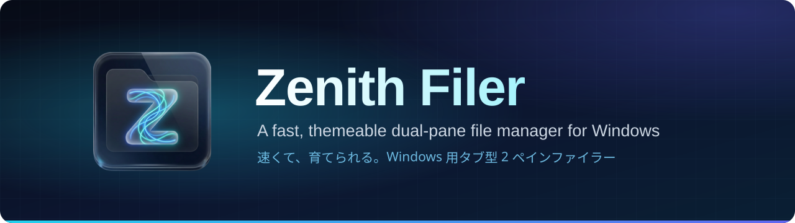
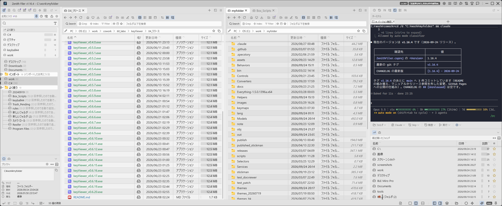
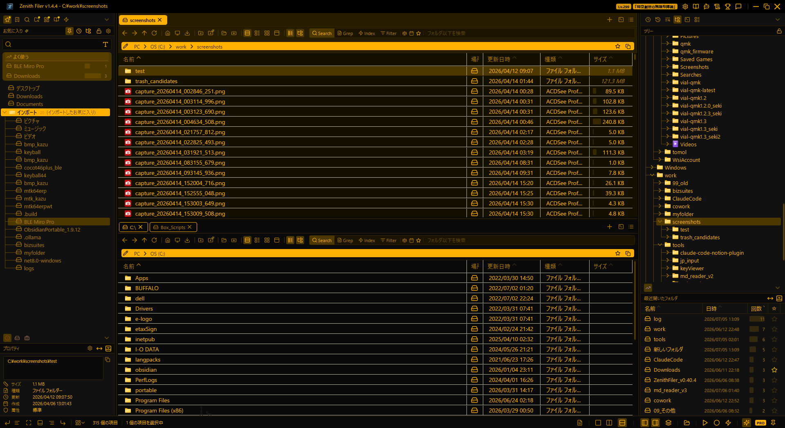
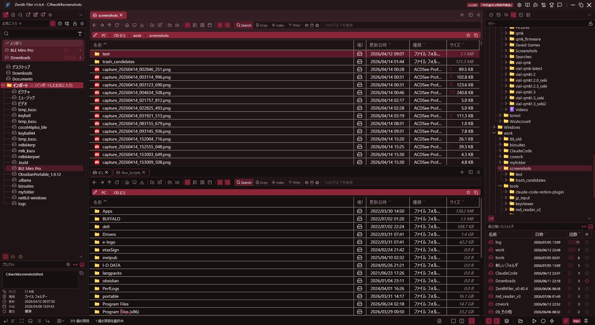
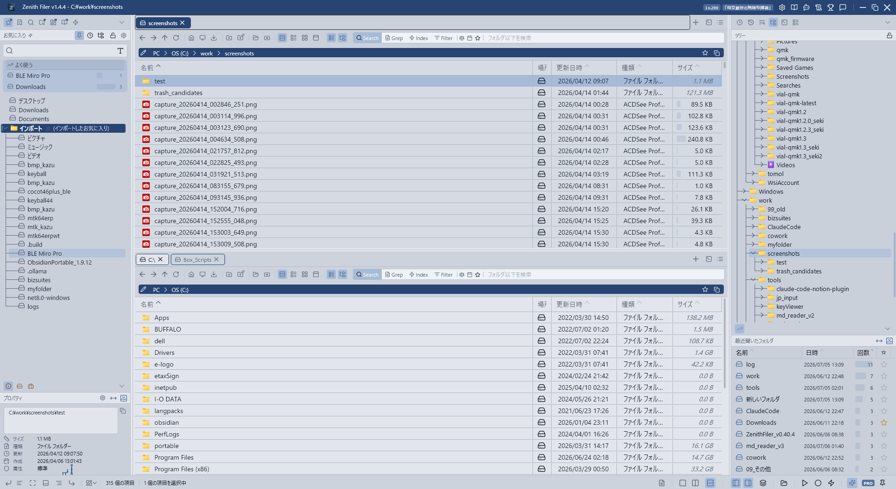
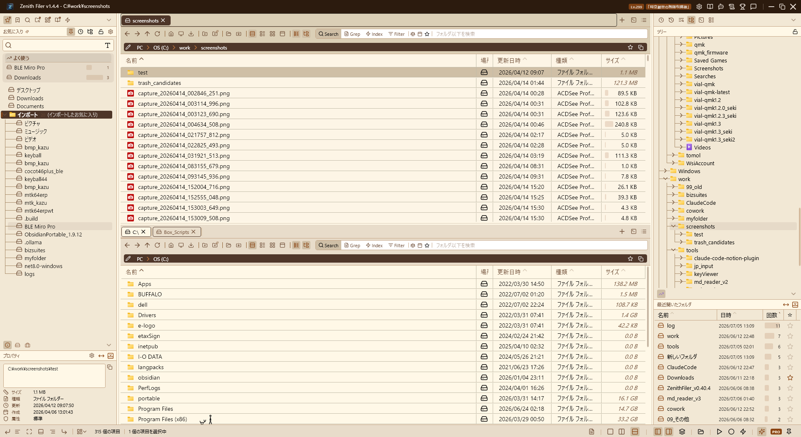
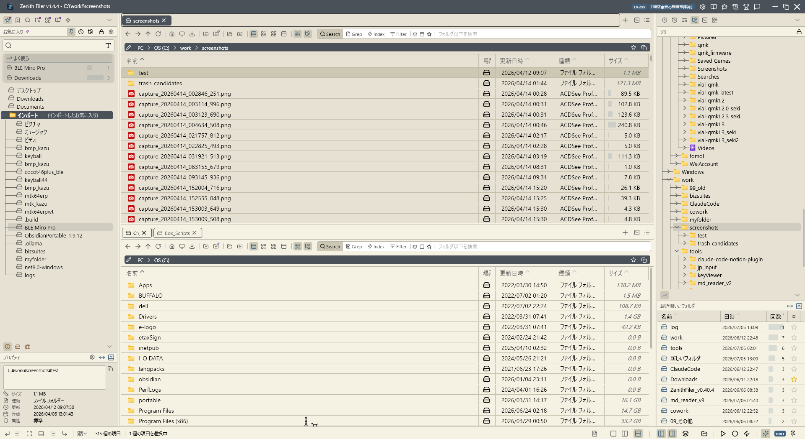
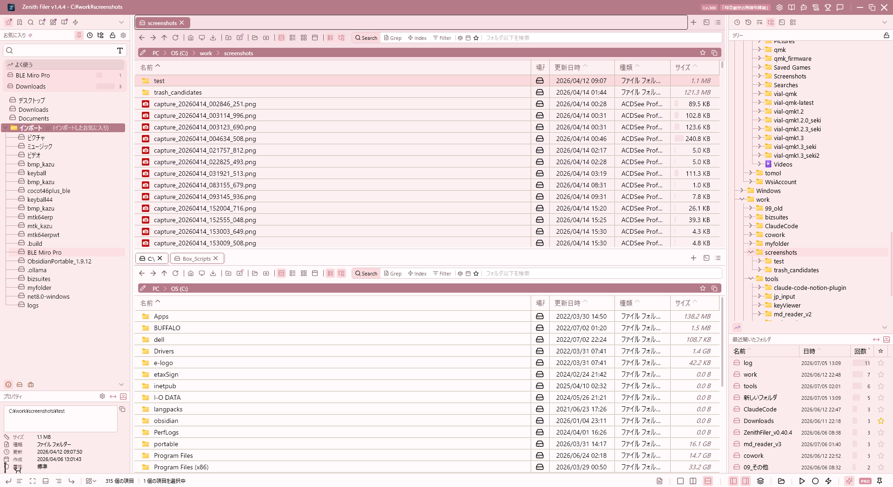
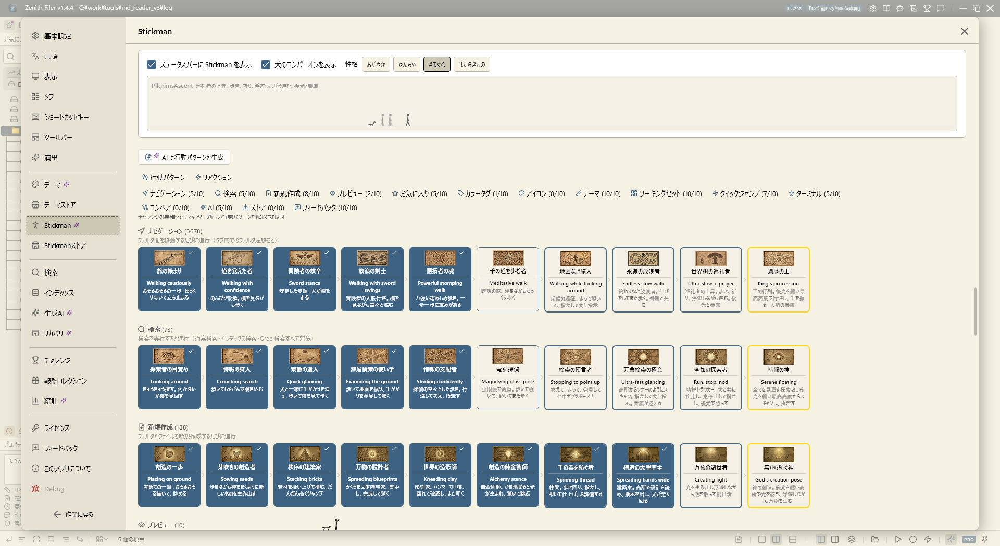
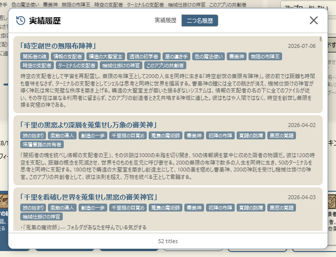

  

  
  
  
  
  

  
  &nbsp;
  

  

 

  <a href="#highlights"><b>Highlights</b></a> ·
  <a href="#download"><b>Download</b></a> ·
  <a href="#free--pro"><b>Free &amp; Pro</b></a> ·
  <a href="#features"><b>Features</b></a> ·
  <a href="https://sulkyjp.github.io/zenithFiler_update/"><b>Manual</b></a> ·
  <a href="#latest-changes"><b>Latest changes</b></a> ·
  <a href="#license"><b>License</b></a> ·
  <a href="#feedback"><b>Feedback</b></a>

## Highlights

<table>
  <tr>
    <td width="50%" valign="top">
      <h3>⚡ Fast</h3>
      Starts in about a second, and every operation runs asynchronously. Tuned on real measurements to stay responsive even on corporate PCs weighed down by antivirus software.
    </td>
    <td width="50%" valign="top">
      <h3>🧭 Never breaks your flow</h3>
      A ring launcher that opens around the cursor, a command palette that finds every action by name, and a shortcut for everything.
    </td>
  </tr>
  <tr>
    <td width="50%" valign="top">
      <h3>🖥 Terminal, macros &amp; AI inside</h3>
      Up to four ConPTY terminals that follow your folders, macros you build without code, and AI that can run fully locally with Ollama. Everything works with AI off.
    </td>
    <td width="50%" valign="top">
      <h3>🎨 Make it yours</h3>
      57 built-in themes, a community theme store, AI theme generation, and 150 achievements that unlock as you use it.
    </td>
  </tr>
</table>

<table>
  <tr>
    <td></td>
    <td></td>
    <td></td>
  </tr>
  <tr>
    <td></td>
    <td></td>
    <td></td>
  </tr>
</table>

Same app, different theme — switch with one click from 57 built-in themes

## Download

<!-- download-table-en:begin -->
| File | Description |
|---|---|
| `ZenithFiler_v2.1.1.zip` | **Full** — includes the .NET runtime. Best for first-time installs or moving to a new machine |
| `ZenithFiler_v2.1.1_delta_from_2.1.0.zip` | **Delta** — only the files that changed since the previous version |
<!-- download-table-en:end -->

> [!TIP]
> **No installer.** Unzip and run `ZenithFiler.exe`. Settings stay next to the app, so it runs from a USB stick too. Once installed, it keeps itself current with automatic delta updates.
> Supported OS: Windows 10 / 11 (x64).

## Free &amp; Pro

|  | Free | Pro |
|---|:---:|:---:|
| Browsing, file operations, terminal, themes, search | ✅ Unlimited | ✅ Unlimited |
| Exports, batch operations, folder sync, theme customization | Daily limit | ✅ Unlimited |
| Macros and AI features | Daily limit | ✅ Unlimited |

  

> [!NOTE]
> **$15, one-time, tax included.** Checkout is handled by [Polar](https://buy.polar.sh/polar_cl_u02Y6qn9QQJCPLre0LwBv58I8Ll2Cg7XYl7pj3PXcyt), which acts as the merchant of record. Your license key is emailed to you within 24 hours; enter it in Control Deck (`Ctrl+Shift+O`) → License.
> Buying from Japan? Use [Vector](https://www.vector.co.jp/soft/winnt/util/se528637.html) instead.

## Features

Click a category to expand it · Every feature is explained in the <a href="https://sulkyjp.github.io/zenithFiler_update/">online manual</a>

<b>🧭 Reach features without moving your hand</b>

| Feature | Description |
|---|---|
| Ring launcher | Press the left and right mouse buttons together and a ring of your 8 most-used actions opens around the cursor. Flick toward one and let go |
| Command palette | `Ctrl+Shift+P` finds and runs any action by name, description, or key — including actions with no shortcut bound |
| Keyboard shortcuts | Every action can be remapped, with JSON export and import. Shortcuts keep working during Japanese/IME input |
| Tabs and two panes | The A pane (center) and B pane (right), each with its own tabs. Single-pane mode is one click away |
| Working sets | Save an entire tab layout and restore it with one click |

<b>📁 File management</b>

| Feature | Description |
|---|---|
| File operations | Copy, move, delete, and rename with undo. Large copies and moves show a progress window with speed and time remaining, where each job can be paused or stopped |
| Drag and drop | Between panes and with other apps; right-drag to choose the action. Dropping onto a shortcut (.lnk) uses its target |
| Batch rename | Rename many files at once with a live preview |
| Batch timestamps & attributes | Change created/modified/accessed times and attributes of many items at once, previewing exactly what will change |
| Archives | Extract and compress ZIP and other formats from the right-click menu, including straight into the other pane |
| Folder compare & sync | Compare the folders in the A and B panes by size, time, or content hash, then sync A → B |
| Hash verification | Compute SHA-256 / SHA-1 / MD5 / CRC-32 and verify against a pasted value — the algorithm is detected automatically |
| FTP / SFTP / FTPS | Server folders open in a pane just like local ones |
| Phones and cameras | Browse MTP devices from the drive list |
| Thumbnails | Image and video thumbnails, freely resizable with `Ctrl+Wheel` |

<b>🖥 Built-in terminal — up to 4 panes, ConPTY</b>

| Feature | Description |
|---|---|
| A real shell | Runs cmd.exe or PowerShell through ConPTY, with correct ANSI 256-color and CJK character widths |
| Up to 4 at once | Four terminals can sit in the nav panes at the same time, each with its own working directory |
| Path sync | `cd` in the terminal moves the A or B pane with it; click a path in the output to open it in a pane |
| Shell integration | Persistent history with `Ctrl+R` search, jump between commands with `Ctrl+↑/↓`, input prediction, and error lines marked in red |
| Claude Code integration | Usage gauge, workspace picker, prompt history, and pasted images converted to file paths automatically |

<b>🤖 AI integration (optional — every feature works with it off)</b>

| Feature | Description |
|---|---|
| Providers | Claude / OpenAI / Azure OpenAI / Gemini / Ollama (local LLM) / Claude Code (CLI) |
| Fully local | With Ollama, nothing leaves your PC. Setup, model download, and server start/stop are handled by the app |
| File operations | AI-assisted renaming, folder organization suggestions, automatic folder creation, favorites cleanup |
| Analysis | Usage statistics analysis, tab-management suggestions, backup summaries |
| Generation | Themes, macros from a sentence, Stickman actions, and achievement titles |
| AI manual | Ask "how do I...?" and get an answer grounded in the manual |

<b>⚙️ Macros</b>

| Feature | Description |
|---|---|
| No-code building | Wire blocks together in Macro Studio, record your actual operations, or describe the macro in a sentence and let AI build it |
| JavaScript underneath | Full access to file operations and navigation through the `zen.*` API |
| Run your way | From the nav pane, the status bar, triggers, or repeatedly — and stop at any time |

<b>🧩 Nav panes — about 20 views</b>

| Feature | Description |
|---|---|
| Views | Favorites, directory tree (with Recycle Bin), recent files, browse history, search, sites (FTP/SFTP), macros, terminal, and more |
| Free layout | Put any view on either side, stack two views, or save the layout as a named preset |
| Detachable | Pop a view out into its own window and snap windows together |
| Automatic favorites | Folders you open often are suggested as favorites automatically |

<b>🔍 Search</b>

| Feature | Description |
|---|---|
| Indexed search | Full-text search powered by Lucene.NET, with Japanese morphological analysis |
| Content search | Fast grep powered by ripgrep |
| Presets and filters | 8 built-in presets plus your own; filter by size, date, and file type |
| Index updates | Real-time, scheduled, or manual; runs only when idle, with an eco mode |

<b>👁 Preview and compare</b>

| Feature | Description |
|---|---|
| Text and code | Live preview for .txt, .json, .bat, .ps1, and more |
| PDF / HTML / images | Paginated PDF, web pages, jpeg/png/gif/webp, and more |
| Office | Excel / CSV (with sheet selection), Word, PowerPoint |
| Text diff | Side-by-side comparison of two files |

<b>🎨 Themes</b>

| Feature | Description |
|---|---|
| 57 built-in themes | 5 categories: Standard / Lifestyle / Professional / Premium / RetroTech, including Plain — white and light gray with no theme color |
| Theme store | Download and rate community themes, or submit your own |
| AI theme generation | Generate a theme from a prompt like "dusk cyberpunk vibes" |
| Per-pane themes | Give the A pane, B pane, and nav panes different themes |
| Customization | Edit any of about 150 color keys; changes are saved separately and never overwrite the original |
| Random / schedule | A random theme on every launch, or automatic day/night switching |
| Fonts and icons | Set font and icon sizes per element |

<b>🏆 Achievements & the Stickman mascot</b>

| Feature | Description |
|---|---|
| 150 achievements | 15 categories × 10 tiers, unlocked naturally through everyday file operations |
| XP, levels, and titles | Level up as you work; AI writes you a title and a backstory |
| Stickman | A mascot living in the status bar that reacts to what you do. Its repertoire grows as you unlock achievements |
| Sync across PCs | Merge achievements from several PCs through a shared folder |

<b>🪟 System integration</b>

| Feature | Description |
|---|---|
| Automatic updates | Delta updates download only what changed |
| Background mode | Lives in the system tray and appears instantly with a global hotkey |
| Window snapping and presets | Snap to 8 layouts (halves and quarters), or save named positions and apply them on launch |
| Multi-monitor rescue | Brings the window back if a disconnected display leaves it off-screen |
| Explorer integration | The Windows context menu, including Windows 11-style entries — or the app's own menu |
| Box Drive | Detects Box paths and copies share links |
| 10 languages | English, Japanese, Chinese (Simplified/Traditional), Korean, German, Spanish, French, Russian, Portuguese — switch without restarting |
| Built-in manual | Per-feature manual and changelog inside the app |

<b>📸 Screenshots</b>

 
Stickman — a mascot whose repertoire grows as you unlock achievements 

  
The AI-generated title and backstory built from your achievements 

  
Two-pane mode 

  
Single-pane mode 

  
Sending feedback from inside the app 

  
The built-in manual (follows the language setting) 

  
The app's own context menu and the Explorer-compatible menu 

  
Automatic updates 

## Latest changes

<b>Show the notes for the latest release</b>

<!-- latest-changes-en:begin -->
**[2.1.1] - 2026-11-13 : The search bar is rebuilt as a single command bar with easier-to-read results, the address bar (breadcrumb) now behaves like File Explorer, and the new tab "+" sits next to the last tab; fixes include type filters turning themselves off, column widths resetting, copies with missing files doing nothing and scrollbar tracks that could not be clicked**

### Changed

- **The new tab "+" button now sits right after the last tab (#481)** [Preview 2.1.0.1 → 2.1.0.4] — The same layout as web browsers and File Explorer in Windows 11. "+" used to sit at the right end of the tab bar, away from the tabs when there were only a few. Now it moves along as you add tabs, and once the tabs no longer fit in the tab bar it stays at the right end so it never scrolls out of sight. With tabs wrapped onto several rows, it appears after the last tab (or at the start of a new row if the last row is full). To keep it at the right end as before, turn off **Tab → Show the new tab button next to the last tab** in Settings. In previews 2.1.0.1 to 2.1.0.3, the tab just left of "+" (the last tab) was sometimes not drawn at startup, leaving an empty gap (#485). At display scales such as 125%, rounding made the width of the tab row slightly too small, so only the last tab was moved to a hidden second row. Now a single-row tab strip always keeps every tab on the same row

- **Search result type chips now show how many results match, and chips that are on are bold (#486)** [Preview 2.1.0.4] — Each chip above the search results ("Folder", "Excel", "PDF"…) now has a count badge in the accent color at its top-right. It appears on chips that are on and chips that are off, so you can see how many results of each type there are before you narrow them down (100 or more shows as "99+"; a type with no results has no badge and its chip is dimmed). The count includes only results that pass the size and date conditions. Chips that are on are now bold as well as filled, and "Select all" / "Deselect all" on the left turn bold in the accent color when every type is on or every type is off. When some results are hidden by type, the count reads "12 / 340 items". When there are results but the type filters hide all of them, the list now says "All 340 results are hidden by the type filters" instead of "No results", with "Show all types" to bring them back. Counts are added up as results arrive, so showing them does not slow the search down (the count used to recount the whole list every time a batch of results arrived). The index search scope can no longer drop to zero folders. Before, you could deselect every folder, and the search then covered all folders while the badge said "0/10" as if it were narrowed. "Deselect all" in the scope now keeps the first selected folder and tells you which one it kept

- **The search bar is now a single input field (a command bar) that shows the conditions in effect as chips, and search results highlight the matching characters in each name (#487)** [Preview 2.1.0.4] — The search bar used to line up four mode buttons, scope, size, date and ★ buttons, and ".*" / "Aa", and the only sign that a condition was set was a filled button. Now the **mode chip** at the left end (for example "Search ▾") lists the four ways of searching with a description and key for each, and the conditions are gathered into one panel opened from the **⚙** at the right end. The panel lists Size, Date modified, Scope (index search only) and Presets with their current values; click a row to open its editor. While a size, date or scope condition is in effect, chips such as "≥ 10 MB", "11/1 – 11/12" and "3/10" appear inside the search field; click a chip to open its editor or its × to remove just that condition. The ⚙ turns the accent color and gets a dot when any condition is set. The "reset" that used to hide behind right-clicking the buttons is replaced by the chip × and "Clear all conditions" in the panel (the search text stays). In a narrow pane the mode chip shows only its icon and the condition chips fold into one, such as "Conditions 2". In the results, the characters of each name that match the words you typed are shown in the accent color, underlined on the selected row. Excluded words (`-word`) and condition words such as `ext:` are not highlighted, and content search (Grep) does not highlight names. Keyboard shortcuts and how Esc works are unchanged. The results list is easier to read too. With column widths set to "Fit to window", the name column used to be fixed at 240px while the path took all the remaining space, so long names were cut off. The name column now widens to fit 90% of the names in the results (up to 40% of the list or 640px, always leaving 35% of the list and at least 200px for the path; the width is set the moment the first results arrive, before any row is drawn, and does not move afterwards). A few very long names no longer squeeze the path; they end with "…" and show in full on hover. Names now use the normal text color instead of the file type color, so the only color in a name is the matching part, and extensions are dimmed. Hovering over a row shows small "Open file location" and "Copy path" buttons at the right end of its path. When search results appear, the visible rows fall into place one after another from the top, each easing down from slightly above its spot (about a second; the progress glow at the bottom of the window no longer runs during searches, the rows settling in show that results arrived; rows can be clicked right away, the effect can be turned off on the Effects page, and it is toned down for back-to-back searches). Also, the search history list that opens from the search box no longer stays open until you press Esc: clicking anywhere outside it and the search box closes it

- **Scrollbars now have arrow buttons at both ends (#490)** [Preview 2.1.0.4] — App scrollbars used to give no visible way to move other than dragging the thumb. Now, when you hover over a scrollbar, arrow buttons appear at its ends; click one to move a line, or hold it to keep moving. When you are not hovering, the scrollbar keeps its slim look. Clicking the empty part of the track above or below the thumb moves a page at a time

- **Suggestion lists for search and the address bar are now rounded floating cards, and the search bar and address bar now match in height and width (#487)** — The search history list that opens from the search box and the suggestions that appear as you type in the address bar used to be plain square boxes stuck to the field, only as wide as its text area. They now open as rounded cards with a shadow, like the search mode menu, a little below the field and exactly as wide as it. Their rows have rounded corners too, and the row under the pointer uses the same hover color as other lists. The address bar strip was also 6px shorter than the search bar and its left and right ends were slightly off; it now has the same height, the same ends and the same rounded corners as the search bar. The filter strip that replaces the address bar while searching has the same size too, so the file list no longer moves up or down when a search starts or ends. When the search bar sits on the same row as the toolbar, its height and right end also line up with the address bar

- **The address bar (breadcrumb) now behaves like File Explorer in Windows 11 (#491)** — Clicking the file list or the other pane while you are typing a path takes the bar back to the breadcrumb without moving (what you typed is dropped, and the next time you switch to the text box it holds the current path). Before, the text box stayed until you clicked the icon on the left or pressed Esc. Just switching to another app keeps the text box. Pressing Enter on a typed path now goes there, switches back to the breadcrumb and moves the keyboard to the file list (before, the text box stayed). Going up a level with the breadcrumb, the "«" list or a typed address opens the folder with the one you came from selected, just like Up. The last level (the folder you are in) now has a "›" too, listing the folders inside it. A new "›" just right of the location icon lists your folders (Downloads, Desktop, Documents and so on), your user folder, This PC and your drives, two clicks from anywhere (the same order as File Explorer; Home, Gallery, Libraries, Network, Control Panel and the Recycle Bin are left out because the file list cannot open them). The "›" lists are now the same rounded floating cards as the search suggestions. Because clicking the file list now leaves the text box, you can no longer keep the text box open while you go and copy a file name from the list (File Explorer works the same way)

### Fixed

- **"Open file location" on a shortcut whose target was moved or deleted now opens the nearest parent folder that still exists (#482)** [Preview 2.1.0.2] — Previously it only showed "Link target not found" and opened nothing. Now it opens the closest folder above the shortcut's recorded target that still exists, and tells you "Link target not found. Opened the nearest folder that still exists". It does not search for where the target was moved to, as File Explorer sometimes does. If the whole drive or shared folder cannot be found, it still shows "Link target not found" as before

- **Fixed an error, "Drag-and-drop operation already in progress", that could appear when you started dragging files (#483)** [Preview 2.1.0.2] — The error fixed once in v2.0.0 (#474) could still appear. The earlier fix recognized "another drag is already in progress" by the error number Windows returns, but the same error sometimes arrived in a different form and slipped past that check. Now, whenever the Windows drag returns an error, whatever the number, it is treated as "the drag did not start": no error window appears and you can carry on. What the error was is still written to the log

- **Column widths you changed went back to their old sizes when you restarted the app; fixed (#484)** [Preview 2.1.0.3] — Dragging a column border was meant to switch the column width setting to "Set by hand" and remember that width. But the code that should notice the drag was never called, so the setting stayed at "Fit to window" and the widths were recalculated from the pane width at every startup. Now dragging a column border switches to "Set by hand" (a notice appears the first time), and the next startup opens with the same widths. The widths are remembered once for the whole app, not per tab, with separate widths for normal lists and search results. For the same reason, the guard that keeps a hidden column from widening when you drag its border was not working either; that is fixed too

- **Fixed the search file type filters (Folder, Excel, PDF…) sometimes being turned off on their own (#486)** [Preview 2.1.0.4] — Each tab kept its own copy of the type filter state, but only one copy was saved for the whole app. Changing a chip in a tab that had been open for a while saved that tab's old state over everything, undoing changes made in other tabs. New search tabs start from the saved state, so the filters looked like they had been turned off when you searched. The type filters are now one shared state for the whole app, like the size and date conditions: a change in any tab applies to every tab's results and is kept across restarts. Two other places that changed conditions without saying so are fixed too. Picking a search history entry cleared the current size and date conditions even when that search had none; now conditions are restored only for entries that had them. Esc in an empty search box (the second press) and right-clicking the preset button were meant to reset the index scope to all folders but kept the previous selection; they now reset it and tell you so

- **Fixed the "index may be out of date" notice above index search results being unreadable in light themes (#487)** [Preview 2.1.0.4] — The notice used the light text color meant for the dark address bar, so on light themes it was almost the same color as its background. The text color is now picked from the notice's own background (black or white, whichever reads)

- **Fixed a line appearing under the first result row when a notice was shown above index search results (#487)** [Preview 2.1.0.4] — The shadow at the top of the list was placed lower by the height of the notice above it instead of at the bottom of the column headers. The notice itself now matches the type chip bar above it, as a rounded box with side margins

- **Fixed copying or moving with files that no longer exist doing nothing or skipping them silently (#489)** [Preview 2.1.0.4] — When the selection included files that another app had renamed, moved or deleted, a right-drag showed no drop menu and nothing happened, and a normal drag or paste skipped the missing files without a word (and did nothing at all if none were found). Now, like File Explorer, the files that exist are copied or moved, and the missing ones are skipped with a notice such as "Skipped 2 item(s) that could not be found (a.txt, b.txt)". When none are found, a notice says so. The right-drag drop menu now appears even when some files are missing

- **Fixed clicking the empty part of a scrollbar (above or below the thumb) doing nothing (#490)** — App scrollbars were meant to move a page when you click the empty track above or below the thumb, but nothing happened. The track pieces picked up the default look from the UI component library, which has no background, so they never received the click. Clicking the track now moves a page at a time, and holding keeps it moving. Besides the file list's vertical and horizontal scrollbars, the slim scrollbars in context menus and in the navigation pane (the folder tree and others) can now be clicked on the track too; they had no track pieces at all before

> See [Releases](https://github.com/sulkyjp/zenithFiler_update/releases) for the full history.
<!-- latest-changes-en:end -->

## License

Zenith Filer is **proprietary software, not open source**. © 2024-2026 K.AKASAKA. All rights reserved.

- Free to download and try. **Personal and commercial use** are both allowed
- **One license key per person** — install it on the devices you use yourself, one at a time
- Redistribution, resale, and reverse engineering are not permitted

Read the full terms in the [EULA](EULA_en.md) · Summary: [LICENSE](LICENSE.md)

Windows is a trademark of the Microsoft group of companies. Claude, OpenAI, Azure, Gemini, Ollama, Box, and other product and company names mentioned are trademarks or registered trademarks of their respective owners. Zenith Filer is an independent product and is not affiliated with or endorsed by them.

## Feedback

> [!IMPORTANT]
> Please send requests and bug reports from **inside the app: Settings → Feedback**. No account is needed. This repository only hosts the release files and is not monitored as a support channel.

- **Replies reach you in the app**, under *Feedback history*
- **When a fix ships, the app asks whether it worked**, so a report is followed through to the end

**Enjoying Zenith Filer?** A like or a short review on [AlternativeTo](https://alternativeto.net/software/zenith-filer/about/) helps other people looking for a file manager find it.

<a href="#japanese">日本語のご案内へ ↓</a>

 

  <a href="#ja-highlights"><b>特長</b></a> ·
  <a href="#ja-download"><b>ダウンロード</b></a> ·
  <a href="#ja-pro"><b>無料版と Pro</b></a> ·
  <a href="#ja-features"><b>主な機能</b></a> ·
  <a href="https://sulkyjp.github.io/zenithFiler_update/ja/"><b>マニュアル</b></a> ·
  <a href="#ja-changes"><b>最新の変更履歴</b></a> ·
  <a href="#ja-license"><b>ライセンス</b></a> ·
  <a href="#ja-feedback"><b>フィードバック</b></a>

## 特長

<table>
  <tr>
    <td width="50%" valign="top">
      <h3>⚡ 速い</h3>
      起動は約 1 秒、すべての操作を非同期で処理。ウイルス対策ソフトで重い社用 PC でも軽快に動くよう、実測にもとづいて最適化しています。
    </td>
    <td width="50%" valign="top">
      <h3>🧭 手を止めずに届く</h3>
      カーソルのまわりに開くリングランチャー、名前で全機能を探せるコマンドパレット、すべての操作に割り当てられるショートカット。
    </td>
  </tr>
  <tr>
    <td width="50%" valign="top">
      <h3>🖥 ターミナル・マクロ・AI が中にある</h3>
      フォルダに追従する ConPTY ターミナルを最大 4 面、コードを書かずに作れるマクロ、Ollama なら完全ローカルで動く AI。AI をオフにしても全機能そのまま使えます。
    </td>
    <td width="50%" valign="top">
      <h3>🎨 育てられる</h3>
      内蔵テーマ 57 種、コミュニティのテーマストア、AI によるテーマ生成、使い込むほど解除される実績 150 種。
    </td>
  </tr>
</table>

## ダウンロード

<!-- download-table-ja:begin -->
| ファイル | 説明 |
|---|---|
| `ZenithFiler_v2.1.1.zip` | **完全版** — .NET ランタイム同梱。初回導入や環境移行に |
| `ZenithFiler_v2.1.1_delta_from_2.1.0.zip` | **差分版** — 前バージョンから変更されたファイルのみ |
<!-- download-table-ja:end -->

> [!TIP]
> **インストール不要。** ZIP を展開して `ZenithFiler.exe` を起動するだけです。設定はアプリの隣に保存されるので、USB メモリからも使えます。導入後は差分の自動アップデートで最新に保たれます。
> 対応 OS: Windows 10 / 11（x64）

## 無料版と Pro

|  | 無料版 | Pro |
|---|:---:|:---:|
| 閲覧・ファイル操作・ターミナル・テーマ・検索 | ✅ 無制限 | ✅ 無制限 |
| 書き出し・一括処理・フォルダ同期・テーマのカスタマイズ | 1 日の回数制限 | ✅ 無制限 |
| マクロ・AI 機能 | 1 日の回数制限 | ✅ 無制限 |

> [!NOTE]
> **Pro ライセンスは [Vector](https://www.vector.co.jp/soft/winnt/util/se528637.html) で購入できます**（Vector からのダウンロードも可能です）。

## 主な機能

| 分野 | できること |
|---|---|
| 🧭 手を止めずに届く | リングランチャー（左右ボタン同時押し）、コマンドパレット（`Ctrl+Shift+P`）、全操作のキー割り当て、ワーキングセット |
| 📁 ファイル管理 | 取り消し付きのファイル操作と進捗ウィンドウ、一括リネーム、日時・属性の一括変更、書庫の展開・圧縮、フォルダ比較・同期、ハッシュ照合、FTP / SFTP / FTPS、スマホ・カメラの閲覧、画像・動画サムネイル |
| 🖥 内蔵ターミナル | ConPTY で最大 4 面、ペインとのパス連動、コマンド履歴の検索、Claude Code 連携 |
| 🤖 AI 連携 | Claude / OpenAI / Azure OpenAI / Gemini / Ollama / Claude Code。AI リネーム、フォルダ整理、文章からのマクロ生成、AI マニュアル |
| ⚙️ マクロ | Macro Studio のブロック組み立て・操作の記録・文章からの生成。中身は JavaScript |
| 🧩 ナビペイン | 約 20 のビューを好きな位置へ、2 段重ね、別ウィンドウへの切り離し、よく開くフォルダの自動お気に入り |
| 🔍 検索 | Lucene.NET と日本語形態素解析による全文検索、ripgrep による内容検索、プリセットとフィルタ |
| 👁 プレビュー | テキスト・コード、PDF、HTML、画像、Excel / CSV / Word / PowerPoint、テキスト差分 |
| 🎨 テーマ | 内蔵 57 種（テーマカラーを持たない白とライトグレーの Plain も）、テーマストア、AI 生成、ペイン別テーマ、約 150 の色キーの編集 |
| 🏆 実績と Stickman | 実績 150 種、XP・レベル・AI が授ける二つ名、操作に反応するマスコット |
| 🪟 システム統合 | 差分自動アップデート、タスクトレイ常駐、ウィンドウスナップと配置プリセット、Explorer のメニュー、Box Drive、10 言語 |

各機能の詳細は、<a href="https://sulkyjp.github.io/zenithFiler_update/ja/">オンラインのマニュアル</a>（アプリ内のマニュアルと同じ内容）をご覧ください。

## 最新の変更履歴

<b>最新リリースの内容を表示</b>

<!-- latest-changes-ja:begin -->
**[2.1.1] - 2026-11-13 : 検索バーを 1 本の入力欄（コマンドバー）に作り直して検索結果を読みやすくし、アドレスバー（パンくず）の動きをエクスプローラーと同じにし、新しいタブの「＋」を一番右のタブの隣に出し、種類のフィルタが外れる・列の幅が戻る・見つからないファイルを含むコピーで何も起きない・スクロールバーの空いた所が押せない、などを直した**

### Changed

- **新しいタブの「＋」のボタンを、一番右のタブのすぐ右に出すようにしました (#481)** 〔先行版 2.1.0.1 → 2.1.0.4〕 — ブラウザや Windows 11 のエクスプローラーと同じ並びです。これまで「＋」はタブバーの右端にあり、タブが少ないときはタブから離れていました。いまはタブを足すと「＋」も一緒に右へ動き、タブがタブバーに収まらなくなると、右端に留まって隠れません。タブを複数行に折り返しているときは、最後のタブの右（行が埋まっていれば次の行の先頭）に出ます。今までどおり右端に置きたいときは、設定の **タブ → 新しいタブのボタンを一番右のタブの隣に出す** をオフにします。先行版 2.1.0.1〜2.1.0.3 では、起動したときに「＋」の左のタブ（一番右のタブ）が描かれず、そこだけ空いて見えることがありました（#485）。表示倍率が 125% などのとき、タブの並びの幅が計算の丸めでわずかに足りなくなり、一番右のタブだけ見えない 2 行目へ回されていたためです。いまは 1 行の並びでは、どの幅でも全部のタブを同じ行に並べます

- **検索結果の種類のチップに、当てはまる件数の丸を出し、オンのチップを太字にしました (#486)** 〔先行版 2.1.0.4〕 — 検索結果の上に並ぶ「フォルダ」「Excel」「PDF」…のチップの右肩に、その種類の件数をアクセント色の丸で出します。オンのチップにもオフのチップにも出るので、絞る前に「どの種類が何件あるか」が分かります（100 件以上は「99+」、0 件の種類は丸を出さずにチップを薄くします）。件数はサイズ・日付の条件を通ったものを数えます。オンのチップは塗りに加えて太字にし、左の「すべて選択」「すべて解除」は、全部オン・全部オフのときにそちらをアクセント色の太字で示します。種類で隠れている結果があるときは、件数の表示が「12 / 340 items」になります。結果はあるのに種類のフィルタで全部隠れたときは、「見つかりません」ではなく「種類のフィルタで 340 件がすべて隠れています」と出し、「すべての種類を表示」で戻せます。件数は結果が届くたびに足していくので、件数を出すために探すのが遅くなることはありません（これまで件数の表示は、結果が届くたびに一覧を頭から数え直していました）。索引検索の範囲は、最後の 1 つを外せないようにしました。これまでは 0 件にでき、そのときは実際には全部のフォルダを探すのに、印は「0/10」と絞っているように見えていました。範囲の「すべて解除」は、選んでいる中の先頭の 1 つを残して外し、何を残したかを知らせます

- **検索バーを 1 本の入力欄（コマンドバー）に作り直し、効いている条件を欄の中の札で見せ、検索結果の名前の当たった文字に色を付けました (#487)** 〔先行版 2.1.0.4〕 — これまで検索バーには、探し方の 4 つのボタン・範囲・サイズ・日付・★ のボタン・「.*」「Aa」が横に並んでいて、条件が付いているかはボタンの塗りでしか分かりませんでした。いまは左端の**モードの札**（例: 「Search ▾」）を押すと 4 つの探し方が説明とキー付きで開き、条件は右端の **⚙** から開く 1 枚の面にまとめました。面にはサイズ・更新日・範囲（インデックス検索のときだけ）・プリセットが並び、それぞれにいまの値が出て、押すとその入力が開きます。サイズ・更新日・範囲の条件が効いている間は、検索欄の中に「≥ 10 MB」「11/1 – 11/12」「3/10」のような札が並び、札を押すとその入力が開き、× でその条件だけ外せます。⚙ は条件があるとアクセント色になって右肩に点が付きます。ボタンの右クリックに隠れていた「条件を戻す」は、札の × と面の「すべての条件を外す」に置き換えました（検索の文字は消しません）。ペインが狭いときは、モードの札はアイコンだけに、条件の札は「条件 2」の 1 枚にまとまります。検索結果の名前は、打った語に当たった文字だけをアクセント色にし、選んだ行では下線にしました。`-語` の除外や `ext:` などの条件の語には色を付けず、内容検索（Grep）では名前に色を付けません。キーの割り当てと Esc の動きは変えていません。検索結果の一覧も読みやすくしました。列の幅が「画面の幅に合わせる」のとき、名前の列は 240px 固定でパスが残りを全部取り、長い名前が切れていました。いまは名前の列を、結果の 9 割の名前が収まる幅まで広げます（一覧の幅の 4 割・640px まで。パスには一覧の幅の 35%・最低 200px を残す。幅は最初の結果が届いた瞬間に決めて行が描かれる前に付け、その検索の間はあとから動かさない）。ごく一部の長い名前のためにパスを狭めることはなく、収まらない名前は「…」で切れ、指すと全文が出ます。名前の色は種類の色をやめてふつうの文字色にし、色が付くのは一致した所だけにしました。拡張子は薄く描きます。行にマウスを乗せると、パスの右端に「ファイルの場所を開く」「パスをコピー」の小さなボタンが出ます。検索結果が並ぶときは、見えている行が上の行から順に、少し上からふわっと現れて元の位置に収まります（約 1 秒。検索中に画面の下を走っていた進み具合の光は出さず、結果が並ぶ動きで届いたことを見せます。行は最初から押せます。演出ページで切れ、続けて探したときは控えめになります）。あわせて、検索欄を押すと出る履歴の候補が、外を押しても閉じず Esc でしか閉じなかったのを、候補と検索欄の外を押せば閉じるようにしました

- **スクロールバーの両端に △▽（横は ◁▷）のボタンを付けました (#490)** 〔先行版 2.1.0.4〕 — これまでアプリのスクロールバーは、つまみのドラッグのほかに動かす手掛かりが見えませんでした。いまはスクロールバーにマウスを乗せると両端に三角のボタンが浮かび上がり、押すと 1 行ずつ、押し続けると続けて動きます。乗せていないときは今までどおりの細い見た目です。つまみの上下の空いた所を押すと 1 ページずつ動きます

- **検索の候補とアドレス欄の候補を、角の丸い浮いたカードにし、検索バーとアドレス欄の高さと幅をそろえました (#487)** — 検索欄を押すと出る履歴の候補と、アドレス欄に打つと出る候補は、角の無い四角が欄に貼り付いて出ていて、幅も欄の文字の部分だけでした。いまは探し方のメニューと同じ角の丸いカードに影を付けて、欄の少し下に、欄と同じ幅で出します。候補の行も角を丸め、マウスを乗せた行はほかの一覧と同じ色で示します。あわせて、アドレス欄の帯が検索バーより 6px 低く、左右の端も少しずれていたのを、検索バーと同じ高さ・同じ左右の端・同じ角の丸みにそろえました。検索中にアドレス欄と入れ替わるフィルターの帯も同じ寸法にしたので、検索を始めても終えても下の一覧が上下に動きません。検索バーをツールバーと同じ行に置いているときも、高さと右の端をアドレス欄にそろえます

- **アドレスバー（パンくず）の動きを、Windows 11 のエクスプローラーと同じにしました (#491)** — パスを打っている途中で一覧やもう一方のペインを押すと、移動せずにパンくずの表示に戻ります（打ちかけの文字は捨て、次に入力欄にすると今いる場所のパスが入っています）。これまでは左端のアイコンか Esc を押すまで入力欄のままでした。別のアプリへ切り替えただけなら入力欄のままです。パスを打って Enter で移ると、パンくずの表示に戻り、キーボードの操作はファイルの一覧へ移ります（これまでは入力欄のまま残りました）。パンくず・「«」・打ち込みで上の階層へ移ると、来た元のフォルダが選ばれた状態で開きます（「上へ」と同じ）。いちばん右（今いるフォルダ）にも「›」が付き、中のフォルダを一覧で選べます。左端の場所アイコンの右に「›」を足し、ダウンロード・デスクトップ・ドキュメントなどのユーザーのフォルダ、ユーザー名、PC、ドライブへ 2 クリックで移れるようにしました（エクスプローラーと同じ並び。ホーム・ギャラリー・ライブラリ・ネットワーク・コントロール パネル・ごみ箱は、アプリの一覧で開けないので並べません）。「›」の一覧も、検索の候補と同じ角の丸い浮いたカードにしました。入力欄のまま一覧からファイル名をコピーしに行く使い方は、一覧を押した時点でパンくずに戻るのでできなくなりました（エクスプローラーと同じ）

### Fixed

- **リンク先が移動・削除されたショートカットで「ファイルの場所を開く」を押すと、残っている上位のフォルダを開くようにしました (#482)** 〔先行版 2.1.0.2〕 — これまでは「リンク先が見つかりません」と知らせるだけで、どこも開きませんでした。いまは、ショートカットが覚えている行き先の場所のうち、まだ残っているいちばん近い上位のフォルダを開き、「リンク先が見つからないので、残っている上位のフォルダを開きました」と知らせます。エクスプローラーのように移動先を探し当てることはしません。ドライブや共有フォルダごと見つからないときは、今までどおり「リンク先が見つかりません」と知らせます

- **ファイルをドラッグしようとしたときに「ドラッグ操作は既に実行中です」のエラーが出ることがあったのを直しました (#483)** 〔先行版 2.1.0.2〕 — v2.0.0 で一度直した（#474）エラーが、まだ出ていました。前の直し方は、Windows が返すエラーの番号で「別のドラッグと重なった」ことを見分けていました。ところが同じ文面のエラーが別の形で届き、見分けを素通りしていました。いまは、Windows のドラッグがエラーで返ったときは番号によらず「ドラッグは始まらなかった」として扱い、エラーの窓を出さずにそのまま操作を続けられます。何のエラーだったかは、ログに残します

- **列の幅を変えても、アプリを再起動すると元の幅に戻っていたのを直しました (#484)** 〔先行版 2.1.0.3〕 — 列の境目をドラッグすると、列の幅の決め方が「自分で決める」に切り替わり、その幅を覚えるはずでした。ところが、このドラッグを拾う処理が一度も呼ばれておらず、決め方は「画面の幅に合わせる」のまま、起動のたびに画面の幅から計算し直していました。いまは境目をドラッグすると「自分で決める」に切り替わり（初めての時は知らせが出ます）、次に起動しても同じ幅で開きます。覚える幅はタブごとではなくアプリ全体で 1 つで、ふつうの一覧と検索結果は別々に覚えます。あわせて、隠した列の境目をドラッグしても幅が広がらないようにする処理も、同じ理由で効いていなかったので直りました

- **検索すると、種類のフィルタ（フォルダ・Excel・PDF…）が勝手に外れていることがあったのを直しました (#486)** 〔先行版 2.1.0.4〕 — 種類のフィルタの状態はタブごとに持っていたのに、保存はアプリ全体で 1 つでした。そのため、前から開いていたタブで 1 つ切り替えると、そのタブが開いたときの古い状態で全体を上書きし、別のタブで変えた分が消えていました。その後に開く検索タブはこの状態を引き継ぐので、「検索したらフィルタが外れている」ように見えました。いまは種類のフィルタをサイズ・日付の条件と同じくアプリ全体で 1 つにし、どのタブで変えても全部のタブの結果に効き、再起動しても残ります。あわせて、条件が黙って変わる所を 2 つ直しました。検索履歴を選ぶと、条件を付けずに探した履歴でも、いま付けているサイズ・日付の条件が消えていました。いまは条件を付けて探した履歴だけ条件を戻します。検索欄が空のときの Esc（2 回目）とプリセットのボタンの右クリックは、「索引の範囲を全部に戻す」はずが前の選び方のまま残していました。いまは全部に戻し、戻したことを知らせます

- **インデックス検索の結果の上に出る「インデックスが古いかもしれない」の注意の文字が、明るいテーマで読めなかったのを直しました (#487)** 〔先行版 2.1.0.4〕 — 注意の帯の文字に、アドレスバー（暗い帯）用の明るい文字色を使っていたため、明るい地のテーマでは地とほぼ同じ色になっていました。いまは帯の地の色から、読める文字色（黒か白）を選びます

- **インデックス検索の結果の上に注意の帯が出ると、一覧の 1 行目の下に線が出ていたのを直しました (#487)** 〔先行版 2.1.0.4〕 — 一覧の上端に落とす影の位置を、ヘッダーの下端ではなく、上の行（注意の帯）の高さの分だけ下で計算していました。注意の帯も、上の種類のチップの帯と同じく、左右に余白を取った角の丸い枠にしました

- **見つからないファイルを含めてコピー・移動すると、何も起きなかったり黙って飛ばされたりしていたのを直しました (#489)** 〔先行版 2.1.0.4〕 — ほかのアプリで名前が変わった・移動された・消されたファイルを含めて運ぶと、右ボタンのドラッグでは落とした先のメニューが出ずに何も起きず、ふつうのドラッグや貼り付けでは見つからないファイルを黙って飛ばしていました（全部見つからないときは黙って何もしませんでした）。いまはエクスプローラーと同じく、見つかるファイルは運び、見つからないファイルは飛ばして「見つからない 2 件（a.txt, b.txt）は飛ばし、残りをコピーします」と知らせます。全部見つからないときは「コピーする項目が見つかりませんでした」と知らせます。右ボタンのドラッグのメニューは、見つからないファイルがあっても出ます

- **スクロールバーの空いた所（つまみの上下）を押しても動かなかったのを直しました (#490)** — アプリの中のスクロールバーは、つまみの上下の空いた所を押すと 1 ページずつ動くはずでしたが、押しても何も起きませんでした。空いた所の部品の見た目に、画面の部品集の既定の見た目が当たっていて、その見た目は地の色を持たないため、押下を受け取れていませんでした。いまは空いた所を押すと 1 ページずつ動き、押し続けると続けて動きます。ファイル一覧の縦・横のスクロールバーのほか、右クリックのメニューの中や、ナビペインのフォルダのツリーなどの細いスクロールバーでも、空いた所を押せるようにしました（これらには元々空いた所の部品がありませんでした）

> 過去の変更履歴は [Releases](https://github.com/sulkyjp/zenithFiler_update/releases) を参照してください。
<!-- latest-changes-ja:end -->

## ライセンス

Zenith Filer は**著作者が権利を持つ商用ソフトウェアで、オープンソースではありません**。© 2024-2026 K.AKASAKA. All rights reserved.

- 無料でダウンロードして試せます。**個人でも仕事でも**使えます
- **ライセンスキーは 1 人に 1 本**。自分で使う PC に入れられ、同時に使うのは 1 台までです
- 再配布・転売・リバースエンジニアリングは禁止です

全文は[使用許諾契約書（EULA）](EULA_ja.md)、要約は [LICENSE](LICENSE.md) をご覧ください。

Windows は Microsoft グループの商標です。Claude・OpenAI・Azure・Gemini・Ollama・Box など、記載の製品名・会社名は各社の商標または登録商標です。Zenith Filer は独立した製品であり、これらの会社と提携しておらず、推奨も受けていません。

## フィードバック

> [!IMPORTANT]
> 要望・不具合は、**アプリ内の「設定 → フィードバック」**からお送りください。アカウント登録は不要です。このリポジトリは配布物を置くためだけのもので、問い合わせ窓口ではありません。

- 作者からの回答が**アプリ内の「フィードバック履歴」に届きます**
- 修正版が出ると「直った／まだ直っていない」を知らせるボタンが出るので、**最後まで追えます**

<a href="#english">↑ Back to English</a>

---

  © 2024-2026 K.AKASAKA · <a href="LICENSE.md">License</a> · <a href="https://github.com/sulkyjp">sulkyjp</a> · <a href="#english">English</a> · <a href="#japanese">日本語</a>

