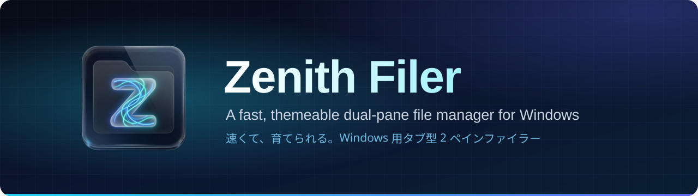
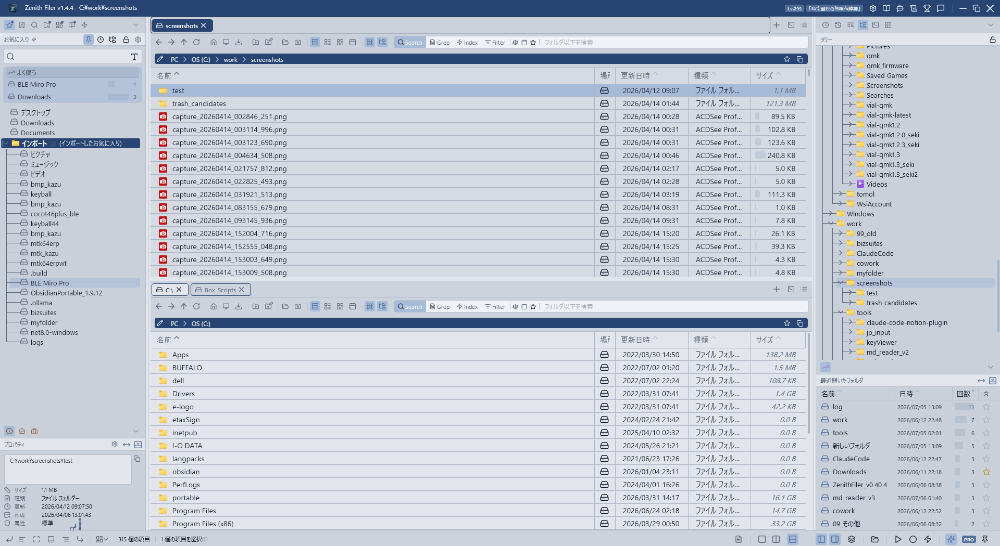
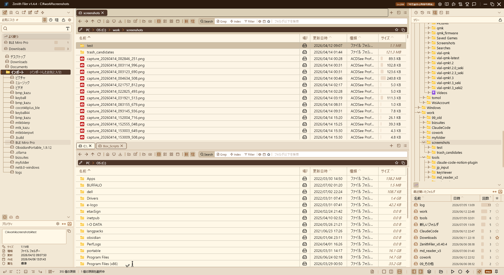
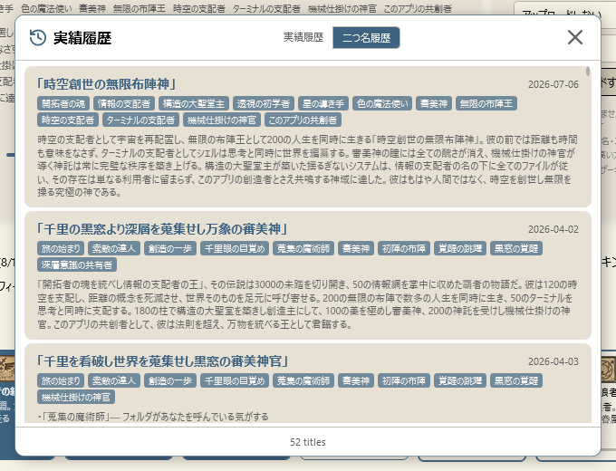

  

  
  
  
  
  

  
  &nbsp;
  

  

 

  <a href="#highlights"><b>Highlights</b></a> ·
  <a href="#download"><b>Download</b></a> ·
  <a href="#free--pro"><b>Free &amp; Pro</b></a> ·
  <a href="#features"><b>Features</b></a> ·
  <a href="https://sulkyjp.github.io/zenithFiler_update/"><b>Manual</b></a> ·
  <a href="#latest-changes"><b>Latest changes</b></a> ·
  <a href="#license"><b>License</b></a> ·
  <a href="#feedback"><b>Feedback</b></a>

## Highlights

<table>
  <tr>
    <td width="50%" valign="top">
      <h3>⚡ Fast</h3>
      Starts in about a second, and every operation runs asynchronously. Tuned on real measurements to stay responsive even on corporate PCs weighed down by antivirus software.
    </td>
    <td width="50%" valign="top">
      <h3>🧭 Never breaks your flow</h3>
      A ring launcher that opens around the cursor, a command palette that finds every action by name, and a shortcut for everything.
    </td>
  </tr>
  <tr>
    <td width="50%" valign="top">
      <h3>🖥 Terminal, macros &amp; AI inside</h3>
      Up to four ConPTY terminals that follow your folders, macros you build without code, and AI that can run fully locally with Ollama. Everything works with AI off.
    </td>
    <td width="50%" valign="top">
      <h3>🎨 Make it yours</h3>
      57 built-in themes, a community theme store, AI theme generation, and 150 achievements that unlock as you use it.
    </td>
  </tr>
</table>

<table>
  <tr>
    <td></td>
    <td></td>
    <td></td>
  </tr>
  <tr>
    <td></td>
    <td></td>
    <td></td>
  </tr>
</table>

Same app, different theme — switch with one click from 57 built-in themes

## Download

<!-- download-table-en:begin -->
| File | Description |
|---|---|
| `ZenithFiler_v2.2.0.zip` | **Full** — includes the .NET runtime. Best for first-time installs or moving to a new machine |
| `ZenithFiler_v2.2.0_delta_from_2.1.1.zip` | **Delta** — only the files that changed since the previous version |
<!-- download-table-en:end -->

> [!TIP]
> **No installer.** Unzip and run `ZenithFiler.exe`. Settings stay next to the app, so it runs from a USB stick too. Once installed, it keeps itself current with automatic delta updates.
> Supported OS: Windows 10 / 11 (x64).

## Free &amp; Pro

|  | Free | Pro |
|---|:---:|:---:|
| Browsing, file operations, terminal, themes, search | ✅ Unlimited | ✅ Unlimited |
| Exports, batch operations, folder sync, theme customization | Daily limit | ✅ Unlimited |
| Macros and AI features | Daily limit | ✅ Unlimited |

  

> [!NOTE]
> **$15, one-time, tax included.** Checkout is handled by [Polar](https://buy.polar.sh/polar_cl_u02Y6qn9QQJCPLre0LwBv58I8Ll2Cg7XYl7pj3PXcyt), which acts as the merchant of record. Your license key is emailed to you within 24 hours; enter it in Control Deck (`Ctrl+Shift+O`) → License.
> Buying from Japan? Use [Vector](https://www.vector.co.jp/soft/winnt/util/se528637.html) instead.

## Features

Click a category to expand it · Every feature is explained in the <a href="https://sulkyjp.github.io/zenithFiler_update/">online manual</a>

<b>🧭 Reach features without moving your hand</b>

| Feature | Description |
|---|---|
| Ring launcher | Press the left and right mouse buttons together and a ring of your 8 most-used actions opens around the cursor. Flick toward one and let go |
| Command palette | `Ctrl+Shift+P` finds and runs any action by name, description, or key — including actions with no shortcut bound |
| Keyboard shortcuts | Every action can be remapped, with JSON export and import. Shortcuts keep working during Japanese/IME input |
| Tabs and two panes | The A pane (center) and B pane (right), each with its own tabs. Single-pane mode is one click away |
| Working sets | Save an entire tab layout and restore it with one click |

<b>📁 File management</b>

| Feature | Description |
|---|---|
| File operations | Copy, move, delete, and rename with undo. Large copies and moves show a progress window with speed and time remaining, where each job can be paused or stopped |
| Drag and drop | Between panes and with other apps; right-drag to choose the action. Dropping onto a shortcut (.lnk) uses its target |
| Batch rename | Rename many files at once with a live preview |
| Batch timestamps & attributes | Change created/modified/accessed times and attributes of many items at once, previewing exactly what will change |
| Archives | Extract and compress ZIP and other formats from the right-click menu, including straight into the other pane |
| Folder compare & sync | Compare the folders in the A and B panes by size, time, or content hash, then sync A → B |
| Hash verification | Compute SHA-256 / SHA-1 / MD5 / CRC-32 and verify against a pasted value — the algorithm is detected automatically |
| FTP / SFTP / FTPS | Server folders open in a pane just like local ones |
| Phones and cameras | Browse MTP devices from the drive list |
| Thumbnails | Image and video thumbnails, freely resizable with `Ctrl+Wheel` |

<b>🖥 Built-in terminal — up to 4 panes, ConPTY</b>

| Feature | Description |
|---|---|
| A real shell | Runs cmd.exe or PowerShell through ConPTY, with correct ANSI 256-color and CJK character widths |
| Up to 4 at once | Four terminals can sit in the nav panes at the same time, each with its own working directory |
| Path sync | `cd` in the terminal moves the A or B pane with it; click a path in the output to open it in a pane |
| Shell integration | Persistent history with `Ctrl+R` search, jump between commands with `Ctrl+↑/↓`, input prediction, and error lines marked in red |
| Claude Code integration | Usage gauge, workspace picker, prompt history, and pasted images converted to file paths automatically |

<b>🤖 AI integration (optional — every feature works with it off)</b>

| Feature | Description |
|---|---|
| Providers | Claude / OpenAI / Azure OpenAI / Gemini / Ollama (local LLM) / Claude Code (CLI) |
| Fully local | With Ollama, nothing leaves your PC. Setup, model download, and server start/stop are handled by the app |
| File operations | AI-assisted renaming, folder organization suggestions, automatic folder creation, favorites cleanup |
| Analysis | Usage statistics analysis, tab-management suggestions, backup summaries |
| Generation | Themes, macros from a sentence, Stickman actions, and achievement titles |
| AI manual | Ask "how do I...?" and get an answer grounded in the manual |

<b>⚙️ Macros</b>

| Feature | Description |
|---|---|
| No-code building | Wire blocks together in Macro Studio, record your actual operations, or describe the macro in a sentence and let AI build it |
| JavaScript underneath | Full access to file operations and navigation through the `zen.*` API |
| Run your way | From the nav pane, the status bar, triggers, or repeatedly — and stop at any time |

<b>🧩 Nav panes — about 20 views</b>

| Feature | Description |
|---|---|
| Views | Favorites, directory tree (with Recycle Bin), recent files, browse history, search, sites (FTP/SFTP), macros, terminal, and more |
| Free layout | Put any view on either side, stack two views, or save the layout as a named preset |
| Detachable | Pop a view out into its own window and snap windows together |
| Automatic favorites | Folders you open often are suggested as favorites automatically |

<b>🔍 Search</b>

| Feature | Description |
|---|---|
| Indexed search | Full-text search powered by Lucene.NET, with Japanese morphological analysis |
| Content search | Fast grep powered by ripgrep |
| Presets and filters | 8 built-in presets plus your own; filter by size, date, and file type |
| Index updates | Real-time, scheduled, or manual; runs only when idle, with an eco mode |

<b>👁 Preview and compare</b>

| Feature | Description |
|---|---|
| Text and code | Live preview for .txt, .json, .bat, .ps1, and more |
| PDF / HTML / images | Paginated PDF, web pages, jpeg/png/gif/webp, and more |
| Office | Excel / CSV (with sheet selection), Word, PowerPoint |
| Text diff | Side-by-side comparison of two files |

<b>🎨 Themes</b>

| Feature | Description |
|---|---|
| 57 built-in themes | 5 categories: Standard / Lifestyle / Professional / Premium / RetroTech, including Plain — white and light gray with no theme color |
| Theme store | Download and rate community themes, or submit your own |
| AI theme generation | Generate a theme from a prompt like "dusk cyberpunk vibes" |
| Per-pane themes | Give the A pane, B pane, and nav panes different themes |
| Customization | Edit any of about 150 color keys; changes are saved separately and never overwrite the original |
| Random / schedule | A random theme on every launch, or automatic day/night switching |
| Fonts and icons | Set font and icon sizes per element |

<b>🏆 Achievements & the Stickman mascot</b>

| Feature | Description |
|---|---|
| 150 achievements | 15 categories × 10 tiers, unlocked naturally through everyday file operations |
| XP, levels, and titles | Level up as you work; AI writes you a title and a backstory |
| Stickman | A mascot living in the status bar that reacts to what you do. Its repertoire grows as you unlock achievements |
| Sync across PCs | Merge achievements from several PCs through a shared folder |

<b>🪟 System integration</b>

| Feature | Description |
|---|---|
| Automatic updates | Delta updates download only what changed |
| Background mode | Lives in the system tray and appears instantly with a global hotkey |
| Window snapping and presets | Snap to 8 layouts (halves and quarters), or save named positions and apply them on launch |
| Multi-monitor rescue | Brings the window back if a disconnected display leaves it off-screen |
| Explorer integration | The Windows context menu, including Windows 11-style entries — or the app's own menu |
| Box Drive | Detects Box paths and copies share links |
| 10 languages | English, Japanese, Chinese (Simplified/Traditional), Korean, German, Spanish, French, Russian, Portuguese — switch without restarting |
| Built-in manual | Per-feature manual and changelog inside the app |

<b>📸 Screenshots</b>

 
Stickman — a mascot whose repertoire grows as you unlock achievements 

  
The AI-generated title and backstory built from your achievements 

  
Two-pane mode 

  
Single-pane mode 

  
Sending feedback from inside the app 

  
The built-in manual (follows the language setting) 

  
The app's own context menu and the Explorer-compatible menu 

  
Automatic updates 

## Latest changes

<b>Show the notes for the latest release</b>

<!-- latest-changes-en:begin -->
**[2.2.0] - 2026-11-15 : Zenith Filer is now also available from the Microsoft Store; adds a "Recently updated" view that lists only new files, 12-hour time, a notice when the developer replies to your feedback, Zenith Link for the Zenith Deck custom keyboard (stage 1) and a "Share on X" button; the feedback page is rebuilt; fixes include original files being lost when an overwrite copy failed, stopped copies and moves that could not be undone and freezes when selecting many files**

### Added

- **Times can now be shown in 12-hour format with AM/PM (#495)** [Preview 2.1.1.1] — Settings → Language has a new **Time format** option with three choices: **24-hour** (the default, as before: "2026/11/14 15:05"), **12-hour** ("2026/11/14 3:05 PM"; on Japanese Windows, "午後 3:05"), and **Match Windows settings** (uses the date and time formats from the Region settings in Windows, so with US settings the date order also changes, as in "11/14/2026 3:05 PM"). Times shown on screen switch together: Date modified, Date created and date property columns in the file list, row tooltips, Properties, Recent files, Frequent folders, Working sets, preview information, the overwrite confirmation, the backup list and more. The file list updates right away when you change it (no restart needed). Dates in logs and in exported CSV and Excel files are data and do not change. Requested by a user overseas

- **New nav pane view "Recently updated" lists only the files marked as new (#497)** [Preview 2.1.1.2] — See the files that were just updated anywhere, without opening folders one by one. It lists, newest first and up to 200, the files updated within the highlight range (Control Deck → Display → Markers → Spotting what's new; 24 hours by default) from your indexed folders and the folders you have open, with the name, location (the folder it is in) and date modified. Files still within the ✨ time get the same ✨ as in the file list. The index is read without scanning the disk, so it stays light, and a file you save inside an open folder shows up within seconds without waiting for the index to update (local drives only; network and cloud folders appear when the index updates). Deleted files disappear right away, and files that fall out of the range remove themselves. Double-click or press `Enter` to open the location in the active pane with the file selected. Right-click for Open file, Show location in pane A / pane B and Show in Explorer, or middle-click to open the location in a new tab. The search box at the top filters by name and location. If you already use the app, it is added at the end of the left icon bar with a ✨ icon (on a new installation, place it from `∨` at the right end of the icon bar → "Edit All Pane Slots")

- **You're now notified when the developer replies to your feedback, even with settings closed (#514)** [Preview 2.1.1.2] — Replies were only checked when you opened the Feedback page in settings, so you couldn't tell when an answer had arrived. The app now checks in the background 1 minute after startup and every 4 hours, and shows "The developer replied — #number subject" when a new reply has come in. When an update brings you to the version with the fix, it asks you to check whether it's fixed. Open in the notification takes you to that report under Conversations, and a small dot appears on the Feedback button in the title bar while there's an unread reply or a fix to check. You're never notified twice about the same reply. Only reports in progress and those closed within the last 30 days are checked, and unchanged reports are asked about in a way that doesn't count against the request limit. You can turn this off with "Check for replies in the background" below the conversations (on by default). If the key used to read replies has expired, you're asked to update the app instead of seeing a generic connection error

- **Added "Zenith Link" for the Zenith Deck custom keyboard (stage 1: telling it whether ZenithFiler is in front) (#395)** — Turn on "Zenith Link (custom keyboard)" under Control Deck → General → External devices to send ZenithFiler's state to a Zenith Deck connected over USB (off by default). This stage sends only whether ZenithFiler is in front: when any ZenithFiler window (including Settings and dialogs) comes to the front, the keyboard switches to its ZenithFiler key layer, and switches back when you move to another app. While ZenithFiler is in front it repeats this every second, so if ZenithFiler closes or stops responding, the keyboard returns to normal within a few seconds. It reconnects after you unplug the keyboard or switch it between its two PCs. Data goes only to the keyboard on USB, never to the network. While off, the link isn't loaded at all and adds nothing to startup or everyday use. Panes, folders, tabs, theme colors and progress come in the next stages

- **Added a "Share on X" button to the what's-new card and the About page (#520)** — Press the ♡ button to open a post about Zenith Filer on X (formerly Twitter) in your default browser. The text reads "I'm using Zenith Filer v(current version)" with the official page URL and `#ZenithFiler`, in the app's display language. You decide on the post page whether to post and what it says; the app itself sends nothing to X. If you like the app, we'd be glad if you spread the word

- **Zenith Filer is now also available from the Microsoft Store (#521)** — It will appear in the Microsoft Store once Microsoft's review is complete (this takes a few days). It is the same app with the same features. Install it with "Get" in the Microsoft Store; there is no SmartScreen warning on first launch. Settings and data live in `%LocalAppData%\ZenithFiler\data`, and updates are delivered by the Microsoft Store (auto-update in Control Deck › About is shown as off and cannot be changed, and "Check for updates in Microsoft Store" opens the Store's update page). Preview builds and carrying the app on a USB stick remain available with the GitHub version, which is unchanged. Control Deck › About shows "GitHub version" or "Microsoft Store version" next to the version number, so you can tell which one you are running. To move from the GitHub version, copy the contents of its `data` folder (everything except `bin`); your settings, license, themes and indexes carry over. Both versions use the same shortcut for "Start when I sign in to Windows", so the switch shows as on only when the copy you are using is the one that starts at sign-in, and the other version's shortcut is never removed. If the shortcut points to a copy that no longer exists (for example, you deleted the GitHub version after moving), it is pointed at the current copy the next time the app starts. See "Installation and Folder Structure" in the manual

### Changed

- **Folders now get the "new" marker when something deep inside them changes (#496)** [Preview 2.1.1.2] — The "new" marker (bold Date modified and ✨) used to be decided only by each item's own Date modified. Windows updates a folder's Date modified only when an item directly inside it is added, removed or renamed, so editing a file several levels down left the folders above it unmarked. Zenith Filer now looks through a folder down to the deepest level for its newest change and uses that too. For example, saving `Project\Docs\2026\Quote.xlsx` marks `Docs` in the list of `Project`, and `Project` in the list above it, so you can see at a glance which way to go to find the new file. Hover over ✨ to see when the newest change inside happened. This is checked while folder sizes are counted (on by default for local drives), so the file list is no slower. Changes deep inside a folder you have open mark it right away. In places where folder sizes are not counted (network and cloud-synced folders and servers, unless turned on in settings), or when automatic folder size counting is off, folders are marked by their own Date modified as before. Files dated in the future (such as photos from a camera with a wrong clock) are ignored

- **Deleting many selected items in a large folder no longer freezes before the deletion starts (#509)** [Preview 2.1.1.2] — To decide where to put the focus after deleting, the list was searched from the top once for every selected item. Selecting everything in a 100,000-item folder meant around 5 billion comparisons, and the window stopped for seconds before the deletion confirmation appeared. The list is now scanned only once

- **Cancelling a rename or confirming it unchanged no longer reloads the whole folder (#510)** [Preview 2.1.1.2] — Pressing Esc during F2 rename, pressing Enter without changing the name, or answering No to the change-extension prompt changed nothing, yet the whole folder was reloaded just to reselect the item. In large folders or on file servers that meant waiting seconds each time. The item is now reselected without reloading

- **Reselecting many files no longer freezes the window (#508)** [Preview 2.1.1.2] — After pasting or moving thousands of items, and when inverting the selection, selecting by wildcard, clicking a group header, re-sorting or drag-selecting, items were selected one at a time. Each one copied the whole selection and refreshed the properties and preview, so 5,000 items froze the window for seconds. Items are now selected in one go

- **Preview builds now log what the app was doing when the window froze (#502)** [Preview 2.1.1.2] — The log only said how long the UI froze, not which work caused it (almost all of 118 freezes in three months on the development PC had no known cause). When the window freezes for 2 seconds or more, the app now records where the UI work is stuck while it is still stuck. This happens at most once every 10 minutes and 5 times per run, so it stays light. It will come to regular releases once preview builds confirm it does not clash with security software on company PCs

- **The Feedback page is rebuilt around your conversations with the developer (#515)** [Preview 2.1.1.2] — The send form used to sit at the top, so reading a reply meant scrolling past it every time; the text was small and faint, and the developer's replies used the same background as the card. Now **Conversations** and **New feedback** switch at the top of the page. The page opens on Conversations when there is an unread reply or a fix waiting for you to confirm, with a count next to it. Each report is a card showing its status (in progress, done, not planned), reference number, subject and the first line of the developer's latest reply, and opens like a chat: the developer's replies are on the left in a bubble lightly tinted with the accent color, your messages on the right. Unread replies are marked "New" with a brief glow on their edge, and reports that are done or not planned end with a divider such as "Done — fixed in v2.1.1". Links in replies can be clicked only when they point to the developer's own pages (the developer's GitHub and the manual site); other URLs are shown as text instead of disappearing. Also: dates older than 7 days are shown as dates (instead of growing to "120 days ago"), the time of the last check is shown ("Checked 3 min ago"), check failures appear in red, an empty page explains what to do, the reply box shows a hint, new replies no longer rebuild the bubbles you are reading (so selected text stays), and Tab now reaches the type and attachment controls

- **"It's fixed", "Still happening" and replies in Feedback now respond the moment you press them (#516)** [Preview 2.1.1.2] — Pressing them used to show nothing for a few seconds, then rebuild the whole conversation, with no way to undo. "Still happening" also quietly sent whatever was in the reply box below. Now "It's fixed" immediately turns into "Telling the developer it's fixed" with a brief glow, and a thin line shrinks over 5 seconds; Undo puts things back without sending anything, and the answer is sent when the line runs out. "Still happening" opens a "When does it happen?" box right there (the note is optional), and once sent the report goes straight back to in progress (it used to stay "Done" until GitHub reopened it). If sending fails, "Couldn't send" and "Try again" appear in place. A reply now appears as your bubble, faded and marked "Sending…", the moment you send it; if it fails, your text goes back into the box with the reason in red. The wait before you can reply again is counted down next to the button, and "Seen by the developer" appears under your message once the developer has read it

- **Sending feedback now feels more responsive (#517)** [Preview 2.1.1.2] — After sending, a notification says "Received as #number — replies will appear under Conversations", the page switches to Conversations with your report opened, and its status is read right away (the message just stayed under the send button and the history showed "Unknown"). When you can't send yet, the reason appears before you press the button ("Add a subject to send", "You can send again in 4:32"); the button used to be silently disabled, or the rate limit only showed up after pressing. The subject box shows a character count. Attachment switches you changed yourself are no longer reset when you pick another category. Your user folder name (after C:\Users\) in the subject and description is replaced with `<user>` before sending, and the notice that said "no personal information is collected" now explains that what you write arrives as written and what gets hidden

- **Removed the › at the right end of the rows in the search conditions panel (#519)** — The rows in the panel opened by the button at the right end of the search bar (Open search conditions: Size, Date modified, Scope, presets) had a › at the right end. It is the same mark a right-click menu uses for a submenu that opens to the side, so it looked as if clicking would open one, which was confusing. Clicking a row actually closes this panel and opens the panel for entering that condition. The right side of each row already shows the current value (such as "Any"), which is enough to tell the row can be clicked. This now matches the Windows Settings layout, and the value sits at the right edge of the row

- **The "before" and "after" columns in Batch Rename can now be resized and fill the width of the window (#522)** — The two columns used to have fixed widths that did not grow when you made the window larger. When only the end of a long name changed, the difference was hidden behind "…", and the only way to compare was the "e.g." line under the rename mask. You can now drag the border between the column headers to change a column's width, or double-click it to fit the contents. The two columns fill the width of the window, and the ratio you set between them is kept when you resize the window

### Fixed

- **Pressing Space with Japanese input turned on now opens Quick Preview (#492)** [Preview 2.1.1.1] — With Japanese input (kana) on, Space went to the IME and only typed a full-width space, so Quick Preview did not open and nothing appeared on screen. In the file list (and the preview window), Space is now taken as the shortcut unless you are in the middle of converting text, so you can open and close the preview without switching the input off. While you are converting (for example after typing "か"), Space still converts as before. Letter keys assigned to actions (such as F or L in a keymap preset) are still taken as text while Japanese input is on, because they cannot be told apart from typing Japanese to jump to a file by its first letters. Instead, when an assigned key is taken as text, the status bar now says "Japanese input is on, so F was typed as text. Switch it off (Hankaku/Zenkaku key) to use the shortcut" (at most once every 30 seconds). Shortcuts with Ctrl or Alt keep working with Japanese input on, as before

- **Clicking a scrollbar track twice in quick succession no longer opens the selected file or folder (#490)** [Preview 2.1.1.1] — The file list opened the selected item on any double-click, without checking where the double-click happened. Since v2.1.1 made scrollbar tracks clickable, two quick clicks on the track reached the list as a double-click and opened the item. Items now open only when you double-click a row. Clicking the track, the thumb or the arrow buttons quickly only scrolls, as in File Explorer

- **With wrapped tabs, the tab bar no longer looks broken by a "+" sitting alone on the second row (#493)** [Preview 2.1.1.1] — When the first row of tabs was just full and only the new tab "+" did not fit, the "+" was put on a row of its own. The tab bar became two rows tall with only one row of tabs, and with the option to match the A and B heights, the other pane grew too. Now, when the "+" does not fit, the rightmost tab moves down to the next row together with it (the same look as before v2.1.1). The number of rows does not change

- **Text in the status bar no longer occasionally overlaps (#494)** [Preview 2.1.1.1] — Status bar text could overlap and become unreadable in four cases: (1) the progress text of a copy or similar operation and a completion message showed in the same place (the mechanism added earlier to hold messages back during progress was being undone at startup); (2) starting a copy while a message was showing put the progress text on top of it; (3) the progress text overlapped the item count and selection shown on the left (the mechanism that hides them during progress was also undone at startup); (4) with a narrow window or a long message, the text in the middle ran over the buttons and information on the left and right. Now these mechanisms stay in place after startup, a message that is showing is taken down as soon as progress starts, and the text in the middle is placed where it does not overlap the left and right sides, shortened with "…" when it does not fit. Short messages in a full-screen window still appear in the center as before

- **Index search results no longer show Date modified 9 hours early in Japan (#497)** [Preview 2.1.1.2] — The index stores dates in UTC but did not convert them back to local time when reading them, so the Date modified column of search results was off by your time zone offset (9 hours in Japan: a file saved at 3 PM showed 6 AM). Filtering by date and the sort order were already correct. Found while building the Recently updated view above

- **Overwriting a file by copying no longer loses the original when the copy fails or is cancelled (#499)** [Preview 2.1.1.2] — When copying onto a file with the same name and choosing Overwrite, cancelling, a full disk, a dropped network connection or a source file locked by another app all deleted the original destination file (without going to the Recycle Bin). The destination was emptied when the copy started and removed on failure. Copies now write to a hidden temporary file in the same folder and swap it in only once it is complete. If the copy stops partway, only the temporary file is removed and the original stays as it was. The same applies to each file overwritten while copying a folder into an existing one

- **Stopping a copy or move partway no longer loses Ctrl+Z for what was already transferred (#500)** [Preview 2.1.1.2] — The undo entry was only registered when the whole transfer finished. After cancelling, an automatic stop after repeated failures, or an unexpected error, the files already transferred could not be put back. Now whatever was transferred can be undone with one Ctrl+Z however the transfer stopped. Also: (1) files that failed before the stop are still reported ("N items could not be transferred"); (2) the reason for an automatic stop (no permission, the same failure repeating) is no longer replaced by "Cancelled"; (3) when a merging folder move stops at a file in use, what was already moved can be undone; (4) a single shell error no longer stops the whole transfer — it is counted as one failure and the rest continues

- **Closing the app during a copy or move no longer leaves half-written files behind (#501)** [Preview 2.1.1.2] — Exiting did not check for running file operations, so the process ended partway and the destination was left with partial files under the right names (with their dates not restored), looking like complete files. Now the app asks "N file operation(s) are still running. Stop them and exit?". Yes stops them, waits a few seconds at most for half-written files to be cleaned up, then closes (files already transferred stay). No keeps the app open. When Windows is shutting down or signing out, the operations are stopped without asking. Closing to the tray (resident mode) lets the operations carry on

- **Undo no longer says "Undone" when there is nothing left to undo, and a folder moved to another drive can now be moved back with Ctrl+Z (#505)** [Preview 2.1.1.2] — If a moved or renamed file or folder was moved or deleted elsewhere before pressing Ctrl+Z, the app said "Undone" without doing anything. It now says the item to undo was not found. Undoing a folder moved to another drive always failed after freezing for about 1.4 seconds, because Windows cannot rename across drives. It is now moved back with the Windows move, just like the original move (and the same for Ctrl+Y)

- **Deleting from the nav pane tree no longer says "Deleted" and hides the folder when the deletion was stopped (#503)** [Preview 2.1.1.2] — Answering No to Windows' "permanently delete?" prompt (in places without a Recycle Bin), or a deletion that stopped at a file in use, still showed "Folder deleted" and removed the folder from the tree, so it disappeared from the tree until reopened even though it was still there. The app now checks the folder is really gone before saying so, and leaves the tree alone if it is not

- **Ctrl+V paste and key-bound copy/move to the other pane now tell you when they fail (#506)** [Preview 2.1.1.2] — The same failure showed an error for drag and drop, but with Ctrl+V or keys such as F5/F6 (when assigned to copy or move to the other pane) it only went to the log, so pressing the key seemed to do nothing. Now you see a message such as "Paste failed" with the reason. Nothing is shown when you cancel

- **After many files change at once, the list no longer stays stale with a false "Reconnecting to network" message (#504)** [Preview 2.1.1.2] — Switching branches in git, extracting an archive or a build writing its output can change so much at once that Windows' change notifications overflow. This was treated like a network disconnect: the app showed "Reconnecting to network" and re-attached the watcher, but never reloaded the list, so the changes did not appear until F5. Now the list is reloaded once, without the message. After a real disconnect and reconnect, the list is also reloaded once to pick up what changed in between

- **Feedback conversations no longer disappear after a network or save failure (#513)** [Preview 2.1.1.2] — Replies you had received, or the whole feedback list, could vanish from the screen: (1) if GitHub briefly failed to respond while checking for replies, the saved replies were overwritten with nothing, and the next successful check marked old replies as unread again; (2) if the records file could not be written, the whole feedback list disappeared; (3) if antivirus or sync software briefly held the records file, it was read as empty and saved that way. Now an item that could not be checked keeps its previous replies, and if the records cannot be read or written the screen stays as it is and tells you. A damaged records file is kept under another name instead of being discarded. Also: (4) after sending "Fixed", "Not fixed yet" or a reply, a failed refresh made the app ask "is it fixed?" again next time (so it could be sent twice); the answer is now recorded as soon as it is sent; (5) when sending timed out but actually reached GitHub, the app now checks and says it was sent; (6) unread replies are tracked one by one, so a new reply counts as unread even if the developer deleted another; (7) replies are checked again when you reopen the settings window

> See [Releases](https://github.com/sulkyjp/zenithFiler_update/releases) for the full history.
<!-- latest-changes-en:end -->

## License

Zenith Filer is **proprietary software, not open source**. © 2024-2026 K.AKASAKA. All rights reserved.

- Free to download and try. **Personal and commercial use** are both allowed
- **One license key per person** — install it on the devices you use yourself, one at a time
- Redistribution, resale, and reverse engineering are not permitted

Read the full terms in the [EULA](EULA_en.md) · Summary: [LICENSE](LICENSE.md)

Windows is a trademark of the Microsoft group of companies. Claude, OpenAI, Azure, Gemini, Ollama, Box, and other product and company names mentioned are trademarks or registered trademarks of their respective owners. Zenith Filer is an independent product and is not affiliated with or endorsed by them.

## Feedback

> [!IMPORTANT]
> Please send requests and bug reports from **inside the app: Settings → Feedback**. No account is needed. This repository only hosts the release files and is not monitored as a support channel.

- **Replies reach you in the app**, under *Feedback history*
- **When a fix ships, the app asks whether it worked**, so a report is followed through to the end

**Enjoying Zenith Filer?** A like or a short review on [AlternativeTo](https://alternativeto.net/software/zenith-filer/about/) helps other people looking for a file manager find it.

<a href="#japanese">日本語のご案内へ ↓</a>

 

  <a href="#ja-highlights"><b>特長</b></a> ·
  <a href="#ja-download"><b>ダウンロード</b></a> ·
  <a href="#ja-pro"><b>無料版と Pro</b></a> ·
  <a href="#ja-features"><b>主な機能</b></a> ·
  <a href="https://sulkyjp.github.io/zenithFiler_update/ja/"><b>マニュアル</b></a> ·
  <a href="#ja-changes"><b>最新の変更履歴</b></a> ·
  <a href="#ja-license"><b>ライセンス</b></a> ·
  <a href="#ja-feedback"><b>フィードバック</b></a>

## 特長

<table>
  <tr>
    <td width="50%" valign="top">
      <h3>⚡ 速い</h3>
      起動は約 1 秒、すべての操作を非同期で処理。ウイルス対策ソフトで重い社用 PC でも軽快に動くよう、実測にもとづいて最適化しています。
    </td>
    <td width="50%" valign="top">
      <h3>🧭 手を止めずに届く</h3>
      カーソルのまわりに開くリングランチャー、名前で全機能を探せるコマンドパレット、すべての操作に割り当てられるショートカット。
    </td>
  </tr>
  <tr>
    <td width="50%" valign="top">
      <h3>🖥 ターミナル・マクロ・AI が中にある</h3>
      フォルダに追従する ConPTY ターミナルを最大 4 面、コードを書かずに作れるマクロ、Ollama なら完全ローカルで動く AI。AI をオフにしても全機能そのまま使えます。
    </td>
    <td width="50%" valign="top">
      <h3>🎨 育てられる</h3>
      内蔵テーマ 57 種、コミュニティのテーマストア、AI によるテーマ生成、使い込むほど解除される実績 150 種。
    </td>
  </tr>
</table>

## ダウンロード

<!-- download-table-ja:begin -->
| ファイル | 説明 |
|---|---|
| `ZenithFiler_v2.2.0.zip` | **完全版** — .NET ランタイム同梱。初回導入や環境移行に |
| `ZenithFiler_v2.2.0_delta_from_2.1.1.zip` | **差分版** — 前バージョンから変更されたファイルのみ |
<!-- download-table-ja:end -->

> [!TIP]
> **インストール不要。** ZIP を展開して `ZenithFiler.exe` を起動するだけです。設定はアプリの隣に保存されるので、USB メモリからも使えます。導入後は差分の自動アップデートで最新に保たれます。
> 対応 OS: Windows 10 / 11（x64）

## 無料版と Pro

|  | 無料版 | Pro |
|---|:---:|:---:|
| 閲覧・ファイル操作・ターミナル・テーマ・検索 | ✅ 無制限 | ✅ 無制限 |
| 書き出し・一括処理・フォルダ同期・テーマのカスタマイズ | 1 日の回数制限 | ✅ 無制限 |
| マクロ・AI 機能 | 1 日の回数制限 | ✅ 無制限 |

> [!NOTE]
> **Pro ライセンスは [Vector](https://www.vector.co.jp/soft/winnt/util/se528637.html) で購入できます**（Vector からのダウンロードも可能です）。

## 主な機能

| 分野 | できること |
|---|---|
| 🧭 手を止めずに届く | リングランチャー（左右ボタン同時押し）、コマンドパレット（`Ctrl+Shift+P`）、全操作のキー割り当て、ワーキングセット |
| 📁 ファイル管理 | 取り消し付きのファイル操作と進捗ウィンドウ、一括リネーム、日時・属性の一括変更、書庫の展開・圧縮、フォルダ比較・同期、ハッシュ照合、FTP / SFTP / FTPS、スマホ・カメラの閲覧、画像・動画サムネイル |
| 🖥 内蔵ターミナル | ConPTY で最大 4 面、ペインとのパス連動、コマンド履歴の検索、Claude Code 連携 |
| 🤖 AI 連携 | Claude / OpenAI / Azure OpenAI / Gemini / Ollama / Claude Code。AI リネーム、フォルダ整理、文章からのマクロ生成、AI マニュアル |
| ⚙️ マクロ | Macro Studio のブロック組み立て・操作の記録・文章からの生成。中身は JavaScript |
| 🧩 ナビペイン | 約 20 のビューを好きな位置へ、2 段重ね、別ウィンドウへの切り離し、よく開くフォルダの自動お気に入り |
| 🔍 検索 | Lucene.NET と日本語形態素解析による全文検索、ripgrep による内容検索、プリセットとフィルタ |
| 👁 プレビュー | テキスト・コード、PDF、HTML、画像、Excel / CSV / Word / PowerPoint、テキスト差分 |
| 🎨 テーマ | 内蔵 57 種（テーマカラーを持たない白とライトグレーの Plain も）、テーマストア、AI 生成、ペイン別テーマ、約 150 の色キーの編集 |
| 🏆 実績と Stickman | 実績 150 種、XP・レベル・AI が授ける二つ名、操作に反応するマスコット |
| 🪟 システム統合 | 差分自動アップデート、タスクトレイ常駐、ウィンドウスナップと配置プリセット、Explorer のメニュー、Box Drive、10 言語 |

各機能の詳細は、<a href="https://sulkyjp.github.io/zenithFiler_update/ja/">オンラインのマニュアル</a>（アプリ内のマニュアルと同じ内容）をご覧ください。

## 最新の変更履歴

<b>最新リリースの内容を表示</b>

<!-- latest-changes-ja:begin -->
**[2.2.0] - 2026-11-15 : Microsoft Store からも入れられるようにし、新着のファイルだけを並べるビュー・12 時間制の時刻・フィードバックに回答が届いたときの知らせ・自作キーボードとの連携 Zenith Link（第 1 段）・「X で紹介する」を足し、フィードバックのページを作り直し、上書きのコピーの失敗で元のファイルが消える・止めたコピーや移動を戻せない・たくさんのファイルを選ぶと固まる、などを直した**

### Added

- **時刻を 12 時間制（午前・午後）でも出せるようにしました (#495)** 〔先行版 2.1.1.1〕 — 設定 → 言語に「時刻の表記」を足しました。**24 時間制**（既定・今までどおり「2026/11/14 15:05」）、**12 時間制**（「2026/11/14 午後 3:05」。英語などの Windows では「3:05 PM」）、**Windows の設定に合わせる**（Windows の「地域」の設定の日付と時刻の形式を使う。米国の設定なら「11/14/2026 3:05 PM」のように日付の並びも変わる）の 3 つから選べます。一覧の更新日時・作成日時・日付のプロパティの列、行のツールチップ、プロパティ、最近使ったファイル、よく使うフォルダ、ワーキングセット、プレビューの情報、上書きの確認、バックアップの一覧など、画面に出る日時がそろって切り替わります。変えるとその場で一覧の日時が書き直されます（再起動は要りません）。ログや CSV・Excel に書き出したファイルの日時はデータなので変わりません。海外の利用者からの要望です

- **新着のファイルだけを並べるナビペインのビュー「新着ファイル」を足しました (#497)** 〔先行版 2.1.1.2〕 — どこかのフォルダで新しく更新されたファイルを、フォルダを 1 つずつ開いて回らずに一か所で見られます。インデックスに登録したフォルダと開いているフォルダから、新着の範囲（Control Deck →「表示」→「目印」の「新着の目印」。既定は 24 時間）に更新されたファイルを新しい順に 200 件まで並べ、名前・場所（入っているフォルダ）・更新日時を出します。✨ の時間のうちのファイルには、一覧と同じ ✨ が付きます。インデックスはディスクを走査せずに引くので軽く、開いているフォルダの中で保存したファイルは、インデックスの更新を待たずに数秒で出ます（ローカルのドライブだけ。ネットワークとクラウドはインデックスの更新で出ます）。消したファイルはその場で消え、時間が経って範囲の外へ出たものも自分で消えます。ダブルクリックか `Enter` で、操作中のペインにその場所を開いてファイルを選びます。右クリックで「ファイルを開く」「場所を A ペイン／B ペインに表示」「エクスプローラーで場所を開く」、中ボタンで場所を新しいタブに開けます。上の検索欄で名前と場所を絞り込めます。今お使いの方は左のアイコンバーの末尾に ✨ のアイコンで入ります（新しくインストールした場合は、アイコンバー右端の `∨` →「ペイン配置をまとめて編集」から置けます）

- **フィードバックに回答が届いたら、設定画面を開いていなくても知らせるようにしました (#514)** 〔先行版 2.1.1.2〕 — これまでは設定画面のフィードバックを開いたときにしか確認しなかったので、作者が回答しても気づけませんでした。今は起動の 1 分後と 4 時間ごとに裏で確認し、新しい回答が届いていれば「作者から回答が届きました — #番号 件名」と通知を出します。アップデートで直った版になったときは「直ったか確かめてください」と知らせます。通知の「開く」で、フィードバックの「やり取り」でその件が開きます。未読の回答か確かめ待ちがある間は、タイトルバーのフィードバックのボタンに小さな点が付きます。同じ回答で二度は知らせません。確認するのは対応中の件と閉じてから 30 日以内の件だけで、変わっていなければ通信の回数を使わない問い合わせで済ませます。やり取りの下の「回答を裏で確認して知らせる」で止められます（既定はオン）。回答を読むための鍵の期限が切れていたときは、通信の失敗と分けて「アプリを最新版に更新してください」と出します

- **自作キーボード Zenith Deck との連携「Zenith Link」を足しました（第 1 段：前面かどうかを送る） (#395)** — Control Deck →「基本設定」→「外部機器」の「Zenith Link（自作キーボードとの連携）」をオンにすると、USB でつないだ Zenith Deck に ZenithFiler の状態を送ります（既定オフ）。この段で送るのは「ZenithFiler が前面にあるか」だけで、ZenithFiler のどれかの窓（設定やダイアログを含む）が前面に来るとキーボードが ZenithFiler 用のキーの割り当てに切り替わり、ほかのアプリへ移ると元に戻ります。前面にある間は 1 秒ごとに知らせ直すので、ZenithFiler を閉じたり止まったりしてもキーボードは数秒で元に戻ります。抜き差しやキーボードの 2 台の PC の切り替えではつなぎ直します。送るのは USB でつないだキーボードだけで、ネットワークには出ません。オフのあいだは連携の仕組みを読み込まず、起動にも動作にも何も足しません。ペイン・フォルダ・タブ・テーマ・進捗を送るのは次の段からです

- **「X で紹介する」ボタンを、「更新のお知らせ」のカードと「このアプリについて」に足しました (#520)** — ♡ のボタンを押すと、Zenith Filer を紹介する X（旧 Twitter）の投稿画面が既定のブラウザで開きます。文面は「Zenith Filer v（今の版）を使っています」と公式ページの URL・`#ZenithFiler` で、アプリの表示言語に合わせて切り替わります。投稿するかどうかと文面は投稿画面で決められ、アプリから X へ何かを送ることはありません。気に入っていただけたら、使っていることを広めてもらえるとうれしいです

- **Microsoft Store からも入れられるようにしました (#521)** — Microsoft Store に並ぶのは、Microsoft の審査が済んでからです（数日かかります）。中身と機能は GitHub 版と同じで、Microsoft Store の「入手」で入り、初めての起動で警告（SmartScreen）が出ません。設定やデータは `%LocalAppData%\ZenithFiler\data` に置かれ、更新は Microsoft Store が配ります（Control Deck の「このアプリについて」の自動更新は「無効」と表示されて操作できず、「Microsoft Store で更新を確認」で Store の更新の画面が開きます）。先行版と USB メモリでの持ち歩きは、これまでどおり GitHub 版で使えます。GitHub 版は何も変わりません。どちらの版を使っているかは、Control Deck の「このアプリについて」の版の横に「GitHub 版」か「Microsoft Store 版」と出ます。GitHub 版から移るときは、GitHub 版の `data` の中身（`bin` 以外）をコピーすれば、設定・ライセンス・テーマ・インデックスがそのまま使えます。「Windows のサインイン時に起動する」は GitHub 版と Store 版で同じショートカットを使うので、オンと出すのはサインイン時に起動するのが今の版のときだけにし、もう一方の版のものは消しません。GitHub 版を消して移ったときなど、ショートカットの先が無くなっていれば、次の起動で今の版へ付け替えます。手順はマニュアルの「インストールとフォルダ構成」にあります

### Changed

- **フォルダの奥の階層で更新したときも、上のフォルダに新着の目印が付くようにしました (#496)** 〔先行版 2.1.1.2〕 — これまで新着の目印（更新日時の太字と ✨）は、一覧の項目そのものの更新日時だけで決めていました。Windows のフォルダの更新日時は、すぐ下のファイルやフォルダが増えた・消えた・名前が変わったときにしか変わらないので、奥の階層でファイルを書き換えても、上のフォルダには目印が付きませんでした。いまはフォルダの中を奥までたどって一番新しい更新日時を調べ、その日時でもフォルダの目印を決めます。たとえば `プロジェクト\資料\2026\見積.xlsx` を保存すると、`プロジェクト` を開いている一覧の `資料` にも、さらに上の一覧の `プロジェクト` にも目印が付き、どこを開いていけば新しいファイルがあるか一目で分かります。✨ にマウスを乗せると、中で一番新しい更新の日時が出ます。調べるのはフォルダのサイズを数えるとき（ローカルのドライブでは既定でオン）のついでなので、一覧の速さは変わりません。開いている間に奥の階層が変わったときは、その場で目印が付きます。フォルダのサイズを数えない場所（ネットワーク・クラウド同期のフォルダ・サーバー。設定でオンにすれば数えます）と、サイズの自動計算をオフにしているときは、これまでどおりフォルダ自身の更新日時だけで決めます。日付が未来になっているファイル（時計のずれたカメラの写真など）は数えません

- **ファイルの多いフォルダで、たくさん選んで削除するときに、削除が始まる前に固まらないようにしました (#509)** 〔先行版 2.1.1.2〕 — 削除のあとにフォーカスを置く位置を決めるため、選んだ 1 件ごとに一覧を先頭から探していました。10 万件のフォルダで全部を選ぶと 50 億回ほどの比較になり、削除の確認が出る前に画面が数秒止まっていました。今は一覧を 1 回なぞるだけで決めます

- **名前の変更をやめたときや、名前を変えずに確定したときに、フォルダ全体を読み直さないようにしました (#510)** 〔先行版 2.1.1.2〕 — F2 で名前を変えかけて Esc でやめたとき、同じ名前のまま Enter で確定したとき、拡張子を変える確認で「いいえ」を選んだときは、何も変わっていないのに、元の項目を選び直すためだけにフォルダ全体を読み直していました。ファイルの多いフォルダやファイルサーバーでは、そのたびに数秒待たされていました。今は読み直さずに、元の項目を選び直すだけにします

- **たくさんのファイルを選び直すときに固まらないようにしました (#508)** 〔先行版 2.1.1.2〕 — 何千件もの貼り付け・移動のあとに運んだものを選び直すとき、選択の反転、ワイルドカードでの選択、グループの見出しを押したとき、並べ替えのあと、範囲をドラッグで囲んだときに、1 件ずつ選んでいました。1 件選ぶたびに、選んでいる全部を写してプロパティとプレビューを更新していたので、5000 件で数秒止まっていました。今はまとめて 1 回で選びます

- **先行版で、画面が固まったときに「何をしていて固まったか」をログに残すようにしました (#502)** 〔先行版 2.1.1.2〕 — これまでのログには「UI が何秒固まった」としか残らず、何の処理で固まったかが分かりませんでした（開発機の 3 か月分で 118 件のうち、ほぼすべてが原因不明）。2 秒以上固まると、その最中に画面の処理がどこで止まっているかを記録します。10 分に 1 回・1 回の起動で 5 回までにして、重くならないようにしています。製品版には、社用 PC のセキュリティソフトとぶつからないかを先行版で確かめてから入れます

- **フィードバックのページを、作者とのやり取りが主役の形に作り直しました (#515)** 〔先行版 2.1.1.2〕 — これまでは送信フォームが上にあり、作者からの回答を読むたびにフォームの下までスクロールしていました。文字は小さく淡く、作者の回答はカードと同じ地の色で見分けにくいものでした。今はページの上で **「やり取り」** と **「新しく送る」** を切り替えます。未読の回答か「直ったか」の確かめ待ちがあれば「やり取り」から開き、横に件数が出ます。やり取りは報告ごとのカードで、状態（対応中・対応済み・見送り）・受付番号・件名・作者の最後の回答の 1 行目が並び、押すとチャットのように開きます。作者の回答はアクセントの色を薄く敷いた左の吹き出し、ご自身の送信と返信は右の吹き出しです。まだ読んでいなかった回答には「新着」の印が付いて縁がふわっと光り、対応済み・見送りになった報告は最後に「対応済みになりました — v2.1.1 で直しました」のような区切りが出ます。回答の中のリンクは、作者のページ（作者の GitHub とマニュアルのサイト）だけ押して開け、それ以外の URL も消さずに文字で見せます（以前は URL ごと消えていました）。ほかに、送った日は 7 日より前なら日付で出し（以前は「120日前」まで伸びた）、前に確認した時刻（「3 分前に確認」）を出し、確認に失敗したときは赤い文字で知らせ、まだ 1 件も送っていないときは案内を出し、返信欄に案内文を見せ、新しい回答が届いても開いている吹き出しを作り直さない（選んでいる文字が消えない）ようにしました。種類と添付の切り替えにも Tab で届きます

- **フィードバックの「直った」「まだ直っていない」と返信を、押したらすぐ応えるようにしました (#516)** 〔先行版 2.1.1.2〕 — これまでは押すと数秒なにも出ず、終わると画面がまとめて組み直され、取り消しもできませんでした。「まだ直っていない」は、下の返信欄に書いてあったものを黙って一緒に送っていました。今は「直った」を押した瞬間にその場が「直ったと伝えます」に変わって縁がふわっと光り、下の細い線が 5 秒かけて縮みます。その間は「取り消す」で何も送らずに戻せ、線が消えると作者に届きます。「まだ直っていない」はその場に「どんなときに起きますか」の欄が開き（書かなくても送れます）、送ると報告がすぐ対応中に戻ります（以前は GitHub 側で開き直されるのを待つので、しばらく「対応済み」のままでした）。送れなかったときは、その場に「送れませんでした」と「もう一度送る」を出します。返信は、送った瞬間に自分の吹き出しが「送信中…」の淡い形で出て、送れなかったら書いたものを欄に戻して理由を赤い文字で出します。続けての返信の待ち時間は、押す前にボタンの横で数えます。作者が返信を読んだときは、吹き出しの下に「作者が読みました」と出ます

- **フィードバックを送るときの手応えを良くしました (#517)** 〔先行版 2.1.1.2〕 — 送れたら「受け付けました #番号 — 回答は「やり取り」に届きます」と通知を出し、ページを「やり取り」に切り替えて送った件を開き、状態をその場で読み直します（以前は送信ボタンの下に文が残るだけで、履歴の状態は「未確認」のままでした）。送れないときは押す前に理由を出します（「件名を書くと送れます」「続けて送れるまであと 4:32」。以前はボタンが黙って押せないか、押して初めて間隔の制限と分かりました）。件名の欄に文字数を出します。添付の切り替えをご自身で変えたら、種類を選び直しても既定に戻しません。件名と説明の中のご自身のフォルダの名前（C:\Users\ の後ろ）を `<user>` に置き換えてから送り、案内の文も「個人情報は集めません」から、書いたまま届くことと何を伏せるかが分かる文に直しました

- **検索の条件の面で、行の右端の › を外しました (#519)** — 検索バーの右端のボタン（検索の条件を開く）で開く面の行（サイズ・更新日・範囲・プリセット）には、右端に › が付いていました。右クリックメニューで横に子メニューが広がる印と同じ形なので、押すと横に広がりそうに見えて戸惑う、という声をいただきました。実際は、行を押すとこの面が閉じて、その条件を入力する面が開きます。行の右側には今の値（「指定なし」など）が出ているので、それだけで押せる行だと分かります。Windows の設定画面と同じ形にそろえ、値は行の右端まで寄せました

- **一括リネームの「変更前」「変更後」の列の幅を変えられるようにし、窓の幅いっぱいに広がるようにしました (#522)** — これまでは 2 列の幅が決まっていて、窓を広げても列は広がりませんでした。そのため、長い名前の後半だけが変わるときは違いが「…」で隠れ、リネームマスクの「例:」で見比べるしかありませんでした。いまは見出しの境目をつまむと列の幅を変えられ、境目をダブルクリックすると中身に合わせた幅になります。2 列は窓の幅いっぱいに広がり、つまんで決めた 2 列の比は窓の大きさを変えても保たれます

### Fixed

- **日本語入力がオンだと、Space を押してもクイックプレビューが開かなかったのを直しました (#492)** 〔先行版 2.1.1.1〕 — 一覧で日本語入力（かな）をオンにしていると、Space は IME に渡り、全角の空白を打ったことになるだけで、プレビューは開かず画面にも何も出ませんでした。いまは一覧（とプレビューの窓）で、変換の途中でなければ Space をショートカットとして受け、日本語入力がオンのままでもプレビューを開け閉めできます。「か」などを打って変換している途中の Space は今までどおり変換に使います。英字のキーに操作を割り当てている場合（キーマップのプリセットで F や L など）は、日本語入力がオンだと一覧で日本語を打って頭文字で飛ぶ機能と区別できないため、今までどおり文字として受けます。そのかわり、割り当てのあるキーが文字として受けられたときは、ステータスバーに「日本語入力がオンのため F は文字として受けました。半角/全角キーで切り替えるとショートカットになります」と出します（30 秒に 1 回まで）。Ctrl・Alt 付きのショートカットは、これまでどおり日本語入力がオンでも効きます

- **スクロールバーの空いた所を素早く 2 回押すと、選んでいるファイルやフォルダが開いていたのを直しました (#490)** 〔先行版 2.1.1.1〕 — 一覧のダブルクリックの処理が、どこでダブルクリックしたかを見ずに、選んでいる項目を開いていました。v2.1.1 でスクロールバーの空いた所が押せるようになったため、空いた所を続けて押すとダブルクリックとして届き、項目が開くようになっていました。いまは行の上でダブルクリックしたときだけ開きます。スクロールバーの空いた所・つまみ・△▽ をどれだけ速く押しても、スクロールするだけです（エクスプローラーと同じ）

- **タブを折り返して表示していると、「＋」だけが 2 行目に回ってタブの帯の高さが崩れることがあったのを直しました (#493)** 〔先行版 2.1.1.1〕 — 1 行目のタブがちょうど埋まり、新しいタブの「＋」の入る空きだけが足りないとき、「＋」だけが 2 行目に置かれていました。タブは 1 行なのに帯が 2 行分の高さになり、A と B の高さを揃える設定ではもう一方のペインまで伸びて、崩れて見えていました。いまは「＋」が入りきらないときは、いちばん右のタブを連れて 2 行目へ下ろします（v2.1.1 より前と同じ見え方）。タブの帯の行の数は変わりません

- **ステータスバーの文字がまれに重なっていたのを直しました (#494)** 〔先行版 2.1.1.1〕 — 次の 4 つの場合に、ステータスバーの文字が重なって読めなくなることがありました。① コピーなどの進捗の文字と完了のお知らせが同じ場所に重なる（以前に直した「進捗の間はお知らせを出さない」仕組みが、起動のときの処理で外れていました）。② お知らせが出ている最中にコピーなどを始めると、お知らせの上に進捗の文字が出る。③ コピー中の進捗の文字が、左の「項目数｜選択」の表示に重なる（進捗の間は左の表示を隠す仕組みも、同じく起動のときの処理で効かなくなっていました）。④ 窓を狭くしたときや長いお知らせのとき、中央の文字が左右のボタンや表示に乗り上げる。いまは、起動のときに仕組みが外れないようにし、進捗が始まったら出ているお知らせはすぐ下げ、中央の文字は左右に重ならない所に置き、入りきらないときは「…」で縮めます。全画面で短いお知らせは今までどおり中央に出ます

- **インデックス検索の結果の更新日時が、日本では 9 時間早く出ていたのを直しました (#497)** 〔先行版 2.1.1.2〕 — インデックスは更新日時を世界標準時で覚えていますが、読み戻すときに現地の時刻へ直していませんでした。そのため検索結果の「更新日時」の列が、実際より時差の分だけ前に出ていました（日本なら 9 時間。午後 3 時に保存したファイルが午前 6 時になる）。日付で絞る検索と並び順は、もとから正しく動いていました。上の「新着ファイル」を作るときに見つけました

- **上書きのコピーが途中で失敗・キャンセルすると、元からあったファイルが消えていたのを直しました (#499)** 〔先行版 2.1.1.2〕 — 同じ名前のファイルへ「上書き」でコピーしているとき、途中でキャンセルした・ディスクがいっぱいになった・ネットワークが切れた・元のファイルをほかのアプリが掴んでいた、のどれでも、行き先にあった元のファイルが（ごみ箱も通らずに）消えていました。コピーを始めた時点で行き先を空にし、失敗するとそれを消していたためです。今は同じフォルダの一時ファイル（隠しファイル）へ書き、書き終えてから差し替えます。途中でやめたときに消えるのは一時ファイルだけで、元のファイルはそのまま残ります。フォルダごとのコピーで中身を上書きする各ファイルも同じです

- **コピー・移動を途中で止めると、運び終えた分を Ctrl+Z で戻せなかったのを直しました (#500)** 〔先行版 2.1.1.2〕 — 取り消しの登録が、すべて最後まで済んだときだけ行われていました。キャンセルしたとき、同じ失敗が続いて自動で打ち切ったとき、想定外のエラーで止まったときは、それまでに運んだファイルを元に戻せませんでした。今は止まり方に関係なく、運び終えた分を 1 回の Ctrl+Z で戻せます。あわせて、① 止める前に運べなかったファイルがあれば「N 件運べませんでした」も出す ② 自動の打ち切りの理由（権限が無い・同じ失敗が続いた）を「キャンセルしました」で上書きしない ③ フォルダの中身をまとめる移動が使用中のファイルで途中で止まっても、動かし終えた分は取り消せる ④ 1 件のシェルのエラーで転送全体を止めず、その 1 件を失敗として数えて続ける、ようにしました

- **コピー・移動の最中にアプリを閉じると、途中までのファイルが残っていたのを直しました (#501)** 〔先行版 2.1.1.2〕 — 終了するときに、進んでいるファイル操作を見ていませんでした。途中でプロセスが終わり、行き先には名前だけ正しい途中までのファイルが（更新日時も直されずに）残り、ちゃんとしたファイルに見えていました。今は「N 件のファイル操作が進行中です。中止して終了しますか？」と尋ねます。「はい」で操作を中止し、書きかけのファイルの片付けが済むのを数秒まで待ってから閉じます（運び終えたファイルはそのまま残ります）。「いいえ」なら閉じません。Windows の終了・ログオフのときは尋ねずに中止だけします。トレイに隠すだけの閉じ方（常駐モード）では、操作はそのまま続きます

- **取り消す相手がもう無いのに「元に戻しました」と出ていたのと、ドライブをまたいで移動したフォルダを Ctrl+Z で戻せなかったのを直しました (#505)** 〔先行版 2.1.1.2〕 — 移動や名前の変更のあと、そのファイル・フォルダをほかで動かしたり消したりしてから Ctrl+Z を押すと、何もしていないのに「元に戻しました」と出ていました。今は「戻す対象が見つかりません」と知らせます。また、別のドライブへ移動したフォルダの取り消しは、Windows がドライブをまたぐ名前の付け替えをできないため、約 1.4 秒固まったあと必ず「元に戻せませんでした」になっていました。今は元の移動と同じく Windows の移動で運んで戻します（やり直しの Ctrl+Y も同じ）

- **ナビペインのツリーから削除するとき、途中でやめても「削除しました」と出てフォルダが見えなくなっていたのを直しました (#503)** 〔先行版 2.1.1.2〕 — ごみ箱に入らない場所で Windows が「完全に削除しますか」と尋ねたときに「いいえ」を選んだ場合や、使用中のファイルで削除が止まった場合でも、「フォルダを削除しました」と出し、ツリーからそのフォルダの枝を消していました（フォルダは残っているのに、開き直すまでツリーに出ない）。今は消えたことを確かめてから知らせ、消えていなければツリーもそのままにします

- **Ctrl+V の貼り付けと、キーでの反対ペインへのコピー・移動が失敗したときに、何も知らせなかったのを直しました (#506)** 〔先行版 2.1.1.2〕 — 同じ失敗でも、ドラッグ＆ドロップならエラーが出るのに、Ctrl+V や F5／F6 などのキー（反対ペインへのコピー・移動を割り当てたとき）ではログにしか残らず、押したのに何も起きないように見えていました。今は「貼り付けに失敗しました」のように理由と一緒に知らせます。途中でやめたときは知らせません

- **一度にたくさんのファイルが変わったあと、一覧が古いままになり「ネットワーク再接続中」と誤って出ていたのを直しました (#504)** 〔先行版 2.1.1.2〕 — git の切り替え・圧縮ファイルの展開・ビルドの出力などで、開いているフォルダの中身が一度に大量に変わると、Windows の変更の知らせが溢れることがあります。以前はこれをネットワークの切断と同じに扱い、「ネットワーク再接続中」と出して見張りを張り直すだけで、一覧は読み直していませんでした（F5 を押すまで変化が出ない）。今は知らせを出さずに一覧を 1 回読み直します。本当に切断して張り直したときも、切れている間の変化を拾うために 1 回読み直します

- **フィードバックのやり取りが、通信や保存の失敗で消えることがあったのを直しました (#513)** 〔先行版 2.1.1.2〕 — 次のような場合に、届いていた回答やフィードバックの一覧が画面から消えていました。① 回答の確認の途中で GitHub が一時的に応えなかったとき、保存してあった回答を空で上書きし、次に確認できたときは古い回答まで「未読」に戻っていた ② 控えのファイルに書けなかったとき、フィードバックの一覧が丸ごと消えた ③ ウイルス対策や同期のアプリが控えのファイルを一瞬掴んでいたとき、空として読んで上書き保存していた。今は、確認できなかった件は前の回答をそのまま残し、控えを読めない・書けないときは画面をそのままにして知らせます。控えのファイルが壊れていたら、捨てずに別の名前で取っておいてから始め直します。あわせて、④「直った」「まだ直っていない」や返信を送ったあとに確認が失敗すると、次に開いたときにまた「直ったか」を尋ねていた（二度送れた）のを、送れた時点で手元に記録するようにし、⑤ 時間切れで「送れませんでした」と出ても実は届いていたときは、確かめて「送りました」と出すようにしました。⑥ 回答の未読は、読んだ回答を 1 件ずつ覚えるようにし、作者が回答を消して別の回答を足したときも新しい回答を未読にします。⑦ 設定の窓を閉じて開き直したときも、回答を確認し直します

> 過去の変更履歴は [Releases](https://github.com/sulkyjp/zenithFiler_update/releases) を参照してください。
<!-- latest-changes-ja:end -->

## ライセンス

Zenith Filer は**著作者が権利を持つ商用ソフトウェアで、オープンソースではありません**。© 2024-2026 K.AKASAKA. All rights reserved.

- 無料でダウンロードして試せます。**個人でも仕事でも**使えます
- **ライセンスキーは 1 人に 1 本**。自分で使う PC に入れられ、同時に使うのは 1 台までです
- 再配布・転売・リバースエンジニアリングは禁止です

全文は[使用許諾契約書（EULA）](EULA_ja.md)、要約は [LICENSE](LICENSE.md) をご覧ください。

Windows は Microsoft グループの商標です。Claude・OpenAI・Azure・Gemini・Ollama・Box など、記載の製品名・会社名は各社の商標または登録商標です。Zenith Filer は独立した製品であり、これらの会社と提携しておらず、推奨も受けていません。

## フィードバック

> [!IMPORTANT]
> 要望・不具合は、**アプリ内の「設定 → フィードバック」**からお送りください。アカウント登録は不要です。このリポジトリは配布物を置くためだけのもので、問い合わせ窓口ではありません。

- 作者からの回答が**アプリ内の「フィードバック履歴」に届きます**
- 修正版が出ると「直った／まだ直っていない」を知らせるボタンが出るので、**最後まで追えます**

<a href="#english">↑ Back to English</a>

---

  © 2024-2026 K.AKASAKA · <a href="LICENSE.md">License</a> · <a href="https://github.com/sulkyjp">sulkyjp</a> · <a href="#english">English</a> · <a href="#japanese">日本語</a>

