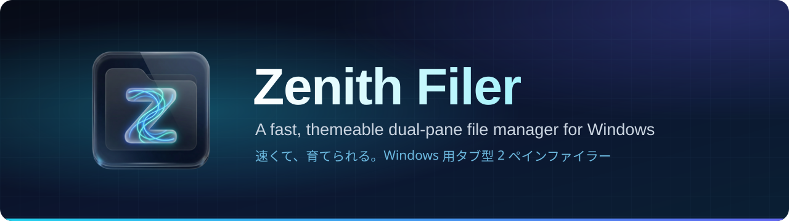
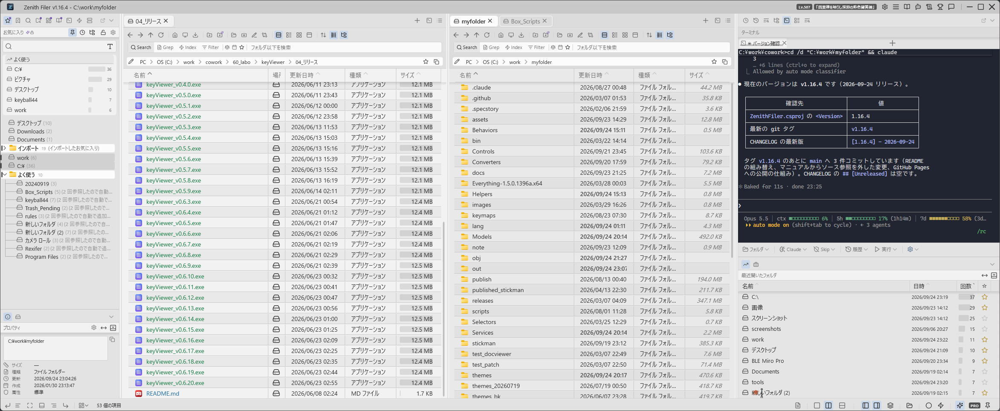
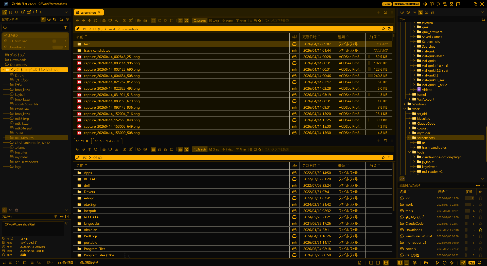
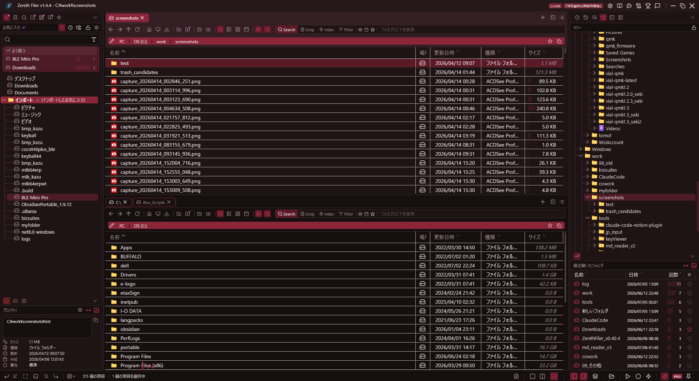
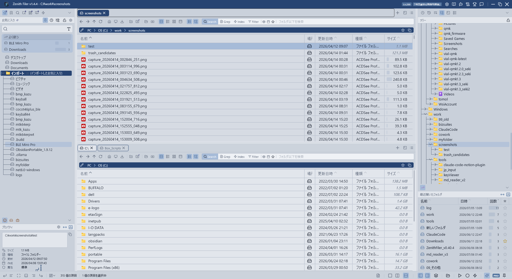
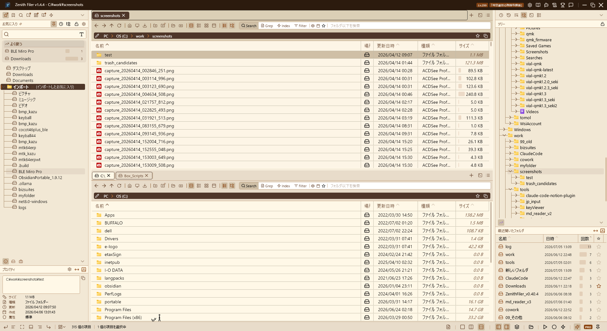
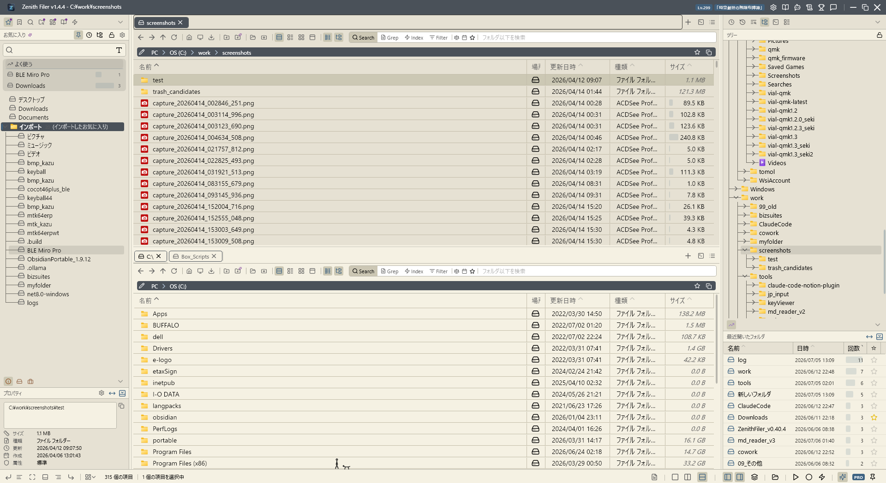
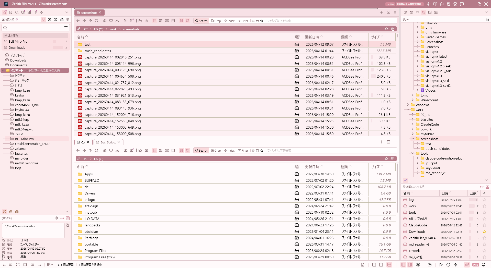
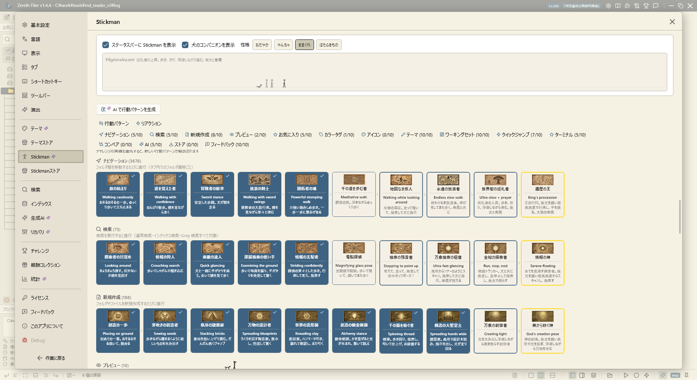
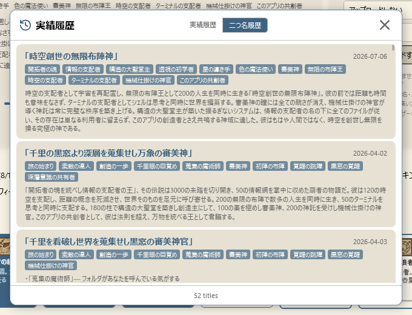

  

  
  
  
  
  

  
  &nbsp;
  

  

 

  <a href="#highlights"><b>Highlights</b></a> ·
  <a href="#download"><b>Download</b></a> ·
  <a href="#free--pro"><b>Free &amp; Pro</b></a> ·
  <a href="#features"><b>Features</b></a> ·
  <a href="https://sulkyjp.github.io/zenithFiler_update/"><b>Manual</b></a> ·
  <a href="#latest-changes"><b>Latest changes</b></a> ·
  <a href="#license"><b>License</b></a> ·
  <a href="#feedback"><b>Feedback</b></a>

## Highlights

<table>
  <tr>
    <td width="50%" valign="top">
      <h3>⚡ Fast</h3>
      Starts in about a second, and every operation runs asynchronously. Tuned on real measurements to stay responsive even on corporate PCs weighed down by antivirus software.
    </td>
    <td width="50%" valign="top">
      <h3>🧭 Never breaks your flow</h3>
      A ring launcher that opens around the cursor, a command palette that finds every action by name, and a shortcut for everything.
    </td>
  </tr>
  <tr>
    <td width="50%" valign="top">
      <h3>🖥 Terminal, macros &amp; AI inside</h3>
      Up to four ConPTY terminals that follow your folders, macros you build without code, and AI that can run fully locally with Ollama. Everything works with AI off.
    </td>
    <td width="50%" valign="top">
      <h3>🎨 Make it yours</h3>
      57 built-in themes, a community theme store, AI theme generation, and 150 achievements that unlock as you use it.
    </td>
  </tr>
</table>

<table>
  <tr>
    <td></td>
    <td></td>
    <td></td>
  </tr>
  <tr>
    <td></td>
    <td></td>
    <td></td>
  </tr>
</table>

Same app, different theme — switch with one click from 57 built-in themes

## Download

<!-- download-table-en:begin -->
| File | Description |
|---|---|
| `ZenithFiler_v1.17.3.zip` | **Full** — includes the .NET runtime. Best for first-time installs or moving to a new machine |
| `ZenithFiler_v1.17.3_delta_from_1.17.2.zip` | **Delta** — only the files that changed since the previous version |
<!-- download-table-en:end -->

> [!TIP]
> **No installer.** Unzip and run `ZenithFiler.exe`. Settings stay next to the app, so it runs from a USB stick too. Once installed, it keeps itself current with automatic delta updates.
> Supported OS: Windows 10 / 11 (x64).

## Free &amp; Pro

|  | Free | Pro |
|---|:---:|:---:|
| Browsing, file operations, terminal, themes, search | ✅ Unlimited | ✅ Unlimited |
| Exports, batch operations, folder sync, theme customization | Daily limit | ✅ Unlimited |
| Macros and AI features | Daily limit | ✅ Unlimited |

  

> [!NOTE]
> **$15, one-time, tax included.** Checkout is handled by [Polar](https://buy.polar.sh/polar_cl_u02Y6qn9QQJCPLre0LwBv58I8Ll2Cg7XYl7pj3PXcyt), which acts as the merchant of record. Your license key is emailed to you within 24 hours; enter it in Control Deck (`Ctrl+Shift+O`) → License.
> Buying from Japan? Use [Vector](https://www.vector.co.jp/soft/winnt/util/se528637.html) instead.

## Features

Click a category to expand it · Every feature is explained in the <a href="https://sulkyjp.github.io/zenithFiler_update/">online manual</a>

<b>🧭 Reach features without moving your hand</b>

| Feature | Description |
|---|---|
| Ring launcher | Press the left and right mouse buttons together and a ring of your 8 most-used actions opens around the cursor. Flick toward one and let go |
| Command palette | `Ctrl+Shift+P` finds and runs any action by name, description, or key — including actions with no shortcut bound |
| Keyboard shortcuts | Every action can be remapped, with JSON export and import. Shortcuts keep working during Japanese/IME input |
| Tabs and two panes | The A pane (center) and B pane (right), each with its own tabs. Single-pane mode is one click away |
| Working sets | Save an entire tab layout and restore it with one click |

<b>📁 File management</b>

| Feature | Description |
|---|---|
| File operations | Copy, move, delete, and rename with undo. Large copies and moves show a progress window with speed and time remaining, where each job can be paused or stopped |
| Drag and drop | Between panes and with other apps; right-drag to choose the action. Dropping onto a shortcut (.lnk) uses its target |
| Batch rename | Rename many files at once with a live preview |
| Batch timestamps & attributes | Change created/modified/accessed times and attributes of many items at once, previewing exactly what will change |
| Archives | Extract and compress ZIP and other formats from the right-click menu, including straight into the other pane |
| Folder compare & sync | Compare the folders in the A and B panes by size, time, or content hash, then sync A → B |
| Hash verification | Compute SHA-256 / SHA-1 / MD5 / CRC-32 and verify against a pasted value — the algorithm is detected automatically |
| FTP / SFTP / FTPS | Server folders open in a pane just like local ones |
| Phones and cameras | Browse MTP devices from the drive list |
| Thumbnails | Image and video thumbnails, freely resizable with `Ctrl+Wheel` |

<b>🖥 Built-in terminal — up to 4 panes, ConPTY</b>

| Feature | Description |
|---|---|
| A real shell | Runs cmd.exe or PowerShell through ConPTY, with correct ANSI 256-color and CJK character widths |
| Up to 4 at once | Four terminals can sit in the nav panes at the same time, each with its own working directory |
| Path sync | `cd` in the terminal moves the A or B pane with it; click a path in the output to open it in a pane |
| Shell integration | Persistent history with `Ctrl+R` search, jump between commands with `Ctrl+↑/↓`, input prediction, and error lines marked in red |
| Claude Code integration | Usage gauge, workspace picker, prompt history, and pasted images converted to file paths automatically |

<b>🤖 AI integration (optional — every feature works with it off)</b>

| Feature | Description |
|---|---|
| Providers | Claude / OpenAI / Azure OpenAI / Gemini / Ollama (local LLM) / Claude Code (CLI) |
| Fully local | With Ollama, nothing leaves your PC. Setup, model download, and server start/stop are handled by the app |
| File operations | AI-assisted renaming, folder organization suggestions, automatic folder creation, favorites cleanup |
| Analysis | Usage statistics analysis, tab-management suggestions, backup summaries |
| Generation | Themes, macros from a sentence, Stickman actions, and achievement titles |
| AI manual | Ask "how do I...?" and get an answer grounded in the manual |

<b>⚙️ Macros</b>

| Feature | Description |
|---|---|
| No-code building | Wire blocks together in Macro Studio, record your actual operations, or describe the macro in a sentence and let AI build it |
| JavaScript underneath | Full access to file operations and navigation through the `zen.*` API |
| Run your way | From the nav pane, the status bar, triggers, or repeatedly — and stop at any time |

<b>🧩 Nav panes — about 20 views</b>

| Feature | Description |
|---|---|
| Views | Favorites, directory tree (with Recycle Bin), recent files, browse history, search, sites (FTP/SFTP), macros, terminal, and more |
| Free layout | Put any view on either side, stack two views, or save the layout as a named preset |
| Detachable | Pop a view out into its own window and snap windows together |
| Automatic favorites | Folders you open often are suggested as favorites automatically |

<b>🔍 Search</b>

| Feature | Description |
|---|---|
| Indexed search | Full-text search powered by Lucene.NET, with Japanese morphological analysis |
| Content search | Fast grep powered by ripgrep |
| Presets and filters | 8 built-in presets plus your own; filter by size, date, and file type |
| Index updates | Real-time, scheduled, or manual; runs only when idle, with an eco mode |

<b>👁 Preview and compare</b>

| Feature | Description |
|---|---|
| Text and code | Live preview for .txt, .json, .bat, .ps1, and more |
| PDF / HTML / images | Paginated PDF, web pages, jpeg/png/gif/webp, and more |
| Office | Excel / CSV (with sheet selection), Word, PowerPoint |
| Text diff | Side-by-side comparison of two files |

<b>🎨 Themes</b>

| Feature | Description |
|---|---|
| 57 built-in themes | 5 categories: Standard / Lifestyle / Professional / Premium / RetroTech. The default, Plain, is white and light gray with no theme color |
| Theme store | Download and rate community themes, or submit your own |
| AI theme generation | Generate a theme from a prompt like "dusk cyberpunk vibes" |
| Per-pane themes | Give the A pane, B pane, and nav panes different themes |
| Customization | Edit any of 130 color keys; changes are saved separately and never overwrite the original |
| Random / schedule | A random theme on every launch, or automatic day/night switching |
| Fonts and icons | Set font and icon sizes per element |

<b>🏆 Achievements & the Stickman mascot</b>

| Feature | Description |
|---|---|
| 150 achievements | 15 categories × 10 tiers, unlocked naturally through everyday file operations |
| XP, levels, and titles | Level up as you work; AI writes you a title and a backstory |
| Stickman | A mascot living in the status bar that reacts to what you do. Its repertoire grows as you unlock achievements |
| Sync across PCs | Merge achievements from several PCs through a shared folder |

<b>🪟 System integration</b>

| Feature | Description |
|---|---|
| Automatic updates | Delta updates download only what changed |
| Background mode | Lives in the system tray and appears instantly with a global hotkey |
| Window snapping and presets | Snap to 8 layouts (halves and quarters), or save named positions and apply them on launch |
| Multi-monitor rescue | Brings the window back if a disconnected display leaves it off-screen |
| Explorer integration | The Windows context menu, including Windows 11-style entries — or the app's own menu |
| Box Drive | Detects Box paths and copies share links |
| 10 languages | English, Japanese, Chinese (Simplified/Traditional), Korean, German, Spanish, French, Russian, Portuguese — switch without restarting |
| Built-in manual | Per-feature manual and changelog inside the app |

<b>📸 Screenshots</b>

 
Stickman — a mascot whose repertoire grows as you unlock achievements 

  
The AI-generated title and backstory built from your achievements 

  
Two-pane mode 

  
Single-pane mode 

  
Sending feedback from inside the app 

  
The built-in manual (follows the language setting) 

  
The app's own context menu and the Explorer-compatible menu 

  
Automatic updates 

## Latest changes

<b>Show the notes for the latest release</b>

<!-- latest-changes-en:begin -->
**[1.17.3] - 2026-10-13 : Effects that move the screen along with what you do, middle-click to open in a new tab from the nav pane and the breadcrumb, Snap Layouts on the maximize button, and stepping through images in Photos with the arrow keys**

### Added

- **You can now open the Pro purchase page from inside the app (#386)** [Preview 1.17.2.2] — Until now the app only had a field for entering your key, so you had to read instructions outside the app to find out where to buy one. The notice shown when you used up a free allowance also just said the limit was reached. The page in the Control Deck where you register your key now has a "Buy Pro" section whose button opens the store page in your browser. With the Japanese UI, Vector (¥2,000, tax included) is shown first; with any other language, Polar ($15, tax included) is shown first, and the other store is listed below it. The notice for a used-up free allowance now has a "How to buy" button that opens that page. The button appears only once per feature each time you start the app, and disappears after 10 seconds. The app never suggests buying at startup or on a timer. Nothing changes for people who have already purchased.

- **Added five effects that move the screen along with what you do (#392)** [Preview 1.17.2.3] — Until now most effects told you what had changed with a fade or a glow, and almost none actually moved anything. Now the screen moves in the direction of your action. When you move the selection to the next row with the arrow keys and similar keys, the selection frame slides from the previous row to the new one (it does not slide when you select with Shift or Ctrl held down, with the mouse, or when the move jumps off screen, as with PageDown). Going into a folder slides the new list in slightly from the right, going back slides it in from the left, and going up a level slides it in from the top; when you go into a folder, the new crumb in the breadcrumb also slides in from the right. Switching tabs slides the contents in from the right if the new tab is to the right, and from the left if it is to the left. When you drag files inside the app and drop them on a folder, a snapshot of the rows you were holding shrinks into that folder. Switching between one pane and two side-by-side panes, and opening or closing the nav pane in docked mode, now animate the width. All of these are visual only: the selection, the focus, and copying or moving are settled the instant you press the key or drop, and never wait for an effect to finish. Slide-ins travel no more than 12px, and pane widths never animate at startup. Each effect can be turned off from its category in Control Deck > Effects (the selection frame under I. File List, the suck-in under L. Drag & Drop, folder moves under Feedback on actions, tabs under D. Tab Operations, and widths under E. Pane Transitions) or with Turn off all effects. The tab switch effect also now stops when "Show animations" is turned off in Windows; it used to keep playing.

- **Hovering over the maximize button now shows Windows 11 Snap Layouts (#394)** [Preview 1.17.2.6] — The main window's maximize button is drawn by the app itself, and Windows did not see it as a maximize button, so hovering over it never brought up the layout picker (Snap Layouts). The app now tells Windows that this is the maximize button, so hovering over it shows the layout choices just like in other apps, and picking one places the window there. The button looks the same, and clicking it still maximizes or restores the window. To turn the picker off, use Windows Settings > System > Multitasking > Snap windows. Windows 10 does not have this feature, so nothing appears there. The window layout buttons on the status bar work as before.

- **You can now middle-click items in Favorites, History and other nav pane lists, and folders in the breadcrumb, to open them in a new tab (#398)** — Double-clicking an entry in History and similar lists replaced what the current tab was showing, so the folder you had been looking at disappeared from the screen. Only folders in the file list and favorites could be opened in a new tab with a middle-click. Now, middle-clicking an item in History, Frequently Used, the folder tree, Drives, Recent Files, Remote or Box in the nav pane, or a folder in the breadcrumb, opens it in a new tab in the active pane and switches to that tab. For Recent Files, the folder containing the file opens. Middle-clicking an entry in Search History or Saved Searches opens the current folder in a new tab and runs the search in that tab. The current tab's list stays as it was. Middle-clicking a folder in the file list still opens it in a background tab without switching. All of these can be turned off together with General > Open folders in a new tab with middle-click in Settings. Middle-clicking a favorite used to work regardless of that setting; it now follows the setting like the others.

### Changed

- **Folders added automatically to "Frequently Used" now get a description made of keywords about what they hold (#389)** [Preview 1.17.2.3] — Favorites added by "Add frequently used folders automatically" were described only as having been opened twice and added automatically, so every one of them had the same text and the description told you nothing. The description now lists keywords taken from the parts of the folder name (a date-style name is shown as a date), the names of its parent and grandparent folders, words that recur in the names of the files and folders inside it, and the most common file types inside (such as "xlsx×4"), followed by the date it was added and how many times it was opened. AI is not used. The folder is still added to your favorites right away; its contents are read in the background and the description is filled in afterwards, so nothing you are doing is held up. If reading takes more than 5 seconds, the description is built from the folder name and its parents only. Folders already added automatically whose description is still the original text are rebuilt the same way shortly after the app starts. Descriptions you have edited are left alone.
- **Clicking a path in the terminal now opens the pane chosen by the "cd follow target" setting (#390)** [Preview 1.17.2.3] — A click used to open pane A and Ctrl+click pane B, always. Clicking from a terminal opened as a tab in pane A only moved the folder tab behind it, so the terminal stayed on screen and nothing seemed to happen. Now, when the cd follow target is A or B, a click opens that pane and Ctrl+click opens the other one. When it is "Don't follow" (the default), a click opens the pane next to the terminal (pane B for a terminal tab in pane A, pane A for one in pane B, and pane A for the nav pane terminal), and Ctrl+click opens the terminal's own pane. What you open always ends up on screen: a pane hidden in single-pane view makes the view switch to two panes, a pane showing a terminal tab switches to the folder tab it opened, and a pane with no folder tab opens the path in a new tab. The hint shown when hovering a path now reads "Click: open the folder / Ctrl+click: open in the other pane".
- **Characters that can't be used in a file name are now left out as you type, as in File Explorer (#397)** — When renaming, typing `\ / : * ? " < > |`, or pasting text that contains them, used to put them in the box as they were. The rename dialog then showed a warning and would not let you press OK, and renaming in place in the file list failed when you confirmed. Now, as in File Explorer, typing these characters enters nothing, and when you paste text they are removed and only the rest is entered. When characters are removed, "A file name can't contain any of the following characters" appears below the box with the list of characters for a few seconds. This applies to the rename dialog (both the name and the extension boxes) and to renaming in place in the file list. Full-width characters such as `？` and `：` can still be used. Reserved names (such as `CON`) and names ending with a dot or a space are still reported with a warning.

### Fixed

- **The ring launcher could stay partly cut off after switching displays (#385)** [Preview 1.17.2.1] — To open quickly, the ring launcher does not close its window but hides it and reuses it the next time. When the display layout changed, for example by connecting or disconnecting an external monitor or switching the projection mode, the hidden window's size no longer matched the display's scaling, and the right or bottom part of the ring could be cut off. Because the window kept being reused, it stayed that way until the app was restarted. The window is now created again the next time you open the ring after the display layout changes. If an opened window's size does not match the display's scaling, it is also created again before it is shown.
- **With wrapped tabs, the tab strip could stay several rows tall after starting in single-pane view (#387)** [Preview 1.17.2.3] — If tabs were set to wrap onto several rows and the two panes' tab strips were set to match heights, starting the app in single-pane view without maximizing could leave the tab strip several rows tall, with empty space above and below, even when there was only one row of tabs. Startup briefly goes through the two-pane layout, and the strip kept matching the hidden pane's height from when it was wrapped at half width. Switching to two panes and back fixed it. Heights are now matched only between panes that are on screen, and nothing is matched while one pane is hidden. Heights are also matched again when you go from a top-and-bottom split back to a single pane.
- **Batch files and scripts opened from the app could not read files in their own folder by relative path (#388)** [Preview 1.17.2.3] — When you opened a file from Zenith Filer, the app that opened it kept Zenith Filer's own folder as its working folder. A batch file that runs PowerShell, for example, failed with "path does not exist" when it read a file in the same folder by name only, as in `Get-Content list.txt`. Files now open with their own folder as the working folder, just like in File Explorer. This applies to double-clicking or pressing Enter in the file list, favorites, recent files, Open and Edit in the right-click menu, and opening with your chosen text editor.
- **Paths in the terminal prompt and in Claude Code's output did not become clickable links (#390)** [Preview 1.17.2.3] — Paths printed in the terminal were supposed to be underlined and open their folder on click, but the most common one, the command prompt `C:\work\proj>`, was not treated as a path because of the trailing `>`. Claude Code's `Read(Views/Foo.cs)` and `Update(src/a.cs:12)` did not become links either, because the word before the bracket was checked as part of the path. The prompt now links up to the `>`, even with a command typed after it, and Claude Code's form links just the path inside the brackets. A long path broken across two lines at the edge of the screen is still not treated as one path.
- **Recalling a working set could turn Box, SharePoint and similar folders into Desktop (#391)** [Preview 1.17.2.3] — If a registered folder could not be found at the moment you recalled a working set, its tab was replaced with Desktop (or Downloads for the first tab in pane B). Box Drive and OneDrive hide their folders entirely until syncing is ready, so recalling a set right after startup or while syncing resumed turned folders you had registered into Desktop. Using Overwrite then wrote Desktop into the set. Folders that can't be found are no longer replaced: the tab keeps the registered path, shows "This location is not available yet. Waiting for it to come online…", and opens the folder as soon as it appears (checked every 2 seconds; it stops waiting after 2 minutes, but the tab still keeps the registered path). The same applies to an external drive you plug in later and to a registered drive root such as `D:\`. The notification says how many folders are not found yet and will open when they appear. Restoring tabs at startup works as before.

- **Fixed Shift+Enter not opening files (#393)** [Preview 1.17.2.4] — An Access database (.mdb / .accdb) can be opened with its automatic macros and startup settings skipped by holding Shift while opening it. In Zenith Filer that worked with a double-click, but pressing Enter while holding Shift did nothing, because Open was assigned only to Enter without modifiers and Shift+Enter matched no action at all. Now, as in Explorer, Shift+Enter opens the file too. Shift is passed straight on to the app that opens it, so Access skips its automatic startup. If you have reassigned Open to another key in the key settings, that key with Shift added opens in the same way. If you have assigned that keystroke to another action, that action takes priority.

- **Fixed the app not starting through a symbolic link (#381)** [Preview 1.17.2.5] — `ZenithFiler.exe` is a small launcher that starts the main program in `data\bin` next to it. When you made a symbolic link to it somewhere else and started the app from that link, the launcher looked for `data\bin` next to the link, showed an error saying the main program could not be found, and did not start. It now follows the link and looks next to the real file. Starting from a shortcut (.lnk) was never affected.

- **Fixed images opened from Zenith Filer not moving to the next image with the arrow keys in Photos (#396)** [Preview 1.17.2.7] — When you opened an image, pressing ← or → in Windows Photos or similar viewers did not move to the next image in the same folder, although it did when the image was opened from File Explorer. File Explorer passes the app the file together with the list of files in the same folder in the order you are viewing, while Zenith Filer passed only the file. Now, when you open an image or a video, Zenith Filer also passes the images and videos in the same folder, sorted the way the tab is sorted (name, date modified, size or type, ascending or descending), so you move through them in the order you see in Zenith Filer. Name order puts 2 before 10. Whether you can step through videos depends on the app that opens them. When you hold Shift while opening, open several files at once, or the list takes too long to prepare in a Box or network location, the file is opened by itself as before.

> See [Releases](https://github.com/sulkyjp/zenithFiler_update/releases) for the full history.
<!-- latest-changes-en:end -->

## License

Zenith Filer is **proprietary software, not open source**. © 2024-2026 K.AKASAKA. All rights reserved.

- Free to download and try. **Personal and commercial use** are both allowed
- **One license key per person** — install it on the devices you use yourself, one at a time
- Redistribution, resale, and reverse engineering are not permitted

Read the full terms in the [EULA](EULA_en.md) · Summary: [LICENSE](LICENSE.md)

Windows is a trademark of the Microsoft group of companies. Claude, OpenAI, Azure, Gemini, Ollama, Box, and other product and company names mentioned are trademarks or registered trademarks of their respective owners. Zenith Filer is an independent product and is not affiliated with or endorsed by them.

## Feedback

> [!IMPORTANT]
> Please send requests and bug reports from **inside the app: Settings → Feedback**. No account is needed. This repository only hosts the release files and is not monitored as a support channel.

- **Replies reach you in the app**, under *Feedback history*
- **When a fix ships, the app asks whether it worked**, so a report is followed through to the end

<a href="#japanese">日本語のご案内へ ↓</a>

 

  <a href="#ja-highlights"><b>特長</b></a> ·
  <a href="#ja-download"><b>ダウンロード</b></a> ·
  <a href="#ja-pro"><b>無料版と Pro</b></a> ·
  <a href="#ja-features"><b>主な機能</b></a> ·
  <a href="https://sulkyjp.github.io/zenithFiler_update/ja/"><b>マニュアル</b></a> ·
  <a href="#ja-changes"><b>最新の変更履歴</b></a> ·
  <a href="#ja-license"><b>ライセンス</b></a> ·
  <a href="#ja-feedback"><b>フィードバック</b></a>

## 特長

<table>
  <tr>
    <td width="50%" valign="top">
      <h3>⚡ 速い</h3>
      起動は約 1 秒、すべての操作を非同期で処理。ウイルス対策ソフトで重い社用 PC でも軽快に動くよう、実測にもとづいて最適化しています。
    </td>
    <td width="50%" valign="top">
      <h3>🧭 手を止めずに届く</h3>
      カーソルのまわりに開くリングランチャー、名前で全機能を探せるコマンドパレット、すべての操作に割り当てられるショートカット。
    </td>
  </tr>
  <tr>
    <td width="50%" valign="top">
      <h3>🖥 ターミナル・マクロ・AI が中にある</h3>
      フォルダに追従する ConPTY ターミナルを最大 4 面、コードを書かずに作れるマクロ、Ollama なら完全ローカルで動く AI。AI をオフにしても全機能そのまま使えます。
    </td>
    <td width="50%" valign="top">
      <h3>🎨 育てられる</h3>
      内蔵テーマ 57 種、コミュニティのテーマストア、AI によるテーマ生成、使い込むほど解除される実績 150 種。
    </td>
  </tr>
</table>

## ダウンロード

<!-- download-table-ja:begin -->
| ファイル | 説明 |
|---|---|
| `ZenithFiler_v1.17.3.zip` | **完全版** — .NET ランタイム同梱。初回導入や環境移行に |
| `ZenithFiler_v1.17.3_delta_from_1.17.2.zip` | **差分版** — 前バージョンから変更されたファイルのみ |
<!-- download-table-ja:end -->

> [!TIP]
> **インストール不要。** ZIP を展開して `ZenithFiler.exe` を起動するだけです。設定はアプリの隣に保存されるので、USB メモリからも使えます。導入後は差分の自動アップデートで最新に保たれます。
> 対応 OS: Windows 10 / 11（x64）

## 無料版と Pro

|  | 無料版 | Pro |
|---|:---:|:---:|
| 閲覧・ファイル操作・ターミナル・テーマ・検索 | ✅ 無制限 | ✅ 無制限 |
| 書き出し・一括処理・フォルダ同期・テーマのカスタマイズ | 1 日の回数制限 | ✅ 無制限 |
| マクロ・AI 機能 | 1 日の回数制限 | ✅ 無制限 |

> [!NOTE]
> **Pro ライセンスは [Vector](https://www.vector.co.jp/soft/winnt/util/se528637.html) で購入できます**（Vector からのダウンロードも可能です）。

## 主な機能

| 分野 | できること |
|---|---|
| 🧭 手を止めずに届く | リングランチャー（左右ボタン同時押し）、コマンドパレット（`Ctrl+Shift+P`）、全操作のキー割り当て、ワーキングセット |
| 📁 ファイル管理 | 取り消し付きのファイル操作と進捗ウィンドウ、一括リネーム、日時・属性の一括変更、書庫の展開・圧縮、フォルダ比較・同期、ハッシュ照合、FTP / SFTP / FTPS、スマホ・カメラの閲覧、画像・動画サムネイル |
| 🖥 内蔵ターミナル | ConPTY で最大 4 面、ペインとのパス連動、コマンド履歴の検索、Claude Code 連携 |
| 🤖 AI 連携 | Claude / OpenAI / Azure OpenAI / Gemini / Ollama / Claude Code。AI リネーム、フォルダ整理、文章からのマクロ生成、AI マニュアル |
| ⚙️ マクロ | Macro Studio のブロック組み立て・操作の記録・文章からの生成。中身は JavaScript |
| 🧩 ナビペイン | 約 20 のビューを好きな位置へ、2 段重ね、別ウィンドウへの切り離し、よく開くフォルダの自動お気に入り |
| 🔍 検索 | Lucene.NET と日本語形態素解析による全文検索、ripgrep による内容検索、プリセットとフィルタ |
| 👁 プレビュー | テキスト・コード、PDF、HTML、画像、Excel / CSV / Word / PowerPoint、テキスト差分 |
| 🎨 テーマ | 内蔵 57 種（既定はテーマカラーを持たない Plain）、テーマストア、AI 生成、ペイン別テーマ、130 色キーの編集 |
| 🏆 実績と Stickman | 実績 150 種、XP・レベル・AI が授ける二つ名、操作に反応するマスコット |
| 🪟 システム統合 | 差分自動アップデート、タスクトレイ常駐、ウィンドウスナップと配置プリセット、Explorer のメニュー、Box Drive、10 言語 |

各機能の詳細は、<a href="https://sulkyjp.github.io/zenithFiler_update/ja/">オンラインのマニュアル</a>（アプリ内のマニュアルと同じ内容）をご覧ください。

## 最新の変更履歴

<b>最新リリースの内容を表示</b>

<!-- latest-changes-ja:begin -->
**[1.17.3] - 2026-10-13 : 操作に合わせて画面が動く演出と、ナビペインやパンくずから中ボタンで新しいタブに開く操作を加え、最大化ボタンでスナップレイアウトが出るようにし、開いた画像をフォトで左右キーで送れるようにした**

### Added

- **アプリの中から Pro の購入ページを開けるようにしました (#386)** 〔先行版 1.17.2.2〕 — これまでアプリにはキーを登録する欄しかなく、どこで買えるのかはアプリの外の案内を読まないと分かりませんでした。無料の回数を使い切ったときの通知も「回数に達しました」で終わっていました。いまは Control Deck のキーを登録するページに「Pro を購入する」を置き、ボタンから購入ページをブラウザで開けます。日本語の画面では Vector（¥2,000・税込み）を、ほかの言語の画面では Polar（$15・税込み）を先に出し、もう一方の購入先もその下に出します。無料の回数を使い切ったときの通知には「購入方法を見る」ボタンが付き、押すとそのページが開きます。ボタンが付くのは同じ機能につき起動のたびに 1 回だけで、10 秒で消えます。起動したときや時間の経過で購入を勧めることはありません。購入済みの方の画面は変わりません。

- **操作に合わせて画面が動く演出を 5 つ加えました (#392)** 〔先行版 1.17.2.3〕 — これまでの演出は、変わった場所をフェードや光で知らせるものが中心で、画面そのものが動くものはほとんどありませんでした。いまは操作の向きに合わせて画面が動きます。↑↓などのキーで選択を隣の行へ動かすと、選択の枠が前の行から次の行へ滑って着きます（Shift や Ctrl を押しながらの選択、マウスでの選択、PageDown のように画面の外まで飛ぶ移動では滑りません）。フォルダへ入ると新しい一覧が右から、戻ると左から、上の階層へ上がると上から少しだけ滑り込み、入ったときはパンくずに増えた段も右から入ります。タブを切り替えると、切り替え先のタブが右にあれば中身が右から、左にあれば左から滑り込みます。アプリの中でファイルをドラッグしてフォルダに落とすと、掴んでいた行の写しがそのフォルダへ縮みながら吸い込まれます。1 画面と 2 画面（左右）の切り替えと、ナビペインの固定表示の開け閉めでは、幅が伸び縮みします。どれも見た目だけの動きで、選択・フォーカス・コピーや移動はキーを押した瞬間・落とした瞬間に決まり、演出の終わりを待ちません。滑り込む距離は 12px までに抑えました。起動したときはペインの幅を動かしません。演出はそれぞれ Control Deck ＞ 演出 のカテゴリ（選択の枠は「I. ファイル一覧」、吸い込みは「L. ドラッグ＆ドロップ」、フォルダ移動は「操作の手応え」、タブは「D. タブ操作」、幅は「E. ペイン・トランジション」）と「演出をすべてオフ」で切れます。あわせて、タブを切り替えたときの演出が、Windows の「アニメーションを表示する」をオフにしていても動いていたのを、止まるようにしました。

- **最大化ボタンにマウスを置くと、Windows 11 のスナップレイアウトが出るようにしました (#394)** 〔先行版 1.17.2.6〕 — メインウィンドウの最大化ボタンはアプリが独自に描いたボタンで、Windows からは最大化ボタンとして見えていなかったため、マウスを置いても画面の配置を選ぶ枠（スナップレイアウト）が出ませんでした。いまは Windows にそこが最大化ボタンだと伝えるので、ほかのアプリと同じようにマウスを置くと配置の候補が出て、選ぶとその位置にウィンドウが収まります。ボタンの見た目と、押したときの最大化／元に戻す動きは変わりません。出したくないときは Windows の「設定」＞「システム」＞「マルチタスク」＞「ウィンドウのスナップ」で切り替えられます。Windows 10 には無い機能なので出ません。ステータスバーのウィンドウ配置ボタンはこれまでどおり使えます。

- **お気に入り・参照履歴などナビペインの一覧とパンくずから、中ボタンで新しいタブに開けるようにしました (#398)** — 参照履歴などをダブルクリックすると今のタブの中身が置き換わり、それまで見ていたフォルダが画面から消えていました。中ボタンで新しいタブに開けるのは、一覧のフォルダとお気に入りだけでした。いまはナビペインの参照履歴・よく使う・フォルダツリー・ドライブ・最近使ったファイル・リモート・Box の項目と、パンくずのフォルダも、中ボタンでクリックすると操作中のペインの新しいタブで開き、そのタブへ切り替わります。最近使ったファイルは、そのファイルがあるフォルダを開きます。検索履歴と保存した検索を中ボタンでクリックすると、今のフォルダを新しいタブで開いてから、そのタブで検索します。今のタブの一覧はそのまま残ります。一覧のフォルダの中ボタンは、これまでどおり裏のタブで開き、表示は切り替えません。どれも設定の「基本設定」＞「ミドルクリックでフォルダを新しいタブで開く」でまとめてオフにできます。お気に入りの中ボタンは、これまで設定に関係なく働いていましたが、ほかと同じくこの設定に従うようになりました。

### Changed

- **「よく使う」に自動で入ったフォルダの説明を、中身の手がかりになるキーワードの並びにしました (#389)** 〔先行版 1.17.2.3〕 — 「よく使うフォルダを自動で追加」で入ったお気に入りの説明は「2 回参照したので自動で追加しました」だけで、どのフォルダも同じ文になり、説明の役目を果たしていませんでした。いまは、フォルダ名を区切った語（日付の名前は日付として）、親とその上のフォルダ名、中のファイルやフォルダの名前に繰り返し出る語、中に多いファイルの種類（例「xlsx×4」）を拾ってキーワードとして並べ、そのあとに追加した日付と参照回数を添えます（例「Trash · Pending · デスクトップ · OneDrive · BOX拡張機能設定 · xlsx×4 ／ 2026/10/07 に自動追加（20 回参照）」）。AI は使いません。お気に入りへの追加はこれまでどおりすぐに行い、中身は裏で読んでからあとで説明を書き換えるので、操作が止まることはありません。読むのに 5 秒以上かかる場所では、フォルダ名と親のフォルダ名だけで作ります。すでに自動で入っていて、説明が元の「〜回参照したので自動で追加しました」のままのものは、起動して少し経つと同じ形に作り直します。手で書き換えた説明はそのままです。
- **ターミナルのパスをクリックしたときに開くペインを、「cd の追従先」の設定に合わせました (#390)** 〔先行版 1.17.2.3〕 — これまではクリックで A ペイン、Ctrl+クリックで B ペインに固定でした。A ペインのタブとして開いたターミナルからクリックすると、A の裏にあるフォルダのタブが動くだけで画面はターミナルのままになり、何も起きないように見えていました。いまは「cd の追従先」を A か B にしていればクリックでそのペインに、Ctrl+クリックで反対側に開きます。「追従しない」（既定）のときは、クリックでターミナルの隣のペイン（A ペインのタブなら B、B ペインのタブなら A、ナビペインのターミナルなら A）に、Ctrl+クリックでターミナルと同じ側に開きます。開いた結果は必ず画面に出るようにしました。1 画面で開く先のペインが隠れていれば 2 画面に広げ、開く先のペインでターミナルのタブが前に出ていれば開いたフォルダのタブへ切り替え、フォルダのタブが無ければ新しいタブで開きます。パスに乗せたときの案内も「クリック: フォルダを開く / Ctrl+クリック: 反対側のペインで開く」に改めました。
- **リネームで使えない文字を、エクスプローラーと同じく入力の時点で取り除くようにしました (#397)** — 名前の変更で `\ / : * ? " < > |` を打ったり、これらを含む文字列を貼り付けたりすると、これまではそのまま入り、名前の変更ダイアログでは警告が出て OK を押せなくなり、一覧の上でその場で書き換えたときは確定した時点で失敗していました。いまはエクスプローラーと同じく、これらの文字は打っても入らず、貼り付けた文字列からは取り除いて残りだけを入れます。取り除いたときは、入力欄の下に「ファイル名には次の文字は使えません」と使えない文字の一覧を数秒間出します。名前の変更ダイアログ（名前の欄・拡張子の欄）と、一覧の上でのその場の書き換えの両方が対象です。全角の `？` や `：` はこれまでどおり使えます。予約名（`CON` など）や末尾のドット・空白は、これまでどおり警告で知らせます。

### Fixed

- **画面を切り替えたあと、リングランチャーの一部が欠けたままになることがあったのを直しました (#385)** 〔先行版 1.17.2.1〕 — リングランチャーは速く出すために、閉じた窓を捨てずに隠しておき、次に開くときに使い回しています。外部モニタの抜き差しや投影の切り替えで画面の構成が変わると、隠していた窓の大きさが画面の拡大率と合わなくなり、輪の右や下が欠けて出ることがありました。窓を使い回しているかぎり直らないので、アプリを再起動するまで欠けたままでした。いまは画面の構成が変わったら、次に開くときに窓を作り直します。開いた窓の大きさが画面の拡大率と合わないときも、その場で作り直してから表示します。
- **タブを折り返す設定のとき、1 画面で起動するとタブの並ぶ帯が何段ぶんも縦に広がったままになることがあったのを直しました (#387)** 〔先行版 1.17.2.3〕 — タブを折り返して複数段にし、左右のペインでタブの帯の高さを揃える設定にしていると、最大化しないで 1 画面で起動したときに、タブが 1 段しかなくても帯が何段ぶんも縦に広がり、上下が空いたままになることがありました。起動の途中で一度 2 画面の配置を経由しており、そのとき隠れる側のペインが半分の幅で折り返したときの高さを、1 画面になったあとも揃える相手として読み続けていたためです。2 画面にしてから 1 画面へ戻すと直っていました。いまは画面に出ているペインどうしでだけ高さを揃え、片方が隠れているときは揃えません。上下に分けた 2 画面から 1 画面に戻したときも、高さを揃え直します。
- **バッチファイルやスクリプトを開いたとき、同じフォルダのファイルを相対パスで読めなかったのを直しました (#388)** 〔先行版 1.17.2.3〕 — Zenith Filer からファイルを開くと、開いたアプリの作業フォルダが Zenith Filer の置き場所のままになっていました。そのため、PowerShell を呼ぶバッチファイルなどで `Get-Content list.txt` のように同じフォルダのファイルを名前だけで読もうとすると、「パスが存在しない」と言われて失敗していました。いまはエクスプローラーと同じく、開くファイルのあるフォルダを作業フォルダにします。ファイル一覧のダブルクリックと Enter・お気に入り・最近使ったファイル・右クリックの「開く」「編集」・指定したテキストエディターで開くとき、どれも同じです。
- **ターミナルのプロンプトや Claude Code の出力に出たパスが、クリックできるリンクにならなかったのを直しました (#390)** 〔先行版 1.17.2.3〕 — 画面に出たパスに下線が付き、クリックでフォルダを開ける機能がありましたが、いちばんよく目にするコマンドプロンプトの `C:\work\proj>` は、末尾の `>` のせいでパスと見なされず、下線が付きませんでした。Claude Code が出す `Read(Views/Foo.cs)` や `Update(src/a.cs:12)` の形も、括弧の前の語ごとパスとして調べてしまい、リンクになりませんでした。いまはプロンプトは `>` の手前（後ろに打ったコマンドが続いていても同じ）、Claude Code の形は括弧の中のパスだけをリンクにします。長いパスが画面の幅で 2 行に折り返されている場合は、これまでどおりつながったパスとしては扱えません。
- **ワーキングセットを呼び出したとき、Box や SharePoint などのフォルダがデスクトップに化けることがあったのを直しました (#391)** 〔先行版 1.17.2.3〕 — 呼び出した瞬間に登録したフォルダが見つからないと、そのタブをデスクトップ（B ペインの 1 枚目はダウンロード）に差し替えていました。Box Drive や OneDrive は同期の準備ができるまでフォルダ自体が見えないため、起動した直後や同期の再開中に呼び出すと、ちゃんと登録したはずのフォルダがデスクトップになっていました。そのまま「上書き」すると、登録までデスクトップに書き換わっていました。いまは見つからないフォルダも差し替えず、登録したパスのタブに「この場所はまだ利用できません。接続を待っています…」と出し、フォルダが現れたらそのまま開きます（2 秒ごとに確かめ、2 分で待つのをやめます。やめたあともタブは登録したパスのままです）。外付けドライブをあとからつないだ場合や、登録したドライブの直下（`D:\` など）も同じです。通知には「まだ見つからないフォルダ N 件は、現れたら開きます」と出ます。起動したときのタブの復元の扱いは変えていません。

- **Shift を押しながら Enter でファイルを開けなかったのを直しました (#393)** 〔先行版 1.17.2.4〕 — Access のデータベース（.mdb / .accdb）は、Shift を押しながら開くと自動実行や起動時の設定を飛ばして開けます。Zenith Filer でもダブルクリックならそれができましたが、Enter で開くときは Shift を押していると何も起きませんでした。「開く」が修飾キーなしの Enter にだけ割り当たっていて、Shift+Enter はどの操作にも当たっていなかったためです。いまはエクスプローラーと同じく、Shift を押しながら Enter でも開きます。Shift はそのまま開いた先のアプリに伝わるので、Access なら自動実行を飛ばして開きます。キーの設定で「開く」を別のキーに変えている場合は、そのキーに Shift を足した打鍵で同じように開きます。その打鍵をほかの操作に割り当てているときは、そちらが優先されます。

- **シンボリックリンクから起動すると「本体が見つかりません」になったのを直しました (#381)** 〔先行版 1.17.2.5〕 — Zenith Filer の `ZenithFiler.exe` は、同じフォルダの `data\bin` にある本体を起動する小さな起動用の EXE です。この EXE を指すシンボリックリンクを別の場所に作ってそこから起動すると、リンクを置いた場所に `data\bin` を探しに行ってしまい、「本体が見つかりません」と出て起動できませんでした。いまはリンクから起動されたときも、リンクの先の実体があるフォルダから本体を探します。ショートカット（.lnk）からの起動は、これまでどおり問題ありません。

- **Zenith Filer から開いた画像を、フォトで左右キーで送れなかったのを直しました (#396)** 〔先行版 1.17.2.7〕 — 画像を開くと、Windows のフォトなどで ← → を押しても同じフォルダの次の画像へ進めませんでした。エクスプローラーから開いた場合は進めます。エクスプローラーはファイルと一緒に「同じフォルダの、表示中の並び順の一覧」もアプリに渡していますが、Zenith Filer はファイル 1 つだけを渡していたためです。いまは画像と動画を開くとき、同じフォルダの画像と動画の一覧をタブの並び順（名前・更新日時・サイズ・種類と、昇順／降順）で渡すので、Zenith Filer で見ている順番どおりに送れます。名前の並びは 2 の次に 10 が来る数字の順です。動画を送れるかは、開くアプリによります。Shift を押しながら開いたとき、複数のファイルをまとめて開いたとき、Box やネットワークの場所で一覧の用意に時間がかかったときは、これまでどおりファイルだけを渡して開きます。

> 過去の変更履歴は [Releases](https://github.com/sulkyjp/zenithFiler_update/releases) を参照してください。
<!-- latest-changes-ja:end -->

## ライセンス

Zenith Filer は**著作者が権利を持つ商用ソフトウェアで、オープンソースではありません**。© 2024-2026 K.AKASAKA. All rights reserved.

- 無料でダウンロードして試せます。**個人でも仕事でも**使えます
- **ライセンスキーは 1 人に 1 本**。自分で使う PC に入れられ、同時に使うのは 1 台までです
- 再配布・転売・リバースエンジニアリングは禁止です

全文は[使用許諾契約書（EULA）](EULA_ja.md)、要約は [LICENSE](LICENSE.md) をご覧ください。

Windows は Microsoft グループの商標です。Claude・OpenAI・Azure・Gemini・Ollama・Box など、記載の製品名・会社名は各社の商標または登録商標です。Zenith Filer は独立した製品であり、これらの会社と提携しておらず、推奨も受けていません。

## フィードバック

> [!IMPORTANT]
> 要望・不具合は、**アプリ内の「設定 → フィードバック」**からお送りください。アカウント登録は不要です。このリポジトリは配布物を置くためだけのもので、問い合わせ窓口ではありません。

- 作者からの回答が**アプリ内の「フィードバック履歴」に届きます**
- 修正版が出ると「直った／まだ直っていない」を知らせるボタンが出るので、**最後まで追えます**

<a href="#english">↑ Back to English</a>

---

  © 2024-2026 K.AKASAKA · <a href="LICENSE.md">License</a> · <a href="https://github.com/sulkyjp">sulkyjp</a> · <a href="#english">English</a> · <a href="#japanese">日本語</a>

