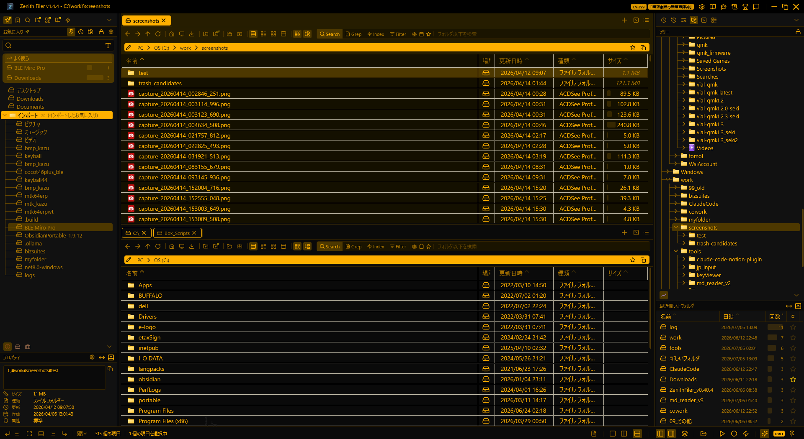
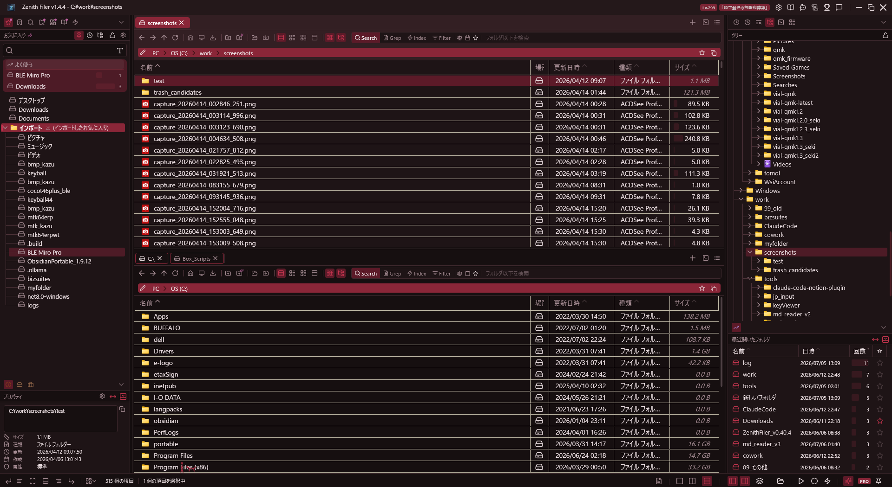

  

  
  
  
  
  

  
  &nbsp;
  

  

 

  <a href="#highlights"><b>Highlights</b></a> ·
  <a href="#download"><b>Download</b></a> ·
  <a href="#free--pro"><b>Free &amp; Pro</b></a> ·
  <a href="#features"><b>Features</b></a> ·
  <a href="https://sulkyjp.github.io/zenithFiler_update/"><b>Manual</b></a> ·
  <a href="#latest-changes"><b>Latest changes</b></a> ·
  <a href="#license"><b>License</b></a> ·
  <a href="#feedback"><b>Feedback</b></a>

## Highlights

<table>
  <tr>
    <td width="50%" valign="top">
      <h3>⚡ Fast</h3>
      Starts in about a second, and every operation runs asynchronously. Tuned on real measurements to stay responsive even on corporate PCs weighed down by antivirus software.
    </td>
    <td width="50%" valign="top">
      <h3>🧭 Never breaks your flow</h3>
      A ring launcher that opens around the cursor, a command palette that finds every action by name, and a shortcut for everything.
    </td>
  </tr>
  <tr>
    <td width="50%" valign="top">
      <h3>🖥 Terminal, macros &amp; AI inside</h3>
      Up to four ConPTY terminals that follow your folders, macros you build without code, and AI that can run fully locally with Ollama. Everything works with AI off.
    </td>
    <td width="50%" valign="top">
      <h3>🎨 Make it yours</h3>
      57 built-in themes, a community theme store, AI theme generation, and 150 achievements that unlock as you use it.
    </td>
  </tr>
</table>

<table>
  <tr>
    <td></td>
    <td></td>
    <td></td>
  </tr>
  <tr>
    <td></td>
    <td></td>
    <td></td>
  </tr>
</table>

Same app, different theme — switch with one click from 57 built-in themes

## Download

<!-- download-table-en:begin -->
| File | Description |
|---|---|
| `ZenithFiler_v2.3.0.zip` | **Full** — includes the .NET runtime. Best for first-time installs or moving to a new machine |
| `ZenithFiler_v2.3.0_delta_from_2.2.0.zip` | **Delta** — only the files that changed since the previous version |
<!-- download-table-en:end -->

> [!TIP]
> **No installer.** Unzip and run `ZenithFiler.exe`. Settings stay next to the app, so it runs from a USB stick too. Once installed, it keeps itself current with automatic delta updates.
> Supported OS: Windows 10 / 11 (x64).

## Free &amp; Pro

|  | Free | Pro |
|---|:---:|:---:|
| Browsing, file operations, terminal, themes, search | ✅ Unlimited | ✅ Unlimited |
| Exports, batch operations, folder sync, theme customization | Daily limit | ✅ Unlimited |
| Macros and AI features | Daily limit | ✅ Unlimited |

  

> [!NOTE]
> **$15, one-time, tax included.** Checkout is handled by [Polar](https://buy.polar.sh/polar_cl_u02Y6qn9QQJCPLre0LwBv58I8Ll2Cg7XYl7pj3PXcyt), which acts as the merchant of record. Your license key is emailed to you within 24 hours; enter it in Control Deck (`Ctrl+Shift+O`) → License.
> Buying from Japan? Use [Vector](https://www.vector.co.jp/soft/winnt/util/se528637.html) instead.

## Features

Click a category to expand it · Every feature is explained in the <a href="https://sulkyjp.github.io/zenithFiler_update/">online manual</a>

<b>🧭 Reach features without moving your hand</b>

| Feature | Description |
|---|---|
| Ring launcher | Press the left and right mouse buttons together and a ring of your 8 most-used actions opens around the cursor. Flick toward one and let go |
| Command palette | `Ctrl+Shift+P` finds and runs any action by name, description, or key — including actions with no shortcut bound |
| Keyboard shortcuts | Every action can be remapped, with JSON export and import. Shortcuts keep working during Japanese/IME input |
| Tabs and two panes | The A pane (center) and B pane (right), each with its own tabs. Single-pane mode is one click away |
| Working sets | Save an entire tab layout and restore it with one click |

<b>📁 File management</b>

| Feature | Description |
|---|---|
| File operations | Copy, move, delete, and rename with undo. Large copies and moves show a progress window with speed and time remaining, where each job can be paused or stopped |
| Drag and drop | Between panes and with other apps; right-drag to choose the action. Dropping onto a shortcut (.lnk) uses its target |
| Batch rename | Rename many files at once with a live preview |
| Batch timestamps & attributes | Change created/modified/accessed times and attributes of many items at once, previewing exactly what will change |
| Archives | Extract and compress ZIP and other formats from the right-click menu, including straight into the other pane |
| Folder compare & sync | Compare the folders in the A and B panes by size, time, or content hash, then sync A → B |
| Hash verification | Compute SHA-256 / SHA-1 / MD5 / CRC-32 and verify against a pasted value — the algorithm is detected automatically |
| FTP / SFTP / FTPS | Server folders open in a pane just like local ones |
| Phones and cameras | Browse MTP devices from the drive list |
| Thumbnails | Image and video thumbnails, freely resizable with `Ctrl+Wheel` |

<b>🖥 Built-in terminal — up to 4 panes, ConPTY</b>

| Feature | Description |
|---|---|
| A real shell | Runs cmd.exe or PowerShell through ConPTY, with correct ANSI 256-color and CJK character widths |
| Up to 4 at once | Four terminals can sit in the nav panes at the same time, each with its own working directory |
| Path sync | `cd` in the terminal moves the A or B pane with it; click a path in the output to open it in a pane |
| Shell integration | Persistent history with `Ctrl+R` search, jump between commands with `Ctrl+↑/↓`, input prediction, and error lines marked in red |
| Claude Code integration | Usage gauge, workspace picker, prompt history, and pasted images converted to file paths automatically |

<b>🤖 AI integration (optional — every feature works with it off)</b>

| Feature | Description |
|---|---|
| Providers | Claude / OpenAI / Azure OpenAI / Gemini / Ollama (local LLM) / Claude Code (CLI) |
| Fully local | With Ollama, nothing leaves your PC. Setup, model download, and server start/stop are handled by the app |
| File operations | AI-assisted renaming, folder organization suggestions, automatic folder creation, favorites cleanup |
| Analysis | Usage statistics analysis, tab-management suggestions, backup summaries |
| Generation | Themes, macros from a sentence, Stickman actions, and achievement titles |
| AI manual | Ask "how do I...?" and get an answer grounded in the manual |

<b>⚙️ Macros</b>

| Feature | Description |
|---|---|
| No-code building | Wire blocks together in Macro Studio, record your actual operations, or describe the macro in a sentence and let AI build it |
| JavaScript underneath | Full access to file operations and navigation through the `zen.*` API |
| Run your way | From the nav pane, the status bar, triggers, or repeatedly — and stop at any time |

<b>🧩 Nav panes — about 20 views</b>

| Feature | Description |
|---|---|
| Views | Favorites, directory tree (with Recycle Bin), recent files, browse history, search, sites (FTP/SFTP), macros, terminal, and more |
| Free layout | Put any view on either side, stack two views, or save the layout as a named preset |
| Detachable | Pop a view out into its own window and snap windows together |
| Automatic favorites | Folders you open often are suggested as favorites automatically |

<b>🔍 Search</b>

| Feature | Description |
|---|---|
| Indexed search | Full-text search powered by Lucene.NET, with Japanese morphological analysis |
| Content search | Fast grep powered by ripgrep |
| Presets and filters | 8 built-in presets plus your own; filter by size, date, and file type |
| Index updates | Real-time, scheduled, or manual; runs only when idle, with an eco mode |

<b>👁 Preview and compare</b>

| Feature | Description |
|---|---|
| Text and code | Live preview for .txt, .json, .bat, .ps1, and more |
| PDF / HTML / images | Paginated PDF, web pages, jpeg/png/gif/webp, and more |
| Office | Excel / CSV (with sheet selection), Word, PowerPoint |
| Text diff | Side-by-side comparison of two files |

<b>🎨 Themes</b>

| Feature | Description |
|---|---|
| 57 built-in themes | 5 categories: Standard / Lifestyle / Professional / Premium / RetroTech, including Plain — white and light gray with no theme color |
| Theme store | Download and rate community themes, or submit your own |
| AI theme generation | Generate a theme from a prompt like "dusk cyberpunk vibes" |
| Per-pane themes | Give the A pane, B pane, and nav panes different themes |
| Customization | Edit any of about 150 color keys; changes are saved separately and never overwrite the original |
| Random / schedule | A random theme on every launch, or automatic day/night switching |
| Fonts and icons | Set font and icon sizes per element |

<b>🏆 Achievements & the Stickman mascot</b>

| Feature | Description |
|---|---|
| 150 achievements | 15 categories × 10 tiers, unlocked naturally through everyday file operations |
| XP, levels, and titles | Level up as you work; AI writes you a title and a backstory |
| Stickman | A mascot living in the status bar that reacts to what you do. Its repertoire grows as you unlock achievements |
| Sync across PCs | Merge achievements from several PCs through a shared folder |

<b>🪟 System integration</b>

| Feature | Description |
|---|---|
| Automatic updates | Delta updates download only what changed |
| Background mode | Lives in the system tray and appears instantly with a global hotkey |
| Window snapping and presets | Snap to 8 layouts (halves and quarters), or save named positions and apply them on launch |
| Multi-monitor rescue | Brings the window back if a disconnected display leaves it off-screen |
| Explorer integration | The Windows context menu, including Windows 11-style entries — or the app's own menu |
| Box Drive | Detects Box paths and copies share links |
| 10 languages | English, Japanese, Chinese (Simplified/Traditional), Korean, German, Spanish, French, Russian, Portuguese — switch without restarting |
| Built-in manual | Per-feature manual and changelog inside the app |

<b>📸 Screenshots</b>

 
Stickman — a mascot whose repertoire grows as you unlock achievements 

  
The AI-generated title and backstory built from your achievements 

  
Two-pane mode 

  
Single-pane mode 

  
Sending feedback from inside the app 

  
The built-in manual (follows the language setting) 

  
The app's own context menu and the Explorer-compatible menu 

  
Automatic updates 

## Latest changes

<b>Show the notes for the latest release</b>

<!-- latest-changes-en:begin -->
**[2.3.0] - 2026-11-20 : The Details view now shows item info when you hover; adds a full list of theme color keys to the manual; searches show that they are running and list results as they are found; start-up no longer waits for every theme file; fixes include files being lost when an overwrite move or a folder sync failed, the window freezing after sleep, and an error that kept repeating in the status bar**

### Added

- **The Details view now shows an item's type, size and dates when you hover over it (#531)** [Preview 2.2.0.1] — In File Explorer, pointing at a file or folder pops up its type, size and date modified, but here that only happened in the icon and tile views, not in the Details view most people use. Now, in the Details view and in search results, resting the pointer on a name shows, after a short pause, the type, size and date modified for files, and for folders the date created plus, once the folder size has been counted, the size and contents ("n files, m folders"). Only values already loaded for the list are used, so hovering never reads the disk and stays quick on network locations; for the same reason it does not list the names inside a folder the way File Explorer does. If the name is cut off by the column width, the full name is shown at the top. When a hover thumbnail is showing for an image or video, the info is left out so the two don't overlap. The icon, tile, list and content views now show the same date created, size and contents for folders too. To turn it off, clear "Show item info on hover" under Settings > Display > File list (the full name of a cut-off item is still shown, as before)

- **Added a full list of theme color keys, with where each color is used, to the manual (#532)** [Preview 2.2.0.2] — When you wanted to tweak a theme's JSON there was no document telling you which key colors what, and in the theme customization screen 10 of the 156 keys (including `ListAlternateRowColor` for alternate rows in the list and `ListGridLineColor` for the row lines) had no description and showed only the key name, so the key for alternate row colors was hard to find. The manual's "Theme Color Keys" page now lists every key by JSON section, with what happens if you leave it out (which key it takes its color from) and where on screen it is used. It also covers the file layout (sections, how to write colors, that keys placed in the wrong section are ignored, and `Chrome` set to `"Neutral"`) and gives an example for alternate row colors. In the customization screen, the 10 keys now have descriptions and 10 other descriptions now say where the color appears. Alternate row colors moved from under "Buttons & Filters" to a new "List Rows" heading

### Changed

- **Searches now show that they are running, and results appear as they are found (#528)** [Preview 2.2.0.1] — Before, on slow places such as file servers, you couldn't tell a search was still running until results showed up, and results only reached the list once 50 had been found, so they seemed to appear all at once at the end. Now, while a search runs, the progress glow at the bottom of the window and "[Search] n items..." are shown again (#487 had turned them off for searches), and the Stickman in the status bar shows a "Searching..." speech bubble above its head and keeps hunting around: it dashes about and skids to a stop, shades its eyes to scan, digs, looks up and peers through a magnifier. The pet (dog and friends) joins in, dashing from one end of the status bar to the other and sniffing around. It goes back to its usual moves when the search ends; other reactions don't interrupt it. In the middle of the list in the pane that is searching, six bars rise and fall in a wave (in the theme's accent color; you can still click the list underneath, and it shows even with the Stickman turned off). The first result shows up as soon as it is found, and more are added every 0.3 seconds (with folders grouped first, folders found so far stay at the top). This applies to name searches and content searches (grep)

- **Features that are not unlocked yet now have their buttons and menu items disabled, with the unlock condition and your progress shown right next to them (#526)** [Preview 2.2.0.1] — Before, you could press the button for a feature that was still locked, and all that happened was a small notice at the bottom of the window for 3 seconds, so the button looked like it did nothing. Now, until a feature is unlocked, its button or menu item is dimmed and can't be pressed, and a lock icon and the condition with your progress, such as "Unlocks at Challenge Lv.50 (Lv.32/50)", appear right below the button (for menu items, in the tooltip when you point at them). This covers "Generate behavior with AI" on the Stickman page (Challenge Lv.50), "Upload" in the Stickman Store and "Upload to store" in the right-click menu of a Stickman behavior (Challenge Lv.50), "Generate Theme with AI" on the Theme page (switch themes 30 times) and "Customize theme" in the right-click menu of a theme (switch themes 5 times). Once you meet the condition, they become available right away

- **When start-up is slow, the log now shows where the time goes (#539)** — The start-up records only covered the time after the app's own start-up work began, so the time spent before that, loading the .NET runtime and its components (DLLs) and being scanned by antivirus software, was invisible. The app now writes the total time since its process was created on `[STARTUP-TIMING] since-process-start` lines: until the app's code starts (`main`), until start-up work begins (`onstartup`) and until the window appears (`reveal`). If the app feels slow to start, please send these lines with your feedback. The Log Specification page in the manual explains how to read them

- **Start-up no longer waits for every theme file to be read before showing the window, which was slow right after a restart (#542)** — At start-up the app read not only the theme in use but every theme file (the 57 bundled themes plus any you added) to build the theme list, and only then showed the window. Normally this is instant because Windows still has the files in memory, but right after the PC restarts, or when the app sits on a slow drive such as a hard disk, each file has to be read from the disk and the wait could exceed 2 seconds. The app now reads only the theme in use (or the four themes when each pane has its own theme) before showing the window and reads the list in the background. If you open the theme list in Settings or the theme step of the first-run guide before the list is ready, it appears once reading finishes, and the window stays responsive in the meantime. When themes are picked at random, the list is needed to make the pick, so the app still reads it before showing the window

### Fixed

- **Fixed feedback sometimes failing to send because it was too long after a run of errors (#527)** [Preview 2.2.0.1] — After the same error happened many times, the attached "Recent Error Logs" became very long and went over the size limit, so sending failed with "Submission failed (HTTP 422)". Each retry also added a record of the failed send to the log, pushing older errors out, so even when a retry finally went through, the error that caused the problem was no longer attached. Now repeated errors are merged into one entry with a count (such as "×12"), failed sends are left out of the attachment, and the error that caused the problem (the exception) is always kept. Long entries are cut to their first part. If the report is still too long, the oldest log entries are left out, and an overly long description is shortened from the end, with "(Part of this report was left out because it was too long.)" added to the report

- **Fixed reaching Challenge Lv.50 not telling you that AI behavior generation and Stickman uploads were unlocked (#526)** [Preview 2.2.0.1] — Unlocks were only checked when you switched themes, never when your level went up. Also, if you were already at Lv.50 or higher, switching themes could tell you these features had "been unlocked" again. Now you're told once, the moment you reach Lv.50, and features you already have are never announced again

- **Fixed drop-down lists that open upward near the bottom of the screen sometimes closing at once or picking a different item, depending on where and how long you clicked (#524)** [Preview 2.2.0.1] — With the Batch Rename dialog near the bottom of the screen, the preset and case lists open upward, and while they slid open the items passed under the mouse pointer, so a normal click could pick whichever item was there and close the list. Now the click that opens a list never picks an item, and the list fades in instead of sliding. Pressing, dragging to an item and releasing still works as before. Clicking the thin gap between two items no longer closes the list without picking anything. This applies to every drop-down in the app, including Settings

- **Fixed the right-click menu sometimes showing a vertical scroll bar when you right-clicked around the middle of the screen, even though there was room (#472)** [Preview 2.2.0.1] — 2.0.0.4 fitted submenus to the screen height, but the file list's right-click menu itself could only grow to the larger of the space above or below the point you clicked (a rule of the Windows UI framework). Near the top or bottom of the screen it was fine, but around the middle a long menu (such as in a Box folder) got a scroll bar, which made it look random. Now the menu can use the full screen height wherever you click, opens upward if it does not fit below and to the left if it does not fit on the right, and scrolls only when it is taller than the screen

- **Fixed the window sometimes freezing for a few seconds, for example after waking from sleep (#533)** [Preview 2.2.0.2] — Every time the app worked out the size of a maximized window, it asked the Windows taskbar on the spot whether "Automatically hide the taskbar" was on and where the taskbar was. Right after waking from sleep or a display change, the taskbar can be slow to answer, and the window froze while it waited (up to 7.5 seconds in the developer's logs). The app now keeps the answer and refreshes it in the background, so a busy taskbar no longer stalls the window. When you change the taskbar settings or the display layout, it picks up the change automatically

- **Fixed "Make B match A" in Folder Comparison sometimes leaving a file missing on the B side when an overwrite failed or was cancelled (#534)** [Preview 2.2.0.2] — Before overwriting, the original file on the B side is moved to a backup folder so the sync can be undone with Ctrl+Z. If the copy then failed or was cancelled, that file was never moved back, so it disappeared from B. Cancelling partway also lost the Ctrl+Z for everything synced up to that point. Now a failed or cancelled copy puts the original straight back, and after cancelling you can still undo what was already synced with Ctrl+Z

- **Fixed the item being replaced sometimes getting lost when you moved a file over a folder with the same name (or a folder over a file) and the move failed (#535)** [Preview 2.2.0.2] — Windows cannot overwrite one kind of item with the other, so the item at the destination was deleted, without going to the Recycle Bin, before the move. If the move then failed or was cancelled, the item being replaced was gone. Now it is set aside under a hidden temporary name in the same place and only deleted once the move has finished; if the move fails or is cancelled, it gets its original name and attributes back

- **Fixed AI Folder Creation sometimes deleting a folder that already existed, along with its contents, when creating failed partway (#536)** [Preview 2.2.0.2] — When creating fails partway, the folders made so far are removed again. But if a folder the AI said to create was already there, it was still recorded as created, so the clean-up could delete it together with the files inside. Now existing folders are not recorded, and the clean-up only removes folders that are empty. Also, if a name in the AI's plan points outside the target folder or can't be used (such as `..`, a path separator or a path starting with a drive), nothing is created and you are told why

- **Fixed copying a folder sometimes never finishing when it contained a junction or symbolic link to a folder (#537)** [Preview 2.2.0.2] — Folder copies followed links to folders inside the folder being copied and copied their contents. A link pointing back to one of its parent folders made the copy keep creating the same levels over and over. Now link folders inside the folder being copied are skipped instead of entered, the same as when a move combines folder contents. If the folder you copy is itself a link, its contents are copied as before. OneDrive folders that haven't been downloaded yet are not links, so they are still copied

- **Fixed the icon views showing rows of blurry, oversized icons while thumbnails were loading, and thumbnails for documents such as Visio files sometimes showing and sometimes not (#538)** — While a thumbnail was being made, its place was filled by a 16 px icon stretched to the full size of the card. Now the large icon is fetched along with the thumbnail, and until the thumbnail arrives a sharp icon is shown at the same size as on a document card. Also, the app tells slow drives (cloud folders, network shares and so on) apart by how long thumbnails take, and holds thumbnails back on slow ones. Documents such as Visio, PDF and Office files take a while to render even on a fast drive, because their thumbnail handler has to read the file, so two of them in a row were enough to mark the drive as slow and pause its thumbnails for about 30 seconds. Items shown during that time stayed as icons and then appeared later. Now only images and videos, whose thumbnail time mostly comes from reading the file, are used to judge how fast a drive is

- **Fixed compressing a folder whose name contains a dot cutting the name off at the last dot (#540)** — The name of the new ZIP comes from the selected item. For a file the extension is dropped ("report.xlsx" becomes "report.zip"), but folders went through the same step, so in a folder name like "v2.2.0.2" the last ".2" was treated as an extension and the result was "v2.2.0.zip". Folder names are now used as they are ("v2.2.0.2.zip"), and only files lose their extension. The name shown on the right-click compress items and the name suggested in "Compress..." follow the same rule
- **Fixed an error that could keep repeating when a long message appeared in the status bar (#541)** — So that a message in the middle of the status bar never runs over the buttons and info on either side, a long message is shrunk to the free space between them and shortened with "…". When a message was shrunk to exactly that space, a tiny rounding error put its allowed right edge just before its left edge, and the position calculation stopped with "min cannot be greater than max". Because this ran every time the window was laid out, the error kept coming back, for example after the notice shown when moving files. The message is now placed at the left edge of the free space even when the rounding is off. Two other places that used the same kind of calculation could fail the same way and are fixed too: the position of labels in the ring launcher (when a label is exactly as wide as its space) and the position of props shown by the status bar mascot (when the status bar is very narrow)
- **Fixed the Claude Code usage meter in the terminal showing nothing in the Microsoft Store version (#525)** — The meter gets its numbers from the statusLine command that Claude Code runs every few seconds. The Store version could not ship that command as a separate program (Microsoft's review does not allow that form), so registering the hook did nothing. In the Store version, `zenithfiler.exe` itself now takes that call: it reads the usage, writes it for the meter and exits at once, without opening a window. Press "Register hook" under Terminal → Claude Code usage in the navigation pane and the meter appears just as in the GitHub version (if you registered it before, the app switches it over the next time you open it). The GitHub version is unchanged

> See [Releases](https://github.com/sulkyjp/zenithFiler_update/releases) for the full history.
<!-- latest-changes-en:end -->

## License

Zenith Filer is **proprietary software, not open source**. © 2024-2026 K.AKASAKA. All rights reserved.

- Free to download and try. **Personal and commercial use** are both allowed
- **One license key per person** — install it on the devices you use yourself, one at a time
- Redistribution, resale, and reverse engineering are not permitted

Read the full terms in the [EULA](EULA_en.md) · Summary: [LICENSE](LICENSE.md)

Windows is a trademark of the Microsoft group of companies. Claude, OpenAI, Azure, Gemini, Ollama, Box, and other product and company names mentioned are trademarks or registered trademarks of their respective owners. Zenith Filer is an independent product and is not affiliated with or endorsed by them.

## Feedback

> [!IMPORTANT]
> Please send requests and bug reports from **inside the app: Settings → Feedback**. No account is needed. This repository only hosts the release files and is not monitored as a support channel.

- **Replies reach you in the app**, under *Feedback history*
- **When a fix ships, the app asks whether it worked**, so a report is followed through to the end

**Enjoying Zenith Filer?** A like or a short review on [AlternativeTo](https://alternativeto.net/software/zenith-filer/about/) helps other people looking for a file manager find it.

<a href="#japanese">日本語のご案内へ ↓</a>

 

  <a href="#ja-highlights"><b>特長</b></a> ·
  <a href="#ja-download"><b>ダウンロード</b></a> ·
  <a href="#ja-pro"><b>無料版と Pro</b></a> ·
  <a href="#ja-features"><b>主な機能</b></a> ·
  <a href="https://sulkyjp.github.io/zenithFiler_update/ja/"><b>マニュアル</b></a> ·
  <a href="#ja-changes"><b>最新の変更履歴</b></a> ·
  <a href="#ja-license"><b>ライセンス</b></a> ·
  <a href="#ja-feedback"><b>フィードバック</b></a>

## 特長

<table>
  <tr>
    <td width="50%" valign="top">
      <h3>⚡ 速い</h3>
      起動は約 1 秒、すべての操作を非同期で処理。ウイルス対策ソフトで重い社用 PC でも軽快に動くよう、実測にもとづいて最適化しています。
    </td>
    <td width="50%" valign="top">
      <h3>🧭 手を止めずに届く</h3>
      カーソルのまわりに開くリングランチャー、名前で全機能を探せるコマンドパレット、すべての操作に割り当てられるショートカット。
    </td>
  </tr>
  <tr>
    <td width="50%" valign="top">
      <h3>🖥 ターミナル・マクロ・AI が中にある</h3>
      フォルダに追従する ConPTY ターミナルを最大 4 面、コードを書かずに作れるマクロ、Ollama なら完全ローカルで動く AI。AI をオフにしても全機能そのまま使えます。
    </td>
    <td width="50%" valign="top">
      <h3>🎨 育てられる</h3>
      内蔵テーマ 57 種、コミュニティのテーマストア、AI によるテーマ生成、使い込むほど解除される実績 150 種。
    </td>
  </tr>
</table>

## ダウンロード

<!-- download-table-ja:begin -->
| ファイル | 説明 |
|---|---|
| `ZenithFiler_v2.3.0.zip` | **完全版** — .NET ランタイム同梱。初回導入や環境移行に |
| `ZenithFiler_v2.3.0_delta_from_2.2.0.zip` | **差分版** — 前バージョンから変更されたファイルのみ |
<!-- download-table-ja:end -->

> [!TIP]
> **インストール不要。** ZIP を展開して `ZenithFiler.exe` を起動するだけです。設定はアプリの隣に保存されるので、USB メモリからも使えます。導入後は差分の自動アップデートで最新に保たれます。
> 対応 OS: Windows 10 / 11（x64）

## 無料版と Pro

|  | 無料版 | Pro |
|---|:---:|:---:|
| 閲覧・ファイル操作・ターミナル・テーマ・検索 | ✅ 無制限 | ✅ 無制限 |
| 書き出し・一括処理・フォルダ同期・テーマのカスタマイズ | 1 日の回数制限 | ✅ 無制限 |
| マクロ・AI 機能 | 1 日の回数制限 | ✅ 無制限 |

> [!NOTE]
> **Pro ライセンスは [Vector](https://www.vector.co.jp/soft/winnt/util/se528637.html) で購入できます**（Vector からのダウンロードも可能です）。

## 主な機能

| 分野 | できること |
|---|---|
| 🧭 手を止めずに届く | リングランチャー（左右ボタン同時押し）、コマンドパレット（`Ctrl+Shift+P`）、全操作のキー割り当て、ワーキングセット |
| 📁 ファイル管理 | 取り消し付きのファイル操作と進捗ウィンドウ、一括リネーム、日時・属性の一括変更、書庫の展開・圧縮、フォルダ比較・同期、ハッシュ照合、FTP / SFTP / FTPS、スマホ・カメラの閲覧、画像・動画サムネイル |
| 🖥 内蔵ターミナル | ConPTY で最大 4 面、ペインとのパス連動、コマンド履歴の検索、Claude Code 連携 |
| 🤖 AI 連携 | Claude / OpenAI / Azure OpenAI / Gemini / Ollama / Claude Code。AI リネーム、フォルダ整理、文章からのマクロ生成、AI マニュアル |
| ⚙️ マクロ | Macro Studio のブロック組み立て・操作の記録・文章からの生成。中身は JavaScript |
| 🧩 ナビペイン | 約 20 のビューを好きな位置へ、2 段重ね、別ウィンドウへの切り離し、よく開くフォルダの自動お気に入り |
| 🔍 検索 | Lucene.NET と日本語形態素解析による全文検索、ripgrep による内容検索、プリセットとフィルタ |
| 👁 プレビュー | テキスト・コード、PDF、HTML、画像、Excel / CSV / Word / PowerPoint、テキスト差分 |
| 🎨 テーマ | 内蔵 57 種（テーマカラーを持たない白とライトグレーの Plain も）、テーマストア、AI 生成、ペイン別テーマ、約 150 の色キーの編集 |
| 🏆 実績と Stickman | 実績 150 種、XP・レベル・AI が授ける二つ名、操作に反応するマスコット |
| 🪟 システム統合 | 差分自動アップデート、タスクトレイ常駐、ウィンドウスナップと配置プリセット、Explorer のメニュー、Box Drive、10 言語 |

各機能の詳細は、<a href="https://sulkyjp.github.io/zenithFiler_update/ja/">オンラインのマニュアル</a>（アプリ内のマニュアルと同じ内容）をご覧ください。

## 最新の変更履歴

<b>最新リリースの内容を表示</b>

<!-- latest-changes-ja:begin -->
**[2.3.0] - 2026-11-20 : 詳細表示でもマウスを乗せると項目の情報を出し、テーマの色キーの一覧をマニュアルに足し、検索の実行中を見せて結果を見つけた順に出し、起動で全テーマのファイルを読み終えるまで待つのをやめ、上書きの移動や同期の失敗で元のファイルが消える・スリープ明けにウィンドウが固まる・ステータスバーのエラーが出続ける、などを直した**

### Added

- **ファイル一覧の詳細表示でも、項目にマウスを乗せると種類・サイズ・日時を出すようにしました (#531)** 〔先行版 2.2.0.1〕 — エクスプローラーでは、ファイルやフォルダーにマウスを乗せると種類・サイズ・更新日時が小さく出ますが、このアプリではアイコンやタイルの表示でしか出ず、いちばんよく使う詳細表示では何も出ませんでした。今は詳細表示と検索結果でも、名前にマウスを乗せると少し待ってから、ファイルは種類・サイズ・更新日時を、フォルダーは作成日時と、フォルダのサイズを数え終えていればサイズと「ファイル n・フォルダ m」の中身を出します。出す値は一覧に読み込み済みのものだけで、乗せたときにディスクを読みに行かないので、ネットワークの場所でも引っかかりません（そのためエクスプローラーのようにフォルダーの中の名前は並べません）。名前が列の幅で切れているときは、先頭に名前の全文も出します。画像や動画でホバーサムネイルが出ているときは、重ならないよう情報は出しません。アイコン・タイル・一覧・コンテンツの表示でも、フォルダーには同じく作成日時・サイズ・中身を出すようにそろえました。出したくないときは、設定の「表示」→「ファイル一覧」の「マウスを乗せたら項目の情報を出す」をオフにします（オフでも、切れた名前の全文は今までどおり出ます）

- **テーマの色キーの全部を、画面のどこの色か付きで並べた一覧をマニュアルに足しました (#532)** 〔先行版 2.2.0.2〕 — テーマの JSON を手直しして色を変えたいときに、どのキーがどこの色かを調べる文書が無く、テーマのカスタマイズ画面でも 156 個のうち 10 個（一覧の交互の行の `ListAlternateRowColor`・行の罫線の `ListGridLineColor` など）は説明が無くキーの名前しか出ていなかったので、交互の行の色を変えるキーが見つけられませんでした。今はマニュアルの「テーマの色キー一覧」に、キーを JSON のセクションごとに並べ、書かないときにどうなるか（どのキーの色を引き継ぐか）と、画面のどこの色かを載せています。ファイルの形（セクション・色の書き方・別のセクションに書いたキーは無視されること・`Chrome` の `"Neutral"`）と、交互の行の色の書き方の例もあります。カスタマイズ画面では説明の無かった 10 個に説明を付け、ほかの 10 個の説明も、画面のどこの色かまで書きました。交互の行の色は「ボタン・フィルタ」の下から、新しい小見出し「一覧の行」へ移しました

### Changed

- **検索の実行中が分かるようにし、結果を見つけた順に少しずつ出すようにしました (#528)** 〔先行版 2.2.0.1〕 — これまでは、ファイルサーバーのように探すのに時間がかかる場所では、結果が出るまで動いているのか分かりにくく、結果も 50 件たまるまで一覧に出なかったので、全部終わってからまとめて出ているように見えていました。今は検索している間、画面の下の進み具合の光と「[検索] n 件...」を出し（#487 で検索では出さないようにしていたのを戻しました）、ステータスバーの Stickman が頭の上に「検索しています...」の吹き出しを出して、走り回っては急に止まり、手をかざして見渡し、地面を掘り、空を見上げ、虫眼鏡でのぞいて探し続けます。ペット（犬など）も一緒に、ステータスバーの端から端へ走っては嗅ぎ回ります。検索が終わると普段の動きに戻ります（ほかの反応では中断しません）。検索しているペインの一覧の中央には、6 本の棒が順に上下する印を出します（色はテーマのアクセント色で、下の一覧はそのまま触れます。Stickman を表示していないときも出ます）。結果は最初の 1 件を見つけたらすぐに出し、そのあとは 0.3 秒ごとに増えていきます（フォルダを先に並べる設定のときは、見つかったフォルダから上に並びます）。名前での検索と中身の検索（grep）の両方が対象です

- **解放前の機能のボタンやメニューを押せなくして、解放の条件と今の進み具合をすぐそばに出すようにしました (#526)** 〔先行版 2.2.0.1〕 — これまでは、まだ解放されていない機能のボタンも押せて、押すと画面の下に小さな通知が 3 秒出るだけだったので、ボタンが反応していないように見えていました。今は解放されるまでボタンやメニューの項目を薄くして押せないようにし、鍵の印と「チャレンジレベル 50 で解放（Lv.32/50）」のような条件と今の進み具合を、ボタンのすぐ下（メニューの項目はマウスを乗せたときのツールチップ）に出します。対象は Stickman の「AI で行動パターンを生成」（チャレンジレベル 50）、Stickman ストアの「アップロード」と Stickman の行動の右クリックの「ストアにアップロード」（チャレンジレベル 50）、テーマの「AIでテーマを生成」（テーマを 30 回切り替える）、テーマの右クリックの「テーマのカスタマイズ」（テーマを 5 回切り替える）です。条件を満たすと、その場で押せるようになります

- **起動に時間がかかるときに、どこで時間を使っているかをログで分かるようにしました (#539)** — これまでの起動の記録は、アプリの起動処理が始まってからの時間しか出していなかったので、その手前の .NET のランタイムや部品（DLL）の読み込み、ウイルス対策ソフトの検査にかかった時間が分かりませんでした。今は、プロセスが立ち上がった時刻からの通算を `[STARTUP-TIMING] since-process-start` の行に出します。アプリの処理が始まるまで（`main`）、起動処理が始まるまで（`onstartup`）、ウィンドウが表示されるまで（`reveal`）の 3 つです。起動が遅いと感じたときは、この行をフィードバックで送ってください。見方はマニュアルの「ログ仕様」にあります

- **再起動の直後などに、起動が全テーマのファイルを読み終えるまでウィンドウを出さずに待っていたのをやめました (#542)** — 起動のとき、使うテーマのほかに、テーマの一覧を作るために同梱の 57 個と追加したテーマのファイルを全部読み終えてから、ウィンドウを出していました。ふだんはファイルが Windows に読み込まれたままなので一瞬ですが、パソコンを再起動した直後や、ハードディスクなどの遅いドライブにアプリを置いているときは 1 つずつディスクへ読みに行くため、その間 2 秒以上待つことがありました。今は、ウィンドウを出すまでに読むのは使うテーマ（ペインごとにテーマを割り当てているときはその 4 つ）だけにし、一覧はその裏で読みます。読み終える前に設定画面のテーマの一覧や初回の案内のテーマ選びを開いたときは、読み終えるのを待ってから一覧を出し、その間も画面は固まりません。テーマをランダムに選ぶ設定のときは、選ぶのに一覧が要るので、今までどおり読み終えてからウィンドウを出します

### Fixed

- **エラーが続いたあとにフィードバックを送ると、本文が長すぎて送れないことがあったのを直しました (#527)** 〔先行版 2.2.0.1〕 — 同じエラーが何度も起きたあとは、添付する「直近のエラーログ」がとても長くなり、送り先の上限を超えて「送信に失敗しました (HTTP 422)」と出ていました。送り直すたびに送信の失敗の記録がログに増えて古いエラーを押し出すので、何度か送るうちに送れても、肝心の原因のエラーが添付から外れていました。今は、同じエラーは 1 件にまとめて回数（「×12」など）を書き、送信の失敗の記録は添付に入れず、原因になったエラー（例外）は必ず残します。1 件が長いときは頭の部分だけを載せます。それでも長いときは古いログから省き、説明も長すぎれば後ろを省いて、本文に「（長すぎるため一部を省きました）」と書き添えます

- **チャレンジレベルが 50 に上がっても、AI 行動生成と Stickman の投稿が解放されたことが知らされなかったのを直しました (#526)** 〔先行版 2.2.0.1〕 — 解放の判定がテーマを切り替えたときにしか行われず、レベルが上がったときには行われていませんでした。また、レベル 50 以上の方がテーマを切り替えると、とっくに解放済みなのに「解放されました」と知らせることがありました。今はレベルが 50 に届いたその場で一度だけ知らせ、すでに解放済みの機能を知らせ直すことはありません

- **画面の下で上に開いたプルダウンが、押した位置や押している長さで、すぐ閉じたり別の項目が選ばれたりしたのを直しました (#524)** 〔先行版 2.2.0.1〕 — 一括リネームのダイアログを画面の下に置いてプリセットや文字種の一覧を開くと、一覧が上に開くときに、開く動きの途中で項目が押したカーソルの下を通るため、普通にクリックしただけでその項目が選ばれて閉じることがありました。今は、開いたときのクリックで項目が選ばれることはなく、一覧は動かさずに浮かび上がるように出ます。押したまま項目まで動かして離す選び方は今までどおり使えます。また、行と行のすき間を押すと選ばれずに閉じていたのも直しました。設定画面など、アプリのすべてのプルダウンに効きます

- **画面の真ん中あたりで右クリックすると、画面に余裕があってもメニューに縦のスクロールバーが出ることがあったのを直しました (#472)** 〔先行版 2.2.0.1〕 — 2.0.0.4 ではサブメニューの高さの上限を画面に合わせましたが、ファイル一覧の右クリックのメニュー本体は、Windows の部品の決まりで「クリックした位置から画面の上端まで」と「下端まで」の広いほうまでしか伸びられませんでした。画面の上端や下端の近くでクリックしたときは出ず、真ん中あたりでクリックしたときだけ項目の多いメニュー（Box のフォルダなど）にスクロールバーが出ていたため、「たまに」出るように見えていました。今はクリックした位置にかかわらず画面の高さいっぱいまで伸び、下に収まらなければ上に、右に収まらなければ左に開きます。画面より長いメニューのときだけスクロールします

- **スリープから戻ったあとなどに、ウィンドウが数秒固まることがあったのを直しました (#533)** 〔先行版 2.2.0.2〕 — 最大化したときの大きさを決めるたびに、「タスクバーを自動的に隠す」設定とタスクバーの位置を Windows のタスクバーにその場で問い合わせていました。スリープ明けや画面の構成が変わった直後はタスクバーの返事が遅く、その間ウィンドウが止まっていました（開発機の記録で最大 7.5 秒）。今は答えを手元に控えて使い、問い合わせ直しは裏で行うので、タスクバーが忙しくても止まりません。タスクバーの設定を変えたときや画面の構成が変わったときは、その知らせを受けて自動で聞き直します

- **「フォルダの比較」の「A → B へ揃える」で、上書きのコピーが失敗したり途中でやめたりすると、B 側の元のファイルが消えたままになることがあったのを直しました (#534)** 〔先行版 2.2.0.2〕 — 揃えるときの上書きは、Ctrl+Z で戻せるように B 側の元のファイルを退避用のフォルダへ移してからコピーします。ところが、コピーが失敗したり途中でやめたりしても退避から戻さなかったので、B 側からそのファイルが消えていました。途中でやめたときは、そこまでに揃えた分の Ctrl+Z も消えていました。今はコピーが失敗・中止したら元のファイルをすぐ戻し、途中でやめてもそこまでに揃えた分は Ctrl+Z で元に戻せます

- **ファイルを同じ名前のフォルダで（またはその逆で）上書きして移動するとき、移動が失敗すると上書きされる側が消えてしまうことがあったのを直しました (#535)** 〔先行版 2.2.0.2〕 — 種類の違うもの同士は Windows の移動で上書きできないため、移動の前に行き先のファイルやフォルダをごみ箱を通さずに削除していました。そのため、移動が失敗したり途中でやめたりすると、上書きされる側を失っていました。今は行き先を同じ場所へ一時的に隠して退避し、移動が済んでから消します。失敗・中止したときは元の名前と状態に戻します

- **AI フォルダ生成で、作成が途中で失敗したとき、もとからあったフォルダを中身ごと消してしまうことがあったのを直しました (#536)** 〔先行版 2.2.0.2〕 — 作成が途中で失敗すると、それまでに作ったフォルダを消して元に戻します。ところが、AI が「作る」とした名前のフォルダがもとからあった場合も「作った」と記録していたので、元に戻すときにそのフォルダを中のファイルごと消すおそれがありました。今はもとからあったフォルダは記録せず、元に戻すときも空のフォルダだけを消します。あわせて、AI が返した名前に `..` や区切り文字、ドライブから始まるパスなど、作る場所の外を指す名前や使えない名前があれば、何も作らずに止めてそのことを知らせます

- **フォルダをコピーするとき、中にジャンクションやシンボリックリンクのフォルダがあると、コピーが終わらなくなることがあったのを直しました (#537)** 〔先行版 2.2.0.2〕 — フォルダのコピーは、中にあるリンクのフォルダもたどって中身を運んでいました。リンクが自分の親を指していると、コピー先に同じ階層を果てしなく作り続けていました。今はコピーするフォルダの中にあるリンクのフォルダは、中へ入らずに飛ばします（移動のときにフォルダの中身をまとめるときと同じ扱いです）。コピーを頼んだフォルダそのものがリンクのときは、今までどおり中身を運びます。OneDrive などのまだダウンロードしていないフォルダはリンクではないので、今までどおり運びます

- **アイコン表示で、サムネイルが出るまでの間、ぼやけた大きなアイコンがずらっと並んでいたのと、Visio などの文書のサムネイルが出たり出なかったりしたのを直しました (#538)** — 画像や文書のサムネイルを作っている間、代わりに 16px の小さなアイコンをカードいっぱいに引き伸ばして出していました。今はサムネイルを頼むときに大きなアイコンも先に用意し、サムネイルが届くまでは文書のカードと同じ大きさのくっきりしたアイコンを出します。また、アプリは「サムネイルを作るのにかかった時間」で遅いドライブ（クラウドや共有フォルダなど）を見分け、遅ければサムネイルを控えています。Visio・PDF・Office などの文書は、速いドライブでも作り手がファイルを読み解くのに時間がかかるため、2 つ続くだけで「遅いドライブ」と誤って判定し、そのドライブのサムネイルを 30 秒ほど止めていました。その間に表示した項目はアイコンのまま残り、しばらくすると出る、を繰り返していました。今は遅さの判定に使うのを、かかる時間が読み込みでほぼ決まる画像と動画だけにしました

- **名前に「.」が入ったフォルダを ZIP に圧縮すると、名前の最後の「.」から後ろが切れていたのを直しました (#540)** — 作る ZIP の名前は、選んだ項目の名前から決めています。ファイルは「report.xlsx」→「report.zip」のように拡張子を外しますが、フォルダにも同じ処理をしていたため、「v2.2.0.2」のようなフォルダ名の最後の「.2」が拡張子とみなされ、「v2.2.0.zip」になっていました。今はフォルダの名前はそのまま使い（「v2.2.0.2.zip」）、拡張子を外すのはファイルだけにしました。右クリックの「「名前.zip」に圧縮」に出る名前と、「圧縮...」の保存先の名前も同じです
- **ステータスバーに長い通知が出たとき、窓の幅によってはエラーが出続けることがあったのを直しました (#541)** — ステータスバー中央の通知は、左右のボタンや表示に乗り上げないよう、長ければ間の空きいっぱいに縮めて「…」で省略します。このとき置く位置の計算に小数の誤差が出て、ちょうど空きの幅に縮めた文の右端が左端よりわずかに手前になり、計算が「下限が上限より大きい」と止まっていました。画面を描き直すたびに同じエラーが起きるので、ファイルを移動したあとの通知などをきっかけにエラーが続いていました。今は誤差が出ても空きの左端に置くようにしました。同じ形の計算をしていた 2 か所、リングランチャーの見出しの位置（見出しの幅が置き場所の幅ちょうどのとき）と、ステータスバーのマスコットが出す小道具の位置（ステータスバーがごく狭いとき）も、同じようにエラーにならないようにしました
- **Microsoft Store 版で、ターミナルの Claude Code の使用量メーターをオンにしても何も出なかったのを直しました (#525)** — メーターは、Claude Code が数秒ごとに呼ぶ statusLine から使用量を受け取って出しています。Store 版はその受け口を別のプログラムとして置けず（Microsoft の審査で認められない形でした）、フックを登録しても表示されませんでした。Store 版では本体の `zenithfiler.exe` が受け口を兼ね、ウィンドウを出さずに使用量だけを受け取ってすぐ終わるようにしました。ナビペインの「ターミナル」→「Claude Code 使用量」で「フックを登録」を押すと、GitHub 版と同じようにメーターが出ます（前に登録していた場合は、次にアプリを開いたときに自動で付け替わります）。GitHub 版は変わりません

> 過去の変更履歴は [Releases](https://github.com/sulkyjp/zenithFiler_update/releases) を参照してください。
<!-- latest-changes-ja:end -->

## ライセンス

Zenith Filer は**著作者が権利を持つ商用ソフトウェアで、オープンソースではありません**。© 2024-2026 K.AKASAKA. All rights reserved.

- 無料でダウンロードして試せます。**個人でも仕事でも**使えます
- **ライセンスキーは 1 人に 1 本**。自分で使う PC に入れられ、同時に使うのは 1 台までです
- 再配布・転売・リバースエンジニアリングは禁止です

全文は[使用許諾契約書（EULA）](EULA_ja.md)、要約は [LICENSE](LICENSE.md) をご覧ください。

Windows は Microsoft グループの商標です。Claude・OpenAI・Azure・Gemini・Ollama・Box など、記載の製品名・会社名は各社の商標または登録商標です。Zenith Filer は独立した製品であり、これらの会社と提携しておらず、推奨も受けていません。

## フィードバック

> [!IMPORTANT]
> 要望・不具合は、**アプリ内の「設定 → フィードバック」**からお送りください。アカウント登録は不要です。このリポジトリは配布物を置くためだけのもので、問い合わせ窓口ではありません。

- 作者からの回答が**アプリ内の「フィードバック履歴」に届きます**
- 修正版が出ると「直った／まだ直っていない」を知らせるボタンが出るので、**最後まで追えます**

<a href="#english">↑ Back to English</a>

---

  © 2024-2026 K.AKASAKA · <a href="LICENSE.md">License</a> · <a href="https://github.com/sulkyjp">sulkyjp</a> · <a href="#english">English</a> · <a href="#japanese">日本語</a>

