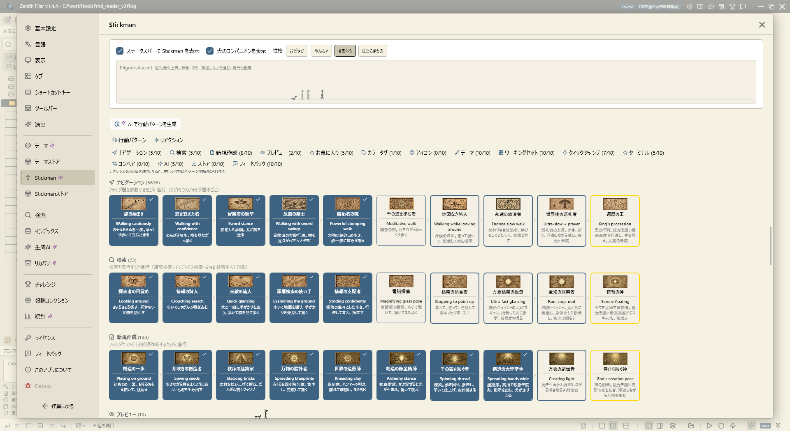

  

  
  
  
  
  

  
  &nbsp;
  

  

 

  <a href="#highlights"><b>Highlights</b></a> ·
  <a href="#download"><b>Download</b></a> ·
  <a href="#free--pro"><b>Free &amp; Pro</b></a> ·
  <a href="#features"><b>Features</b></a> ·
  <a href="https://sulkyjp.github.io/zenithFiler_update/"><b>Manual</b></a> ·
  <a href="#latest-changes"><b>Latest changes</b></a> ·
  <a href="#license"><b>License</b></a> ·
  <a href="#feedback"><b>Feedback</b></a>

## Highlights

<table>
  <tr>
    <td width="50%" valign="top">
      <h3>⚡ Fast</h3>
      Starts in about a second, and every operation runs asynchronously. Tuned on real measurements to stay responsive even on corporate PCs weighed down by antivirus software.
    </td>
    <td width="50%" valign="top">
      <h3>🧭 Never breaks your flow</h3>
      A ring launcher that opens around the cursor, a command palette that finds every action by name, and a shortcut for everything.
    </td>
  </tr>
  <tr>
    <td width="50%" valign="top">
      <h3>🖥 Terminal, macros &amp; AI inside</h3>
      Up to four ConPTY terminals that follow your folders, macros you build without code, and AI that can run fully locally with Ollama. Everything works with AI off.
    </td>
    <td width="50%" valign="top">
      <h3>🎨 Make it yours</h3>
      57 built-in themes, a community theme store, AI theme generation, and 150 achievements that unlock as you use it.
    </td>
  </tr>
</table>

<table>
  <tr>
    <td></td>
    <td></td>
    <td></td>
  </tr>
  <tr>
    <td></td>
    <td></td>
    <td></td>
  </tr>
</table>

Same app, different theme — switch with one click from 57 built-in themes

## Download

<!-- download-table-en:begin -->
| File | Description |
|---|---|
| `ZenithFiler_v2.5.0.zip` | **Full** — includes the .NET runtime. Best for first-time installs or moving to a new machine |
| `ZenithFiler_v2.5.0_delta_from_2.4.0.zip` | **Delta** — only the files that changed since the previous version |
<!-- download-table-en:end -->

> [!TIP]
> **No installer.** Unzip and run `ZenithFiler.exe`. Settings stay next to the app, so it runs from a USB stick too. Once installed, it keeps itself current with automatic delta updates.
> Supported OS: Windows 10 / 11 (x64).

## Free &amp; Pro

|  | Free | Pro |
|---|:---:|:---:|
| Browsing, file operations, terminal, themes, search | ✅ Unlimited | ✅ Unlimited |
| Exports, batch operations, folder sync, theme customization | Daily limit | ✅ Unlimited |
| Macros and AI features | Daily limit | ✅ Unlimited |

  

> [!NOTE]
> **$15, one-time, tax included.** Checkout is handled by [Polar](https://buy.polar.sh/polar_cl_u02Y6qn9QQJCPLre0LwBv58I8Ll2Cg7XYl7pj3PXcyt), which acts as the merchant of record. Your license key is emailed to you within 24 hours; enter it in Control Deck (`Ctrl+Shift+O`) → License.
> Buying from Japan? Use [Vector](https://www.vector.co.jp/soft/winnt/util/se528637.html) instead.

## Features

Click a category to expand it · Every feature is explained in the <a href="https://sulkyjp.github.io/zenithFiler_update/">online manual</a>

<b>🧭 Reach features without moving your hand</b>

| Feature | Description |
|---|---|
| Ring launcher | Press the left and right mouse buttons together and a ring of your 8 most-used actions opens around the cursor. Flick toward one and let go |
| Command palette | `Ctrl+Shift+P` finds and runs any action by name, description, or key — including actions with no shortcut bound |
| Keyboard shortcuts | Every action can be remapped, with JSON export and import. Shortcuts keep working during Japanese/IME input |
| Tabs and two panes | The A pane (center) and B pane (right), each with its own tabs. Single-pane mode is one click away |
| Working sets | Save an entire tab layout and restore it with one click |

<b>📁 File management</b>

| Feature | Description |
|---|---|
| File operations | Copy, move, delete, and rename with undo. Large copies and moves show a progress window with speed and time remaining, where each job can be paused or stopped |
| Drag and drop | Between panes and with other apps; right-drag to choose the action. Dropping onto a shortcut (.lnk) uses its target |
| Batch rename | Rename many files at once with a live preview |
| Batch timestamps & attributes | Change created/modified/accessed times and attributes of many items at once, previewing exactly what will change |
| Archives | Extract and compress ZIP and other formats from the right-click menu, including straight into the other pane |
| Folder compare & sync | Compare the folders in the A and B panes by size, time, or content hash, then sync A → B |
| Hash verification | Compute SHA-256 / SHA-1 / MD5 / CRC-32 and verify against a pasted value — the algorithm is detected automatically |
| FTP / SFTP / FTPS | Server folders open in a pane just like local ones |
| Phones and cameras | Browse MTP devices from the drive list |
| Thumbnails | Image and video thumbnails, freely resizable with `Ctrl+Wheel` |

<b>🖥 Built-in terminal — up to 4 panes, ConPTY</b>

| Feature | Description |
|---|---|
| A real shell | Runs cmd.exe or PowerShell through ConPTY, with correct ANSI 256-color and CJK character widths |
| Up to 4 at once | Four terminals can sit in the nav panes at the same time, each with its own working directory |
| Path sync | `cd` in the terminal moves the A or B pane with it; click a path in the output to open it in a pane |
| Shell integration | Persistent history with `Ctrl+R` search, jump between commands with `Ctrl+↑/↓`, input prediction, and error lines marked in red |
| Claude Code integration | Usage gauge, workspace picker, prompt history, and pasted images converted to file paths automatically |

<b>🤖 AI integration (optional — every feature works with it off)</b>

| Feature | Description |
|---|---|
| Providers | Claude / OpenAI / Azure OpenAI / Gemini / Ollama (local LLM) / Claude Code (CLI) |
| Fully local | With Ollama, nothing leaves your PC. Setup, model download, and server start/stop are handled by the app |
| File operations | AI-assisted renaming, folder organization suggestions, automatic folder creation, favorites cleanup |
| Analysis | Usage statistics analysis, tab-management suggestions, backup summaries |
| Generation | Themes, macros from a sentence, Stickman actions, and achievement titles |
| AI manual | Ask "how do I...?" and get an answer grounded in the manual |

<b>⚙️ Macros</b>

| Feature | Description |
|---|---|
| No-code building | Wire blocks together in Macro Studio, record your actual operations, or describe the macro in a sentence and let AI build it |
| JavaScript underneath | Full access to file operations and navigation through the `zen.*` API |
| Run your way | From the nav pane, the status bar, triggers, or repeatedly — and stop at any time |

<b>🧩 Nav panes — about 20 views</b>

| Feature | Description |
|---|---|
| Views | Favorites, directory tree (with Recycle Bin), recent files, browse history, search, sites (FTP/SFTP), macros, terminal, and more |
| Free layout | Put any view on either side, stack two views, or save the layout as a named preset |
| Detachable | Pop a view out into its own window and snap windows together |
| Automatic favorites | Folders you open often are suggested as favorites automatically |

<b>🔍 Search</b>

| Feature | Description |
|---|---|
| Indexed search | Full-text search powered by Lucene.NET, with Japanese morphological analysis |
| Content search | Fast grep powered by ripgrep |
| Presets and filters | 8 built-in presets plus your own; filter by size, date, and file type |
| Index updates | Real-time, scheduled, or manual; runs only when idle, with an eco mode |

<b>👁 Preview and compare</b>

| Feature | Description |
|---|---|
| Text and code | Live preview for .txt, .json, .bat, .ps1, and more |
| PDF / HTML / images | Paginated PDF, web pages, jpeg/png/gif/webp, and more |
| Office | Excel / CSV (with sheet selection), Word, PowerPoint |
| Text diff | Side-by-side comparison of two files |

<b>🎨 Themes</b>

| Feature | Description |
|---|---|
| 57 built-in themes | 5 categories: Standard / Lifestyle / Professional / Premium / RetroTech, including Plain — white and light gray with no theme color |
| Theme store | Download and rate community themes, or submit your own |
| AI theme generation | Generate a theme from a prompt like "dusk cyberpunk vibes" |
| Per-pane themes | Give the A pane, B pane, and nav panes different themes |
| Customization | Edit any of about 150 color keys; changes are saved separately and never overwrite the original |
| Random / schedule | A random theme on every launch, or automatic day/night switching |
| Fonts and icons | Set font and icon sizes per element |

<b>🏆 Achievements & the Stickman mascot</b>

| Feature | Description |
|---|---|
| 150 achievements | 15 categories × 10 tiers, unlocked naturally through everyday file operations |
| XP, levels, and titles | Level up as you work; AI writes you a title and a backstory |
| Stickman | A mascot living in the status bar that reacts to what you do. Its repertoire grows as you unlock achievements |
| Sync across PCs | Merge achievements from several PCs through a shared folder |

<b>🪟 System integration</b>

| Feature | Description |
|---|---|
| Automatic updates | Delta updates download only what changed |
| Background mode | Lives in the system tray and appears instantly with a global hotkey |
| Window snapping and presets | Snap to 8 layouts (halves and quarters), or save named positions and apply them on launch |
| Multi-monitor rescue | Brings the window back if a disconnected display leaves it off-screen |
| Explorer integration | The Windows context menu, including Windows 11-style entries — or the app's own menu |
| Box Drive | Detects Box paths and copies share links |
| 10 languages | English, Japanese, Chinese (Simplified/Traditional), Korean, German, Spanish, French, Russian, Portuguese — switch without restarting |
| Built-in manual | Per-feature manual and changelog inside the app |

<b>📸 Screenshots</b>

 
Stickman — a mascot whose repertoire grows as you unlock achievements 

  
The AI-generated title and backstory built from your achievements 

  
Two-pane mode 

  
Single-pane mode 

  
Sending feedback from inside the app 

  
The built-in manual (follows the language setting) 

  
The app's own context menu and the Explorer-compatible menu 

  
Automatic updates 

## Latest changes

<b>Show the notes for the latest release</b>

<!-- latest-changes-en:begin -->
**[2.5.0] - 2026-11-25 : Every feature can now be found from the ≡ in the title bar, a menu bar opened with Alt or F10, and the command palette; the menu bar shows what is on, searches every menu, and adds Recent and pinned buttons; text size can be changed almost everywhere; adds the Zenith Link connection to the Zenith Deck keyboard; the first start after a while is faster; fixes include the Photos arrow keys and the F2 extension prompt**

### Added

- **Zenith Link, the link with the Zenith Deck custom keyboard, now sends ZenithFiler's state and lets you operate ZenithFiler from the keyboard (#395)** [Preview 2.4.0.2] — When "Zenith Link (custom keyboard)" under Control Deck → General → External devices is on (off by default), ZenithFiler now sends more than whether it is in front: the active pane (A / B) and whether one or two panes are shown, the folder in each pane, the tab number and count, the name of a renamed tab, how many items are selected and their size, the sort column and direction, and the theme colors and name, all shown on the keyboard's display. Only changes are sent. Copy and move progress (percentage, speed, items left, time left, current file name, paused, failed) is sent even while ZenithFiler is in the background. It also reports search start and result count, no results, adding a favorite, level-ups, theme changes, and errors. From the keyboard's buttons and knobs, you can run ZenithFiler actions by name. ZenithFiler runs only actions listed in the keyboard shortcut settings and your saved macros, and ignores any other text. Actions run only while a ZenithFiler window is in front, except pausing and cancelling copy and move, which also work in the background. The result (done, no such action, not possible right now, or failed) is sent back to the keyboard. For actions that wait for an answer in a confirmation dialog, ZenithFiler replies "accepted" after 0.3 seconds. Also fixed the link staying on a stale connection until ZenithFiler came to the front when the keyboard was replugged while connected (for example after updating its firmware)
- **Added assignable actions for switching tabs and history in a named pane, cycling the sort column, stepping the view size, moving through files in Quick Preview, and pausing or cancelling copy and move (#395)** [Preview 2.4.0.2] — Actions that name a pane, such as "Next tab in pane A" or "Back in pane B", don't change which pane you are working in. Pane B switches even while hidden in single-pane view, so you can pick where "Copy to the other pane" goes without showing it. "Sort by next column" steps through Name → Date modified → Size → Type → Extension, and "Larger / smaller view" changes the view one step at a time, using the same steps as Ctrl+wheel. "Next file in preview" moves through files while Quick Preview stays open. "Pause / resume copy and move" pauses everything that is running, or resumes the paused ones when nothing is running. None of them has a default key; they appear in the "Shortcut Keys" settings and the command palette
- **Text in menus, the Control Deck, the main window, around the file list, in the navigation pane, in preview, in the terminal frame, in dialogs, in tooltips, in notifications and in the manual window can now be resized, and a new Text size page sets the size of text overall, per area, per kind of text and per screen (#548)** [Preview 2.4.0.3 → 2.4.0.4] — Until now only List text and Tab text could be changed. Text in right-click menus, in menus opened from the buttons at the top and in the Control Deck stayed at a fixed size. A new Text size page right below Display in the Control Deck lets you pick the size of the app's text from five presets: Compact, Standard, Large, Extra large and Maximum. The same five presets and a "Fine-tune per area →" link also sit with the text settings on the Display page. On the new page, a slider sets the overall size from 0.8× to 1.5×, and you can also set a size for each area (menus and the Control Deck) and for each kind of text inside it (for menus, items and shortcut keys; for the Control Deck, page headings, section headings, setting names, body text, descriptions, small notes and the left-side list). Turning on "Set per screen" lets you go further and set sizes for individual Control Deck pages (for example, larger descriptions on the AI page only). The sizes multiply, so switching the preset later keeps the differences you set per area. While you drag the overall slider or a Control Deck slider only its sample text changes, and the app applies it when you let go; sliders for the other areas (menus, the main window, the file list, the navigation pane, dialogs and more) change the app live while you drag. Each row shows the resulting point size, and hovering it shows how the size was worked out. List text and Tab text are still set in points, and the overall size applies to them only when they are on Auto (a number you picked stays exactly that). Anyone can keep the five presets. The sliders and per-area settings can be kept with Pro, and can be tried out live without it (they go back when you close the page). In the Control Deck, text with no size of its own, such as input boxes and lists, grows along with everything else, and places whose height is set by a number of lines, such as theme card descriptions, grow taller with their text. It also applies to the main window (title bar, status bar, the address bar strip, working sets, the key guide and the window layout menus) and around the file list (the search and filter bar, the panels it opens, and column and group headers). Smaller text inside list rows, such as the second line in Content view and the details in Tiles view, grows in proportion to List text. It also applies to the navigation pane (the folder tree, favorites, history, search, properties, the tab list, the AI views and more), to preview (preview in the navigation pane, Quick Preview and the text comparison) and to the terminal frame (tabs, buttons and the settings window; text inside the terminal is still set in the terminal settings). Text inside the rows of the tree, history and similar lists grows together with the "Tree and lists" scale (favorite names and descriptions are still set in points in the favorites settings). It also applies to dialogs (Folder Compare, Batch Rename, Macro Studio, the theme and AI dialogs, confirmation and input windows and more) and to the first-run guide (Welcome, First 5 steps and What's New), and the rows of lists inside dialogs grow together with the dialogs' "Body text" scale. Text on buttons, check boxes, radio buttons and drop-down lists now grows with the "Body text" scale of the area they sit in (before, it stayed at 13 pt whatever the scale). It also applies to tooltips and the notification window and to the manual window (the text, headings and code of articles, plus the contents, search and the edge strips between articles), and Stickman's speech bubble follows the overall size. In Ask AI at the bottom of the page, you can write something like "Make everything a little bigger, but keep the file list as is", and the AI picks the global, area and role multipliers, tries them out right away and shows what it changed with a short explanation (Apply keeps them, Discard goes back to the sizes from before you asked, and Refine… lets you keep adjusting). It uses the AI chosen on the AI page with no limit on how often you ask. In the free version it is a trial only and goes back when you close the page. The AI never changes List text or Tab text. Turn on Match sizes across the app, next to the presets, to bring the regular text that varied between 11 and 13pt from area to area up to 13pt, descriptions to 12pt and small notes to 11pt (tabs, the path, the search box and favorites in the navigation pane all end up at 13pt). Nothing gets smaller, it works together with the presets and the per-area settings, and it is free to keep. The same switch is on the Display page. Size profiles at the top of the page keep the overall scale, the per-area scales and size matching together under a name (Save current settings…; up to 30 of your own, which you can rename, delete, and export to a `.json` file to import on another PC). Five recommended profiles come with the app, each tuned role by role: Matched; Easier small text, which enlarges only descriptions, notes and other small text; Easier reading, with larger body text and quieter headings; More on screen, which tightens headings and body text without shrinking small text; and Screen sharing, extra large overall without blowing up the Control Deck. Apply replaces all three at once (Undo right afterwards puts things back; you can also pick a profile from the drop-down on the Display page). Saving and importing work in the free version too, and the recommended profiles keep their per-area scales there. When you apply one of your own profiles in the free version, the overall scale and size matching are kept and the per-area scales are a trial. If you change nothing, everything looks the same as before
- **Actions from the right-click menu, the title bar, the status bar, the tab strip and the toolbar can now be found and run by name from the command palette (#550)** — The command palette promised to "find and run any action by name", but it only reached actions listed in the shortcut settings. Actions that live only in the right-click menu were out of reach: compressing and extracting, exporting to Excel or CSV, converting to PDF, comparing text files, hashes, batch timestamps, copying names and paths, opening in a new tab or the other pane, running as administrator, switching the sort and grouping, and more. These 74 actions are now in the palette. So are 33 actions that only had a button in the title bar, the status bar, the tab strip or the pane toolbar: minimizing, closing the window, exiting Zenith Filer (even in resident mode), moving the window to the main screen or the screen with the cursor, always on top, turning generative AI on or off, screen capture, the log folder and today's log, cancelling the running operation or indexing, a new macro and Macro Studio, the achievement and title history, Bridge and terminal tabs, the tab's name and color, locking, moving the selected tabs to the other pane, going home, to the desktop or to Downloads, opening the current folder in File Explorer, comparing folders, bringing in folders from File Explorer, and creating folders with AI. Picking one does exactly what the right-click item does, for the files and folders you have selected (or for the current folder when nothing is selected). Behind the scenes the palette builds the right-click menu and presses the same item, so the conditions and the work stay in one place. When an action isn't available for the current selection (comparing text without two files selected, for example) or you've used up the free uses, the palette says the action can't run right now. The same actions can also be bound to keys under Control Deck → Shortcuts. Items that Windows or other apps add to the right-click menu (the contents of New, cloud and app items) are not included. This is the first step of making every feature reachable from the palette and from pull-down menus; the remaining places (Control Deck, navigation pane, terminal, Bridge and others) will follow

- **The ≡ in the title bar, and a menu bar shown by pressing and releasing Alt or pressing F10, now open pull-down menus for browsing the app's features (#550)** — Each new feature added another entry to the navigation pane, and it had become hard to tell where things were. To make features findable without knowing their names, there are now classic pull-down menus. Click ≡ and follow a heading (File, Edit, View, Go, Search, Tools, AI, Options, Help) through its submenus to run any feature that's in the palette. It isn't a single page of every feature because hundreds of items at once are tiring to search through; every menu has at most 15 items and nothing is more than three levels deep. Items you can't use for the current selection stay grayed out in the same place instead of disappearing, and pointing at one tells you why, so the way to each feature never changes. Rest the pointer on an item for a moment and, below the menu, you see what the feature does (every item has a two-to-four-sentence description), where its settings are, and the other ways to run it (its key, buttons, right-click, and the name to type in the command palette); each row of the command palette shows the same description (it never covers the items; turn it off with "Describe menu items on hover" under Shortcuts in the Control Deck). Pro features with free uses show how many are left, such as "Pro · 2 left", and are grayed out once they run out. The key bound to each item is shown at the right. While the menu is open, you can also open a heading with its underlined letter (F for File). As in File Explorer, pressing and releasing `Alt` on its own, or pressing `F10`, shows a menu bar over the top of the active pane, as wide as that pane, so where it appears tells you which pane it acts on (it doesn't push the file list down and takes no space the rest of the time). Open a heading with its underlined letter, `Left` / `Right` and `Enter`, and close it with `Esc`. It doesn't appear when `Alt` is pressed with another key such as `Alt+D`, during IME composition, or inside the terminal. To turn it off, clear "Show the menu bar with Alt or F10" under Shortcuts in the Control Deck. By default, each pane has its own menu bar above its tab strip ("Always show the menu bar" on the same page, on by default; turn it off to show it only when you press `Alt` or `F10`; the button at the right end of the bar also hides it on the spot, and hovering over that button explains that `Alt` and `F10` still show it for a moment and where to turn it back on; on a bar shown for a moment with `Alt` or `F10`, the button at the right end switches to keeping it visible); each pane's menu acts on that pane, it uses the tab strip's colors, and the active pane's bar takes the same highlight as its tab strip. The menu bar's colors match the pane's tab strip so it fits in with every theme, and its headings and the button at its right end use the same color and size as the icons at the right of the tab strip; the items in the open menus and their descriptions use the same color. Every item has an icon, and on/off items show ✓ when on while pick-one items (layout, sort, group by) show ● on the current choice, so the current state is visible as soon as a menu opens (the command palette rows show the same icons). Heading underlines appear only while you hold `Alt`, the highlight slides between headings, moving to the next heading with a menu open swaps it in place without flicker, and a light runs once under the heading when a menu opens. Typing while a menu is open (or 🔍 / `/`) searches every menu, and results show where each item lives (such as "View ▸ Sort by"). Recent at the far left of the menu bar lists the last ten items you used, and Repeat: … in the Edit menu runs the last action again. Right-click an item to assign it a key on the spot (opens the Shortcuts page filtered to it) or pin it to the menu bar as a one-click icon button (up to 12). The Options menu lists the 24 Control Deck pages, grouped as on the left of the Control Deck. From the command palette you can open each page and run the buttons on them by name (57, such as picking a random theme, backing up settings now, exporting shortcut keys and checking for updates); typing a name also lists individual settings as "Setting: …", which take you to that item on its page. Buttons that act at once and can't be undone (resetting statistics, resetting all shortcut keys and so on) aren't pressed; you're taken to the button instead. Buttons in the navigation pane views, above the file list, in the terminal and in the bridge (77, such as Collapse all in Favorites, Rebuild now in the index, Regular expression in the search bar, Launch Claude and dotnet run in the terminal, and Fetch now in the bridge) can also be run by name from the command palette; if the view is closed, it opens first. The ≡ used to open the command palette; the palette now opens with `Ctrl+Shift+P` or Help → Find by name… in the menu
### Changed

- **The window now appears sooner on the first start after the app hasn't been used for a while (#549)** [Preview 2.4.0.3] — A user reported that the first start after a while took more than 10 seconds before the window appeared. Before showing the window, the app was doing four things the first view doesn't need. First, it built the part that shows a tab's contents for placeholder empty tabs and for tabs that were only briefly selected while tabs were being restored, then threw them away: five were built and only two were used. Now the part is built only for the selected tab, once restoring is done. Second, it loaded a set of components it otherwise rarely uses (about 18 MB) just to keep the window on screen. It now asks Windows directly. The same components were also loaded after the window appeared, to apply the startup window layout preset, fit right-click menus to the screen height, and position Control Deck, a detached navigation pane, and the manual window. All of these now ask Windows directly too, so in normal use the components are no longer loaded at all. Monitors are still matched by name first, then by number, and the main monitor is used when neither is found. Third, it checked whether Ollama was running on every start, whatever AI provider you use. It now checks only when you open "AI" in Control Deck while Ollama is your provider, when you switch to Ollama, or when you open the Ollama tab. Fourth, if the folder tree was selected in a closed navigation pane, it still listed drives and devices and expanded the tree to the current folder. The tree now catches up to the current folder when you open the navigation pane. With auto-hide on, it still loads at startup as before, because the pane can slide out at any time. In our measurements, the window appeared in about 3.0 seconds instead of 4.3 on a first start after a while, and in about 1.6 seconds instead of 2.5 on a repeat start, and about 23 MB less is loaded before the window appears

### Fixed

- **Fixed questions in the AI Manual view in the nav pane not counting toward the free version's limit (2 a day) (#550)** — Opening the dialog counted a use, but asking from the nav pane view did not, so the free version could use it without limit. The view now counts one use the first time you ask after opening it (the same as opening the dialog; asking more doesn't add to the count). When you've used up the free uses, it tells you instead of sending the question
- **Fixed the Photos app's left and right arrow keys sometimes not moving to the next image for the first image opened after Zenith Filer starts (#396)** [Preview 2.4.0.1] — Since 1.17.3, opening an image or video also passes a list of the files in the same folder, so the Photos app can move to the next image with the arrow keys. Preparing that list was cut off after 1.5 seconds, and if it wasn't ready, the file was opened without the list and nothing told you. The first time after the app starts, preparing the list also loads a Windows component. On slower PCs that first attempt could miss the deadline, and the arrow keys did nothing. The first attempt now waits up to 3 seconds. After that it still switches over after 1.5 seconds, so opening files on Box or network locations doesn't keep you waiting. A successful open with the list is now logged too, so if the arrow keys still don't work, it's clear the receiving app isn't using the list
- **Fixed pressing Enter at the "change the file extension?" prompt after F2 sometimes opening the selected file instead of answering the prompt (#546)** [Preview 2.4.0.1] — Changing a file's extension while renaming asks whether you really want to change it, since the file may become unusable. When that prompt appeared right after the F2 rename window was closed with Enter, Windows could bring the main window back to the front a moment later. The prompt was still visible, but the main window had the keyboard, so Enter went to the file list and opened the selected file. While a confirmation or warning dialog is open, the main window can no longer be used, just as with the rename window, and the dialog is brought back to the front a few times right after it appears. Enter now goes to the prompt's default button (Yes)
- **Fixed the Apply button in the navigation pane layout window turning gray after just toggling a check box (#547)** [Preview 2.4.0.1] — In the "Edit pane layout" window, the top-left slot cannot be empty. Unchecking the view shown there, moving it to the bottom bar, or moving it to another slot left the top-left empty, so Apply stayed gray with only a small red note below explaining why. When the top-left becomes empty, it now shows the first view still on the top-left bar, in bar order. Views shown in another slot are skipped so that they do not disappear from there. Only when no other view is left on the top-left bar does it stop and show the reason as before

> See [Releases](https://github.com/sulkyjp/zenithFiler_update/releases) for the full history.
<!-- latest-changes-en:end -->

## License

Zenith Filer is **proprietary software, not open source**. © 2024-2026 K.AKASAKA. All rights reserved.

- Free to download and try. **Personal and commercial use** are both allowed
- **One license key per person** — install it on the devices you use yourself, one at a time
- Redistribution, resale, and reverse engineering are not permitted

Read the full terms in the [EULA](EULA_en.md) · Summary: [LICENSE](LICENSE.md)

Windows is a trademark of the Microsoft group of companies. Claude, OpenAI, Azure, Gemini, Ollama, Box, and other product and company names mentioned are trademarks or registered trademarks of their respective owners. Zenith Filer is an independent product and is not affiliated with or endorsed by them.

## Feedback

> [!IMPORTANT]
> Please send requests and bug reports from **inside the app: Settings → Feedback**. No account is needed. This repository only hosts the release files and is not monitored as a support channel.

- **Replies reach you in the app**, under *Feedback history*
- **When a fix ships, the app asks whether it worked**, so a report is followed through to the end

**Enjoying Zenith Filer?** A like or a short review on [AlternativeTo](https://alternativeto.net/software/zenith-filer/about/) helps other people looking for a file manager find it.

<a href="#japanese">日本語のご案内へ ↓</a>

 

  <a href="#ja-highlights"><b>特長</b></a> ·
  <a href="#ja-download"><b>ダウンロード</b></a> ·
  <a href="#ja-pro"><b>無料版と Pro</b></a> ·
  <a href="#ja-features"><b>主な機能</b></a> ·
  <a href="https://sulkyjp.github.io/zenithFiler_update/ja/"><b>マニュアル</b></a> ·
  <a href="#ja-changes"><b>最新の変更履歴</b></a> ·
  <a href="#ja-license"><b>ライセンス</b></a> ·
  <a href="#ja-feedback"><b>フィードバック</b></a>

## 特長

<table>
  <tr>
    <td width="50%" valign="top">
      <h3>⚡ 速い</h3>
      起動は約 1 秒、すべての操作を非同期で処理。ウイルス対策ソフトで重い社用 PC でも軽快に動くよう、実測にもとづいて最適化しています。
    </td>
    <td width="50%" valign="top">
      <h3>🧭 手を止めずに届く</h3>
      カーソルのまわりに開くリングランチャー、名前で全機能を探せるコマンドパレット、すべての操作に割り当てられるショートカット。
    </td>
  </tr>
  <tr>
    <td width="50%" valign="top">
      <h3>🖥 ターミナル・マクロ・AI が中にある</h3>
      フォルダに追従する ConPTY ターミナルを最大 4 面、コードを書かずに作れるマクロ、Ollama なら完全ローカルで動く AI。AI をオフにしても全機能そのまま使えます。
    </td>
    <td width="50%" valign="top">
      <h3>🎨 育てられる</h3>
      内蔵テーマ 57 種、コミュニティのテーマストア、AI によるテーマ生成、使い込むほど解除される実績 150 種。
    </td>
  </tr>
</table>

## ダウンロード

<!-- download-table-ja:begin -->
| ファイル | 説明 |
|---|---|
| `ZenithFiler_v2.5.0.zip` | **完全版** — .NET ランタイム同梱。初回導入や環境移行に |
| `ZenithFiler_v2.5.0_delta_from_2.4.0.zip` | **差分版** — 前バージョンから変更されたファイルのみ |
<!-- download-table-ja:end -->

> [!TIP]
> **インストール不要。** ZIP を展開して `ZenithFiler.exe` を起動するだけです。設定はアプリの隣に保存されるので、USB メモリからも使えます。導入後は差分の自動アップデートで最新に保たれます。
> 対応 OS: Windows 10 / 11（x64）

## 無料版と Pro

|  | 無料版 | Pro |
|---|:---:|:---:|
| 閲覧・ファイル操作・ターミナル・テーマ・検索 | ✅ 無制限 | ✅ 無制限 |
| 書き出し・一括処理・フォルダ同期・テーマのカスタマイズ | 1 日の回数制限 | ✅ 無制限 |
| マクロ・AI 機能 | 1 日の回数制限 | ✅ 無制限 |

> [!NOTE]
> **Pro ライセンスは [Vector](https://www.vector.co.jp/soft/winnt/util/se528637.html) で購入できます**（Vector からのダウンロードも可能です）。

## 主な機能

| 分野 | できること |
|---|---|
| 🧭 手を止めずに届く | リングランチャー（左右ボタン同時押し）、コマンドパレット（`Ctrl+Shift+P`）、全操作のキー割り当て、ワーキングセット |
| 📁 ファイル管理 | 取り消し付きのファイル操作と進捗ウィンドウ、一括リネーム、日時・属性の一括変更、書庫の展開・圧縮、フォルダ比較・同期、ハッシュ照合、FTP / SFTP / FTPS、スマホ・カメラの閲覧、画像・動画サムネイル |
| 🖥 内蔵ターミナル | ConPTY で最大 4 面、ペインとのパス連動、コマンド履歴の検索、Claude Code 連携 |
| 🤖 AI 連携 | Claude / OpenAI / Azure OpenAI / Gemini / Ollama / Claude Code。AI リネーム、フォルダ整理、文章からのマクロ生成、AI マニュアル |
| ⚙️ マクロ | Macro Studio のブロック組み立て・操作の記録・文章からの生成。中身は JavaScript |
| 🧩 ナビペイン | 約 20 のビューを好きな位置へ、2 段重ね、別ウィンドウへの切り離し、よく開くフォルダの自動お気に入り |
| 🔍 検索 | Lucene.NET と日本語形態素解析による全文検索、ripgrep による内容検索、プリセットとフィルタ |
| 👁 プレビュー | テキスト・コード、PDF、HTML、画像、Excel / CSV / Word / PowerPoint、テキスト差分 |
| 🎨 テーマ | 内蔵 57 種（テーマカラーを持たない白とライトグレーの Plain も）、テーマストア、AI 生成、ペイン別テーマ、約 150 の色キーの編集 |
| 🏆 実績と Stickman | 実績 150 種、XP・レベル・AI が授ける二つ名、操作に反応するマスコット |
| 🪟 システム統合 | 差分自動アップデート、タスクトレイ常駐、ウィンドウスナップと配置プリセット、Explorer のメニュー、Box Drive、10 言語 |

各機能の詳細は、<a href="https://sulkyjp.github.io/zenithFiler_update/ja/">オンラインのマニュアル</a>（アプリ内のマニュアルと同じ内容）をご覧ください。

## 最新の変更履歴

<b>最新リリースの内容を表示</b>

<!-- latest-changes-ja:begin -->
**[2.5.0] - 2026-11-25 : アプリの機能をタイトルバーの ≡・Alt と F10 のメニューバー・コマンドパレットからたどって探せるようにし、メニューバーに状態の印・全メニューの検索・最近・ピン留めを足し、画面のほぼすべての文字の大きさを変えられるようにし、自作キーボード Zenith Deck との連携を足し、しばらくぶりの起動を速くし、フォトの左右キー・F2 の拡張子の確認などを直した**

### Added

- **自作キーボード Zenith Deck との連携「Zenith Link」で、ZenithFiler の状態を送り、キーボードから ZenithFiler を操作できるようにしました (#395)** 〔先行版 2.4.0.2〕 — Control Deck →「基本設定」→「外部機器」の「Zenith Link（自作キーボードとの連携）」をオンにしているとき（既定オフ）、これまでの「前面にあるか」に加えて、キーボードの液晶に出す状態を送ります。操作中のペイン（A / B）と 1 画面か 2 画面か、両方のペインのフォルダ、タブの番号と数、名前を付けたタブの名前、選んでいる数と大きさ、並びの列と向き、テーマの色と名前です。変わったときだけ送ります。コピー・移動の進み具合（割合・速さ・残りの数・残り時間・今のファイル名・一時停止・失敗）は、ZenithFiler が裏にいても送ります。検索の開始と件数・0 件・お気に入りへの追加・レベルアップ・テーマの変更・エラーも知らせます。キーボードのボタンやノブからは、操作の名前を送って ZenithFiler を動かせます。ZenithFiler は、ショートカットキーの設定に載っている操作と保存したマクロだけを実行し、それ以外の文字列は実行しません。実行するのは ZenithFiler のどれかの窓が前面にあるときだけで、コピー・移動の一時停止と中止だけは裏にいても効きます。結果（できた・その操作は無い・今はできない・失敗した）はキーボードへ返します。確認のダイアログで答えを待つ操作は、0.3 秒たったら先に「受け付けた」と返します。つながったまま抜き差ししたとき（キーボードの書き換えなど）に、前面に出すまで古いつながりのままだったのも直しました
- **ペインを名指しするタブ送りと履歴・並びの列の送り・表示の大きさの送り・プレビューの前後・コピーと移動の一時停止と中止を、キーに割り当てられるようにしました (#395)** 〔先行版 2.4.0.2〕 — 「A ペインの次のタブ」「B ペインで戻る」のように、どちらのペインかを名指しする操作は、操作するペインを替えません。B ペインは 1 画面で隠れていても切り替わるので、反対のペインへコピーする先を、隠したまま選べます。「並びを次の列へ」は名前 → 更新日時 → サイズ → 種類 → 拡張子の順に送り、「表示を大きく／小さく」は Ctrl+ホイールと同じ段で 1 段ずつ変えます。「プレビューで次のファイル」はクイックプレビューを開いたまま前後へ送ります。「コピー・移動を一時停止／再開」は動いているものをまとめて止め、どれも動いていなければ止めていたものを再開します。どれも既定のキーは無く、設定の「ショートカットキー」とコマンドパレットに出ます
- **メニュー・Control Deck・メインの窓・一覧のまわり・ナビペイン・プレビュー・ターミナルの枠・ダイアログ・ツールチップ・知らせ・マニュアルの窓の文字の大きさを変えられるようにし、文字の大きさを全体・場所・役割・画面ごとに決める「文字の大きさ」のページを足しました (#548)** 〔先行版 2.4.0.3 → 2.4.0.4〕 — これまで変えられたのは、一覧の文字とタブの文字だけでした。右クリックのメニューや上のボタンから開くメニュー、Control Deck の文字は、決まった大きさのままでした。Control Deck の「表示」のすぐ下に「文字の大きさ」のページを足し、アプリ全体の文字の大きさを「コンパクト」「標準」「大きめ」「特大」「最大」の 5 段から選べるようにしました。「表示」のページの文字の欄にも同じ 5 段と「場所ごとに細かく決める →」を置いています。ページでは、全体の倍率をスライダーで 0.8〜1.5 倍に決められ、場所（メニュー・Control Deck）ごとの倍率と、その中の役割（メニューなら項目・ショートカットキー、Control Deck ならページの見出し・区切りの見出し・項目の名前・本文・説明・注釈・左の並び）ごとの倍率も決められます。「画面ごとに決める」をオンにすると、Control Deck のページごと（「AI」のページの説明だけ大きく、など）にも決められます。倍率は掛け合わせで効くので、あとで全体の段を変えても、場所ごとに決めた差はそのまま残ります。スライダーは、Control Deck の場所と全体のものは動かしている間は見本の文字だけが変わって離したときに画面へ当たり、ほかの場所（メニュー・メインの窓・一覧・ナビペイン・ダイアログなど）のものは動かしている間にもその場で変わります。各行には実際の大きさ（pt）が出て、マウスを乗せると計算の内訳が出ます。一覧の文字・タブの文字は今までどおり pt で決め、「自動」のときだけ全体の倍率が掛かります（数字を決めているときはその数字のまま）。5 段は誰でも保存して使えます。スライダーと場所ごとの調整は Pro で保存して使え、Pro でなくても試しに当てて見られます（ページを閉じると元に戻ります）。Control Deck では、入力欄や一覧のように大きさを決めていない文字も一緒に大きくなり、テーマカードの説明のように行数で高さを決めている所は、文字と一緒に高さも伸びます。メインの窓（タイトルバー・ステータスバー・アドレスバーの帯・ワーキングセット・キーガイド・窓の配置のメニュー）と、ファイル一覧のまわり（検索と絞り込みの帯・そこから開く欄・列とグループの見出し）にも効きます。一覧の行の中の小さい文字（コンテンツ表示の 2 行目・並べて表示の説明など）は、一覧の文字に合わせて同じ割合で大きくなります。ナビペイン（フォルダツリー・お気に入り・履歴・検索・プロパティ・タブ一覧・AI のビューなど）・プレビュー（ナビペインのプレビュー・クイックプレビュー・テキストの比較）・ターミナルの枠（タブ・ボタン・設定の窓。端末の中の文字は今までどおりターミナルの設定で決めます）にも効きます。ナビペインのツリーや履歴の行の中の文字は、「ツリーと一覧」の倍率に合わせて一緒に大きくなります（お気に入りの名前と説明は、今までどおりお気に入りの設定の pt で決めます）。ダイアログ（フォルダの比較・一括リネーム・マクロスタジオ・テーマや AI のダイアログ・確認や入力の窓など）と初回の案内（ウェルカム・「はじめの 5 つ」・更新のお知らせ）にも効き、ダイアログの中の一覧の行もダイアログの「本文」の倍率で一緒に大きくなります。ボタン・チェックボックス・ラジオ・ドロップダウンの文字も、置いてある場所の「本文」の倍率で一緒に大きくなります（これまでは倍率を変えても 13pt のままでした）。ツールチップと知らせの窓・マニュアルの窓（記事の本文・見出し・コードと、目次・検索・記事の端の帯）にも効き、Stickman の吹き出しも全体の大きさに合わせて変わります。ページの下の「AI に頼む」に「全体に少し大きく。ただし一覧はそのまま」のように書くと、AI が全体・場所・役割の倍率を決めてその場で試しに当て、変えたところの一覧と一言の説明を出します（「適用」で残し、「やめる」で頼む前に戻し、「もう少し…」で続けて直せます。使う AI は「生成AI」のページで選んだもので、回数の制限はありません。無料版では試しに当てるだけで、ページを閉じると戻ります。一覧の文字・タブの文字は AI には変えさせません）。傾向の 5 段の横の「場所をまたいで大きさをそろえる」をオンにすると、場所ごとに 11〜13pt に分かれていたふつうの文字を 13pt、説明を 12pt、小さな字を 11pt にそろえます（タブ・パス・検索の欄・ナビペインのお気に入りがそろって 13pt になります。小さくなるものはなく、傾向の段や場所ごとの調整と一緒に使え、無料でも保存して使えます。「表示」のページにも同じスイッチがあります）。ページの先頭の **プリセット** には、全体の倍率・場所ごとの倍率・「そろえる」をまとめて名前を付けて取っておけます（「今の設定を保存…」。自分のプリセットは 30 個まで・名前の変更と削除もでき、`.json` に書き出して別の PC で読み込めます）。アプリが用意したおすすめも 5 つ並びます。「そろえる」・説明や注釈など小さな字だけを大きくする「小さな字を読みやすく」・本文を大きくして見出しを控えめにする「文章を読みやすく」・見出しと本文を詰めて小さな字は小さくしない「情報量を多く」・全体を特大にして Control Deck は大きくしすぎない「画面共有・発表向け」で、どれも役割ごとの倍率まで決めてあります。「当てる」で 3 つをまとめて置き換えます（直後なら「元に戻す」で戻せます。「表示」のページのドロップダウンからも選べます）。無料版でも保存・読み込みができ、おすすめは場所ごとの倍率まで保存して使えます。自分のプリセットを当てたときは、全体の倍率と「そろえる」が残り、場所ごとの倍率は試しに当たります。何も変えなければ、見た目は今と同じです
- **右クリック・タイトルバー・ステータスバー・タブ帯・ツールバーの機能を、コマンドパレットから名前で探して実行できるようにしました (#550)** — コマンドパレットは「すべての操作を名前で探して実行できます」とうたっていましたが、実際に届くのはキーの設定に載っている操作だけでした。圧縮・展開、Excel／CSV への書き出し、PDF への変換、テキストの比較、ハッシュ、一括スタンプ、名前やパスのコピー、新しいタブや反対のペインで開く、管理者として実行、並べ替えやグループ化の切り替えなど、右クリックにしか無い機能には届いていませんでした。これらの 74 の機能をパレットに載せました。あわせて、タイトルバー・ステータスバー・タブ帯・ペインのツールバーのボタンにしか無かった 33 の機能（最小化・窓を閉じる・Zenith Filer の終了〔常駐モードでも〕・メイン画面やカーソルのある画面への移動・常に最前面・生成 AI のオン・オフ・画面キャプチャ・ログのフォルダと今日のログ・実行中の処理やインデックス作成の中止・新しいマクロと Macro Studio・実績と二つ名の履歴・ブリッジとターミナルのタブ・タブの名前と色・ロック・選んだタブを反対のペインへ・ホーム・デスクトップ・ダウンロードへ・今のフォルダをエクスプローラーで開く・フォルダの比較・エクスプローラーからの取り込み・AI でフォルダを作る）も載せました。パレットで選ぶと、そのときに選んでいるファイル・フォルダ（何も選んでいなければ今のフォルダ）に対して、右クリックで選んだときと同じことをします。右クリックのメニューを裏で組み立てて同じ項目を押す作りなので、出す条件も処理も右クリックと 1 つのままです。いまの選択では右クリックに出ない機能（ファイルを 2 つ選んでいないときのテキスト比較など）や、無料で使える回数を使い切った機能は「この操作はいま実行できません」と知らせます。同じ機能は Control Deck →「ショートカット」でキーにも割り当てられます。Windows やほかのアプリが右クリックに足した項目（「新規作成」の中身・クラウド・アプリの項目）は載せていません。アプリのすべての機能をパレットとプルダウンのメニューから届くようにする作り直しの 1 段目で、残りの入口（Control Deck・ナビペイン・ターミナル・ブリッジなど）は続けて載せます

- **タイトルバーの ≡ と、Alt を押して離す・F10 で出すメニューバーから、アプリの機能をプルダウンのメニューでたどれるようにしました (#550)** — 機能が増えるたびにナビペインへ入口を足してきたので、どこに何があるか分かりにくくなっていました。名前を知らなくても見つけられるよう、昔ながらのプルダウンのメニューを足しました。≡ を押すと、見出し（ファイル・編集・表示・移動・検索・ツール・AI・設定・ヘルプ）からサブメニューをたどって、パレットに載せた機能を実行できます。一面に機能を並べる形にしなかったのは、数百の機能が一度に並ぶと探すのに疲れるからで、1 つのメニューは 15 項目まで、深さは 3 段までにそろえました。いまの選択では使えない項目は、隠さずに灰色で同じ場所に置き、マウスを乗せると理由が出ます（いつも同じ道順で見つけられるように）。項目にマウスを乗せて少し止めると、メニューの下に、その機能が何をするか（すべての項目に 2〜4 文の説明を書きました）・関わる設定の場所・ほかの入口（キー・ボタン・右クリック・コマンドパレットで打つ名前）が出ます。コマンドパレットの各行にも同じ説明が出ます（項目には重なりません。Control Deck の「ショートカットキー」の「メニューの項目に乗せると説明を出す」でオフにできます）。無料で使える回数がある Pro の機能には「Pro・残り 2 回」のように残りの回数を出し、使い切ると灰色になります。右端には割り当てたキーが出ます。見出しはメニューが開いているときに下線の文字（ファイルなら F）でも開けます。エクスプローラーと同じく、`Alt` を単独で押して離すか `F10` を押すと、操作中のペインの上端に、そのペインの幅でメニューバーが重なって出ます。出た場所で、どちらのペインに効くかが分かります（一覧は押し下げず、ふだんは画面を使いません）。見出しの下線の文字・`←` `→`・`Enter` で開き、`Esc` で閉じます。`Alt+D` のようにほかのキーと一緒に押したときや、日本語の変換中・ターミナルの中では出しません。出したくないときは Control Deck の「ショートカット」の「Alt や F10 でメニューバーを出す」でオフにできます。はじめは、ペインごとにタブの帯の上へメニューバーを 1 本ずつ出しています（同じページの「メニューバーを常に出す」・既定オン。オフにすると `Alt`・`F10` を押したときだけ出ます）。バーの右端のボタンを押してもその場で隠せ、マウスを乗せると、隠したあとも `Alt`・`F10` で一時的に出せることと、また常に出すときの設定の場所が出ます。`Alt`・`F10` で一時的に出したバーの右端のボタンを押すと、常に出す表示に切り替わります。そのペインのメニューはそのペインに効き、色はタブの帯と同じで、操作中のペインのバーはタブの帯と同じ色で光ります。メニューバーの色は、どのテーマでも周りとなじむよう、ペインのタブの帯と同じ色にそろえ、見出しの文字と右端のボタンの絵は、タブの帯の右のアイコンと同じ色・同じ大きさにし、開いたメニューの項目と説明の文字も同じ色にそろえました。どの項目にも絵が付き、オン・オフの項目はオンのとき ✓、表示の形・並べ替え・グループのように 1 つを選ぶ項目はいま選ばれているものに ● が付くので、開いただけで今の状態が分かります（コマンドパレットの行にも同じ絵）。見出しの下線は `Alt` を押している間だけ出し、選んだ見出しの地は見出しの間を滑って移り、開いたまま隣の見出しへ移ってもプルダウンが閉じ直さずにちらつかず、開いたときは見出しの下を光が 1 回走ります。プルダウンを開いたまま文字を打つと（バーの 🔍・`/` でも）、すべてのメニューから探せて、結果にはメニューの中の場所（「表示 ▸ 並べ替え」など）も出ます。メニューバーの左端の「最近」に最近使った 10 個が並び、「編集」の「もう一度: 〇〇」で直前の操作を繰り返せます。項目を右クリックすると、その場でキーを割り当てる（ショートカットキーのページを絞り込んで開く）か、メニューバーにピン留めして絵のボタンで 1 回で押せるようにできます（12 個まで）。メニューの「設定」には Control Deck の 24 ページを、Control Deck の左と同じまとまりで並べました。コマンドパレットからは、ページを開くことと、ページの中のボタン（テーマをランダムに選び直す・今すぐ設定をバックアップ・ショートカットキーの書き出し・更新を確認など 57）を名前で実行でき、名前を打つと個々の設定も「設定: 〇〇」で出て、選ぶとそのページのその項目へ飛びます。すぐ実行されて元に戻せないボタン（統計のリセット・ショートカットキーをすべて標準に戻すなど）は、押さずにそのボタンまで連れて行きます。ナビペインのビュー・ファイル一覧の上の部品・ターミナル・ブリッジのボタン（77。お気に入りの「すべて折りたたむ」・インデックスの「今すぐ作り直す」・検索バーの「正規表現」・ターミナルの「Claude を起動」「dotnet run」・ブリッジの「すぐ fetch」など）もコマンドパレットから名前で実行でき、ビューが閉じていれば開いてから押します。≡ はこれまでコマンドパレットを開いていましたが、パレットは `Ctrl+Shift+P` と、メニューの「ヘルプ」→「名前で探す…」から開きます
### Changed

- **しばらく起動していなかったあとの最初の起動で、窓が出るまでを短くしました (#549)** 〔先行版 2.4.0.3〕 — 久しぶりに起動すると窓が出るまで 10 秒以上かかる、という報告がありました。調べると、窓を出す前に、最初の表示に要らない準備を 4 つしていました。1 つ目は、タブの中身を表示する部品を、起動中に仮の空のタブや復元の途中で一時的に選ばれるタブの分まで作っては捨てていたことです（5 回作って、使うのは 2 回）。部品は、タブの復元が終わってから、選ばれているタブにだけ作るようにしました。2 つ目は、窓の位置を画面に収めるためだけに、ふだん使わない部品の一式（約 18MB）を読み込んでいたことです。Windows に直接たずねる形に替えました。窓が出たあとにも、起動時のウィンドウ配置のプリセットの適用・右クリックのメニューの高さ合わせ・Control Deck や切り離したナビペイン・マニュアルの窓の位置合わせで同じ部品を読んでいたので、これもすべて替え、ふだんの使い方ではこの部品を読まないようにしました。モニターは、これまでどおり名前で探し、見つからなければ番号で、それも無ければメインのモニターに出します。3 つ目は、AI の使い先が何であっても、起動のたびに Ollama が動いているかを確かめにいっていたことです。確かめるのは、使い先が Ollama のときに Control Deck の「生成AI」を開いたとき、使い先を Ollama に切り替えたとき、Ollama のタブを開いたときだけにしました。4 つ目は、ナビペインを閉じていても、ツリーを選んだままにしていると、ドライブや機器を調べて今のフォルダまで広げていたことです。ナビペインを開いたときに今のフォルダへ追いつかせるようにしました（自動で隠す設定のときは、端に寄せると出てくるので、これまでどおり起動時に読み込みます）。手元の計測では、しばらくぶりの起動で窓が出るまでが約 4.3 秒から約 3.0 秒に、続けての起動では約 2.5 秒から約 1.6 秒になり、窓を出す前に読み込むファイルは約 23MB 減りました

### Fixed

- **ナビペインの AI マニュアルで質問すると、無料版の回数（1 日 2 回）に数えられていなかったのを直しました (#550)** — ダイアログから開いたときは回数に数えていましたが、ナビペインのビューから質問したときは数えておらず、無料版でも何度でも使えていました。ビューを開いてから最初に質問したときに 1 回と数えます（ダイアログを開くときと同じ重さで、そのあとは何度質問しても増えません）。回数を使い切っているときは、質問を送らずに知らせます
- **Zenith Filer を起動して最初に開いた画像で、フォトの左右キーの画像送りが効かないことがあったのを直しました (#396)** 〔先行版 2.4.0.1〕 — 1.17.3 から、画像や動画を開くときは「同じフォルダの一覧」を一緒に渡し、フォトの左右キーで隣の画像へ送れるようにしています。ところが一覧の用意は 1.5 秒で打ち切っていて、間に合わないと知らせずに一覧なしの開き方へ切り替えていました。アプリを起動して最初の 1 回は、一覧を渡すための Windows の部品の読み込みも入ります。読み込みの遅い PC ではこの 1 回目が間に合わず、左右キーで送れないことがありました。最初の 1 回だけ 3 秒まで待つようにしました。2 回目からは、Box やネットワークの場所で開くこと自体を待たせないよう、これまでどおり 1.5 秒で切り替えます。あわせて、一覧をつけて開けたときも記録に残すようにしました。開けたのに送れない場合に、受け取ったアプリの側の問題と見分けるためです
- **F2 で拡張子を変えたときの確認で Enter を押すと、確認ではなく選んでいたファイルが開くことがあったのを直しました (#546)** 〔先行版 2.4.0.1〕 — 名前の変更で拡張子を変えると「拡張子を変更すると、ファイルが使えなくなる可能性があります」と確かめます。F2 の名前の変更の画面を Enter で閉じた直後にこの確認が出ると、閉じた画面のあとに Windows が本体の窓を前へ戻す動きが遅れて届くことがありました。そうなると確認が見えていても本体の窓が前に出たままになり、Enter が一覧へ届いて、選んでいたファイルが開いていました。確認や警告のダイアログを出しているあいだは、名前の変更の画面と同じく本体の窓を操作できないようにし、出した直後に何度かダイアログを前へ出し直すようにしました。Enter は確認の既定のボタン（はい）に届きます
- **ナビペインの配置の画面で、チェックを入り切りしただけで「適用」が押せなくなることがあったのを直しました (#547)** 〔先行版 2.4.0.1〕 — 「ペイン配置をまとめて編集」の画面では、左上の枠は空にできません。左上に出しているビューのチェックを外したり、下段のバーへ移したり、別の枠へ移したりすると左上が空になり、「適用」が灰色のまま、下に小さな赤い字で理由が出るだけでした。左上が空になったら、左上のバーに残っているビューを並び順で先頭から選んで出すようにしました。別の枠に出ているビューは選びません（そちらが消えないように）。左上のバーにほかのビューが残っていないときだけ、これまでどおり理由を出して止めます

> 過去の変更履歴は [Releases](https://github.com/sulkyjp/zenithFiler_update/releases) を参照してください。
<!-- latest-changes-ja:end -->

## ライセンス

Zenith Filer は**著作者が権利を持つ商用ソフトウェアで、オープンソースではありません**。© 2024-2026 K.AKASAKA. All rights reserved.

- 無料でダウンロードして試せます。**個人でも仕事でも**使えます
- **ライセンスキーは 1 人に 1 本**。自分で使う PC に入れられ、同時に使うのは 1 台までです
- 再配布・転売・リバースエンジニアリングは禁止です

全文は[使用許諾契約書（EULA）](EULA_ja.md)、要約は [LICENSE](LICENSE.md) をご覧ください。

Windows は Microsoft グループの商標です。Claude・OpenAI・Azure・Gemini・Ollama・Box など、記載の製品名・会社名は各社の商標または登録商標です。Zenith Filer は独立した製品であり、これらの会社と提携しておらず、推奨も受けていません。

## フィードバック

> [!IMPORTANT]
> 要望・不具合は、**アプリ内の「設定 → フィードバック」**からお送りください。アカウント登録は不要です。このリポジトリは配布物を置くためだけのもので、問い合わせ窓口ではありません。

- 作者からの回答が**アプリ内の「フィードバック履歴」に届きます**
- 修正版が出ると「直った／まだ直っていない」を知らせるボタンが出るので、**最後まで追えます**

<a href="#english">↑ Back to English</a>

---

  © 2024-2026 K.AKASAKA · <a href="LICENSE.md">License</a> · <a href="https://github.com/sulkyjp">sulkyjp</a> · <a href="#english">English</a> · <a href="#japanese">日本語</a>

