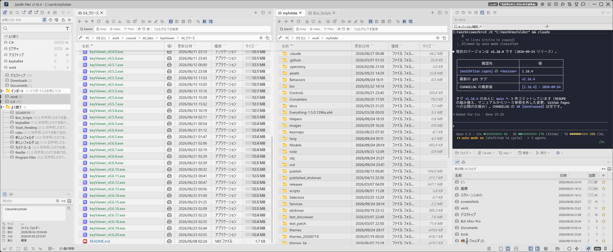
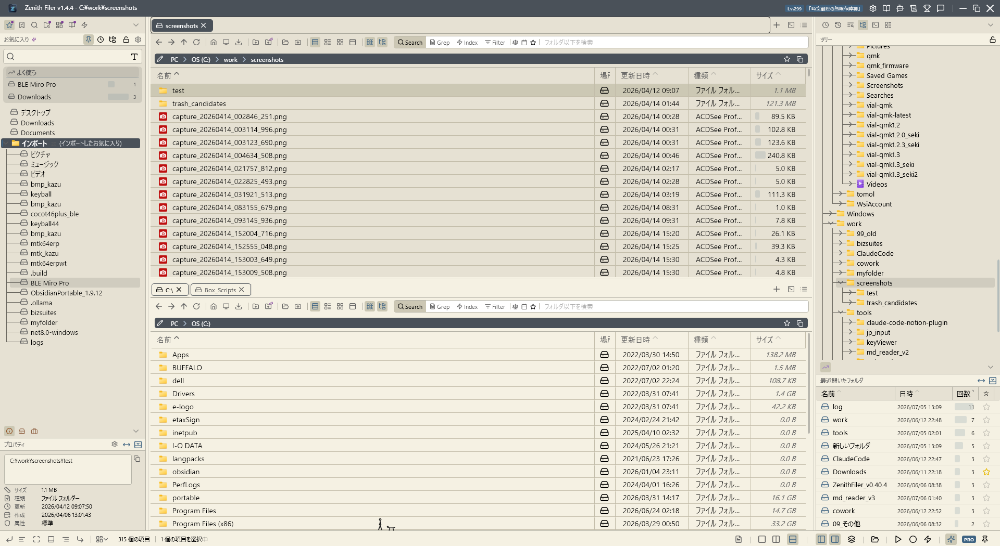
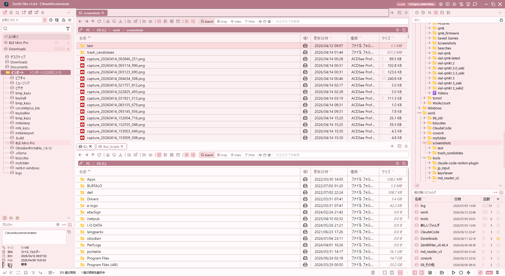

  

  
  
  
  
  

  
  &nbsp;
  

  

 

  <a href="#highlights"><b>Highlights</b></a> ·
  <a href="#download"><b>Download</b></a> ·
  <a href="#free--pro"><b>Free &amp; Pro</b></a> ·
  <a href="#features"><b>Features</b></a> ·
  <a href="https://sulkyjp.github.io/zenithFiler_update/"><b>Manual</b></a> ·
  <a href="#latest-changes"><b>Latest changes</b></a> ·
  <a href="#license"><b>License</b></a> ·
  <a href="#feedback"><b>Feedback</b></a>

## Highlights

<table>
  <tr>
    <td width="50%" valign="top">
      <h3>⚡ Fast</h3>
      Starts in about a second, and every operation runs asynchronously. Tuned on real measurements to stay responsive even on corporate PCs weighed down by antivirus software.
    </td>
    <td width="50%" valign="top">
      <h3>🧭 Never breaks your flow</h3>
      A ring launcher that opens around the cursor, a command palette that finds every action by name, and a shortcut for everything.
    </td>
  </tr>
  <tr>
    <td width="50%" valign="top">
      <h3>🖥 Terminal, macros &amp; AI inside</h3>
      Up to four ConPTY terminals that follow your folders, macros you build without code, and AI that can run fully locally with Ollama. Everything works with AI off.
    </td>
    <td width="50%" valign="top">
      <h3>🎨 Make it yours</h3>
      57 built-in themes, a community theme store, AI theme generation, and 150 achievements that unlock as you use it.
    </td>
  </tr>
</table>

<table>
  <tr>
    <td></td>
    <td></td>
    <td></td>
  </tr>
  <tr>
    <td></td>
    <td></td>
    <td></td>
  </tr>
</table>

Same app, different theme — switch with one click from 57 built-in themes

## Download

<!-- download-table-en:begin -->
| File | Description |
|---|---|
| `ZenithFiler_v2.4.0.zip` | **Full** — includes the .NET runtime. Best for first-time installs or moving to a new machine |
| `ZenithFiler_v2.4.0_delta_from_2.3.0.zip` | **Delta** — only the files that changed since the previous version |
<!-- download-table-en:end -->

> [!TIP]
> **No installer.** Unzip and run `ZenithFiler.exe`. Settings stay next to the app, so it runs from a USB stick too. Once installed, it keeps itself current with automatic delta updates.
> Supported OS: Windows 10 / 11 (x64).

## Free &amp; Pro

|  | Free | Pro |
|---|:---:|:---:|
| Browsing, file operations, terminal, themes, search | ✅ Unlimited | ✅ Unlimited |
| Exports, batch operations, folder sync, theme customization | Daily limit | ✅ Unlimited |
| Macros and AI features | Daily limit | ✅ Unlimited |

  

> [!NOTE]
> **$15, one-time, tax included.** Checkout is handled by [Polar](https://buy.polar.sh/polar_cl_u02Y6qn9QQJCPLre0LwBv58I8Ll2Cg7XYl7pj3PXcyt), which acts as the merchant of record. Your license key is emailed to you within 24 hours; enter it in Control Deck (`Ctrl+Shift+O`) → License.
> Buying from Japan? Use [Vector](https://www.vector.co.jp/soft/winnt/util/se528637.html) instead.

## Features

Click a category to expand it · Every feature is explained in the <a href="https://sulkyjp.github.io/zenithFiler_update/">online manual</a>

<b>🧭 Reach features without moving your hand</b>

| Feature | Description |
|---|---|
| Ring launcher | Press the left and right mouse buttons together and a ring of your 8 most-used actions opens around the cursor. Flick toward one and let go |
| Command palette | `Ctrl+Shift+P` finds and runs any action by name, description, or key — including actions with no shortcut bound |
| Keyboard shortcuts | Every action can be remapped, with JSON export and import. Shortcuts keep working during Japanese/IME input |
| Tabs and two panes | The A pane (center) and B pane (right), each with its own tabs. Single-pane mode is one click away |
| Working sets | Save an entire tab layout and restore it with one click |

<b>📁 File management</b>

| Feature | Description |
|---|---|
| File operations | Copy, move, delete, and rename with undo. Large copies and moves show a progress window with speed and time remaining, where each job can be paused or stopped |
| Drag and drop | Between panes and with other apps; right-drag to choose the action. Dropping onto a shortcut (.lnk) uses its target |
| Batch rename | Rename many files at once with a live preview |
| Batch timestamps & attributes | Change created/modified/accessed times and attributes of many items at once, previewing exactly what will change |
| Archives | Extract and compress ZIP and other formats from the right-click menu, including straight into the other pane |
| Folder compare & sync | Compare the folders in the A and B panes by size, time, or content hash, then sync A → B |
| Hash verification | Compute SHA-256 / SHA-1 / MD5 / CRC-32 and verify against a pasted value — the algorithm is detected automatically |
| FTP / SFTP / FTPS | Server folders open in a pane just like local ones |
| Phones and cameras | Browse MTP devices from the drive list |
| Thumbnails | Image and video thumbnails, freely resizable with `Ctrl+Wheel` |

<b>🖥 Built-in terminal — up to 4 panes, ConPTY</b>

| Feature | Description |
|---|---|
| A real shell | Runs cmd.exe or PowerShell through ConPTY, with correct ANSI 256-color and CJK character widths |
| Up to 4 at once | Four terminals can sit in the nav panes at the same time, each with its own working directory |
| Path sync | `cd` in the terminal moves the A or B pane with it; click a path in the output to open it in a pane |
| Shell integration | Persistent history with `Ctrl+R` search, jump between commands with `Ctrl+↑/↓`, input prediction, and error lines marked in red |
| Claude Code integration | Usage gauge, workspace picker, prompt history, and pasted images converted to file paths automatically |

<b>🤖 AI integration (optional — every feature works with it off)</b>

| Feature | Description |
|---|---|
| Providers | Claude / OpenAI / Azure OpenAI / Gemini / Ollama (local LLM) / Claude Code (CLI) |
| Fully local | With Ollama, nothing leaves your PC. Setup, model download, and server start/stop are handled by the app |
| File operations | AI-assisted renaming, folder organization suggestions, automatic folder creation, favorites cleanup |
| Analysis | Usage statistics analysis, tab-management suggestions, backup summaries |
| Generation | Themes, macros from a sentence, Stickman actions, and achievement titles |
| AI manual | Ask "how do I...?" and get an answer grounded in the manual |

<b>⚙️ Macros</b>

| Feature | Description |
|---|---|
| No-code building | Wire blocks together in Macro Studio, record your actual operations, or describe the macro in a sentence and let AI build it |
| JavaScript underneath | Full access to file operations and navigation through the `zen.*` API |
| Run your way | From the nav pane, the status bar, triggers, or repeatedly — and stop at any time |

<b>🧩 Nav panes — about 20 views</b>

| Feature | Description |
|---|---|
| Views | Favorites, directory tree (with Recycle Bin), recent files, browse history, search, sites (FTP/SFTP), macros, terminal, and more |
| Free layout | Put any view on either side, stack two views, or save the layout as a named preset |
| Detachable | Pop a view out into its own window and snap windows together |
| Automatic favorites | Folders you open often are suggested as favorites automatically |

<b>🔍 Search</b>

| Feature | Description |
|---|---|
| Indexed search | Full-text search powered by Lucene.NET, with Japanese morphological analysis |
| Content search | Fast grep powered by ripgrep |
| Presets and filters | 8 built-in presets plus your own; filter by size, date, and file type |
| Index updates | Real-time, scheduled, or manual; runs only when idle, with an eco mode |

<b>👁 Preview and compare</b>

| Feature | Description |
|---|---|
| Text and code | Live preview for .txt, .json, .bat, .ps1, and more |
| PDF / HTML / images | Paginated PDF, web pages, jpeg/png/gif/webp, and more |
| Office | Excel / CSV (with sheet selection), Word, PowerPoint |
| Text diff | Side-by-side comparison of two files |

<b>🎨 Themes</b>

| Feature | Description |
|---|---|
| 57 built-in themes | 5 categories: Standard / Lifestyle / Professional / Premium / RetroTech, including Plain — white and light gray with no theme color |
| Theme store | Download and rate community themes, or submit your own |
| AI theme generation | Generate a theme from a prompt like "dusk cyberpunk vibes" |
| Per-pane themes | Give the A pane, B pane, and nav panes different themes |
| Customization | Edit any of about 150 color keys; changes are saved separately and never overwrite the original |
| Random / schedule | A random theme on every launch, or automatic day/night switching |
| Fonts and icons | Set font and icon sizes per element |

<b>🏆 Achievements & the Stickman mascot</b>

| Feature | Description |
|---|---|
| 150 achievements | 15 categories × 10 tiers, unlocked naturally through everyday file operations |
| XP, levels, and titles | Level up as you work; AI writes you a title and a backstory |
| Stickman | A mascot living in the status bar that reacts to what you do. Its repertoire grows as you unlock achievements |
| Sync across PCs | Merge achievements from several PCs through a shared folder |

<b>🪟 System integration</b>

| Feature | Description |
|---|---|
| Automatic updates | Delta updates download only what changed |
| Background mode | Lives in the system tray and appears instantly with a global hotkey |
| Window snapping and presets | Snap to 8 layouts (halves and quarters), or save named positions and apply them on launch |
| Multi-monitor rescue | Brings the window back if a disconnected display leaves it off-screen |
| Explorer integration | The Windows context menu, including Windows 11-style entries — or the app's own menu |
| Box Drive | Detects Box paths and copies share links |
| 10 languages | English, Japanese, Chinese (Simplified/Traditional), Korean, German, Spanish, French, Russian, Portuguese — switch without restarting |
| Built-in manual | Per-feature manual and changelog inside the app |

<b>📸 Screenshots</b>

 
Stickman — a mascot whose repertoire grows as you unlock achievements 

  
The AI-generated title and backstory built from your achievements 

  
Two-pane mode 

  
Single-pane mode 

  
Sending feedback from inside the app 

  
The built-in manual (follows the language setting) 

  
The app's own context menu and the Explorer-compatible menu 

  
Automatic updates 

## Latest changes

<b>Show the notes for the latest release</b>

<!-- latest-changes-en:begin -->
**[2.4.0] - 2026-11-21 : Adds a switch that turns off all network access other than files, and an option to show the description and version of programs on hover; moves the Microsoft Store version's settings and data into its package folder; fixes item info in Details view appearing only over the name text, and scroll bars appearing in right-click menus after they open**

### Added

- **Added a switch that turns off all network access other than files, such as update checks, the stores, feedback and AI (#544)** [Preview 2.3.0.1] — A user suggested a way to cut off everything that goes online but isn't about managing files. Until now you could only turn off the update check, the XP leaderboard and reply checks one by one, and there was no way to stop features like the stores or AI that go online when you use them. Turn on "Turn off network access other than files" under Control Deck → General → Network, and update checks and downloads, the XP leaderboard, feedback, the theme and Stickman stores, online AI services, and Ollama and FFmpeg downloads no longer go online. Files on network drives, NAS, FTP and Box, and Ollama running on this PC, keep working. The stores, the feedback page and the update check show the reason in one line at the top and disable their buttons, and trying an online AI feature from anywhere else tells you it isn't available and sends nothing. While it's on you won't be told about new versions, so check for updates yourself (off by default)
- **The hover info can now also show the description and version of programs such as .exe and .dll files (#545)** — A user asked to see the version of an .exe or .dll before opening it, even as an opt-in feature. File Explorer shows a program's file description, company and file version when you point at it, but Zenith Filer's hover info never reads the disk, so it left them out. Turn on "Also show program description and version" under Control Deck → Display → File list, and pointing at a program (.exe, .dll, .sys, .ocx, .cpl, .scr, .drv, .ax, .mui) adds its file description, company and file version below the usual type, size and date modified (and the product version when it differs from the file version). This is the only part that reads inside the file, so it's off by default, and it only reads files that are on this PC's drives with their contents on this PC. Network drives, online-only cloud files and drives already known to be slow are skipped. The file is read in the background: the pop-up opens with the usual lines first and the program details are added below when ready. Each file is read only once

### Changed

- **The Microsoft Store version now keeps its settings and data in its own package folder (#521)** — Microsoft Store review did not approve the special permission (`unvirtualizedResources`) that exempts an app's AppData writes from Windows' tracking. Without it, settings and data kept in `%LocalAppData%\ZenithFiler\data` would live only inside the Microsoft Store version, so Explorer couldn't see them and you couldn't copy them over from the GitHub version. They now live in `%LocalAppData%\Packages\ZenithFiler.ZenithFiler_qvnemebdepqqe\LocalState\data`, the folder Windows sets aside for each Microsoft Store app. It looks the same from inside and outside the app, and it is removed when you uninstall. One more difference: files and folders that the Microsoft Store version newly creates directly in `%LocalAppData%` or `%AppData%` (by copying, creating, or installing from the built-in terminal) are visible in Zenith Filer but not in other apps. Anything created inside a folder that already exists, and editing or deleting existing files, works normally (checked on a test install). If you often create new folders directly in AppData, use the GitHub version. The GitHub version is unchanged. The differences are in the manual under "Installation and Folder Structure"

### Fixed

- **In Details view, item info now appears anywhere in the Name column, not only over the name itself (#543)** [Preview 2.3.0.1] — Version 2.3.0 brought the hover pop-up with type, size and dates to Details view and search results, but it only appeared while the pointer was right on the text of the name. Pointing at the icon or at the empty space after the name showed nothing, so with short file names it looked as if some files had no info at all. As in File Explorer, it now appears wherever you point in the Name column. The full name is still shown at the top when it is cut off by the column width, and shortcuts still show their target. While you are renaming an item, the pop-up stays hidden so it does not cover the text box
- **When a vertical scroll bar appears in a right-click menu after it opens, the menu is now repositioned (#472)** — After 2.3.0 fixed menus being cut to half the screen when opened near the vertical middle, a report said scroll bars still appeared quite often. On the reporting PC, the log showed that no menu ever had a scroll bar right when it opened; it appeared afterwards. The previous version only checked once, right after opening, so it missed these. Menus and submenus are now watched for a scroll bar the whole time they're open. If the contents would fit on the screen but the menu's window is still too small and cuts them off, the menu is repositioned on the spot. The size and screen position at the moment a scroll bar appears, and whether repositioning removed it, are now logged and included with feedback. Menus that are taller than the screen still scroll as before

> See [Releases](https://github.com/sulkyjp/zenithFiler_update/releases) for the full history.
<!-- latest-changes-en:end -->

## License

Zenith Filer is **proprietary software, not open source**. © 2024-2026 K.AKASAKA. All rights reserved.

- Free to download and try. **Personal and commercial use** are both allowed
- **One license key per person** — install it on the devices you use yourself, one at a time
- Redistribution, resale, and reverse engineering are not permitted

Read the full terms in the [EULA](EULA_en.md) · Summary: [LICENSE](LICENSE.md)

Windows is a trademark of the Microsoft group of companies. Claude, OpenAI, Azure, Gemini, Ollama, Box, and other product and company names mentioned are trademarks or registered trademarks of their respective owners. Zenith Filer is an independent product and is not affiliated with or endorsed by them.

## Feedback

> [!IMPORTANT]
> Please send requests and bug reports from **inside the app: Settings → Feedback**. No account is needed. This repository only hosts the release files and is not monitored as a support channel.

- **Replies reach you in the app**, under *Feedback history*
- **When a fix ships, the app asks whether it worked**, so a report is followed through to the end

**Enjoying Zenith Filer?** A like or a short review on [AlternativeTo](https://alternativeto.net/software/zenith-filer/about/) helps other people looking for a file manager find it.

<a href="#japanese">日本語のご案内へ ↓</a>

 

  <a href="#ja-highlights"><b>特長</b></a> ·
  <a href="#ja-download"><b>ダウンロード</b></a> ·
  <a href="#ja-pro"><b>無料版と Pro</b></a> ·
  <a href="#ja-features"><b>主な機能</b></a> ·
  <a href="https://sulkyjp.github.io/zenithFiler_update/ja/"><b>マニュアル</b></a> ·
  <a href="#ja-changes"><b>最新の変更履歴</b></a> ·
  <a href="#ja-license"><b>ライセンス</b></a> ·
  <a href="#ja-feedback"><b>フィードバック</b></a>

## 特長

<table>
  <tr>
    <td width="50%" valign="top">
      <h3>⚡ 速い</h3>
      起動は約 1 秒、すべての操作を非同期で処理。ウイルス対策ソフトで重い社用 PC でも軽快に動くよう、実測にもとづいて最適化しています。
    </td>
    <td width="50%" valign="top">
      <h3>🧭 手を止めずに届く</h3>
      カーソルのまわりに開くリングランチャー、名前で全機能を探せるコマンドパレット、すべての操作に割り当てられるショートカット。
    </td>
  </tr>
  <tr>
    <td width="50%" valign="top">
      <h3>🖥 ターミナル・マクロ・AI が中にある</h3>
      フォルダに追従する ConPTY ターミナルを最大 4 面、コードを書かずに作れるマクロ、Ollama なら完全ローカルで動く AI。AI をオフにしても全機能そのまま使えます。
    </td>
    <td width="50%" valign="top">
      <h3>🎨 育てられる</h3>
      内蔵テーマ 57 種、コミュニティのテーマストア、AI によるテーマ生成、使い込むほど解除される実績 150 種。
    </td>
  </tr>
</table>

## ダウンロード

<!-- download-table-ja:begin -->
| ファイル | 説明 |
|---|---|
| `ZenithFiler_v2.4.0.zip` | **完全版** — .NET ランタイム同梱。初回導入や環境移行に |
| `ZenithFiler_v2.4.0_delta_from_2.3.0.zip` | **差分版** — 前バージョンから変更されたファイルのみ |
<!-- download-table-ja:end -->

> [!TIP]
> **インストール不要。** ZIP を展開して `ZenithFiler.exe` を起動するだけです。設定はアプリの隣に保存されるので、USB メモリからも使えます。導入後は差分の自動アップデートで最新に保たれます。
> 対応 OS: Windows 10 / 11（x64）

## 無料版と Pro

|  | 無料版 | Pro |
|---|:---:|:---:|
| 閲覧・ファイル操作・ターミナル・テーマ・検索 | ✅ 無制限 | ✅ 無制限 |
| 書き出し・一括処理・フォルダ同期・テーマのカスタマイズ | 1 日の回数制限 | ✅ 無制限 |
| マクロ・AI 機能 | 1 日の回数制限 | ✅ 無制限 |

> [!NOTE]
> **Pro ライセンスは [Vector](https://www.vector.co.jp/soft/winnt/util/se528637.html) で購入できます**（Vector からのダウンロードも可能です）。

## 主な機能

| 分野 | できること |
|---|---|
| 🧭 手を止めずに届く | リングランチャー（左右ボタン同時押し）、コマンドパレット（`Ctrl+Shift+P`）、全操作のキー割り当て、ワーキングセット |
| 📁 ファイル管理 | 取り消し付きのファイル操作と進捗ウィンドウ、一括リネーム、日時・属性の一括変更、書庫の展開・圧縮、フォルダ比較・同期、ハッシュ照合、FTP / SFTP / FTPS、スマホ・カメラの閲覧、画像・動画サムネイル |
| 🖥 内蔵ターミナル | ConPTY で最大 4 面、ペインとのパス連動、コマンド履歴の検索、Claude Code 連携 |
| 🤖 AI 連携 | Claude / OpenAI / Azure OpenAI / Gemini / Ollama / Claude Code。AI リネーム、フォルダ整理、文章からのマクロ生成、AI マニュアル |
| ⚙️ マクロ | Macro Studio のブロック組み立て・操作の記録・文章からの生成。中身は JavaScript |
| 🧩 ナビペイン | 約 20 のビューを好きな位置へ、2 段重ね、別ウィンドウへの切り離し、よく開くフォルダの自動お気に入り |
| 🔍 検索 | Lucene.NET と日本語形態素解析による全文検索、ripgrep による内容検索、プリセットとフィルタ |
| 👁 プレビュー | テキスト・コード、PDF、HTML、画像、Excel / CSV / Word / PowerPoint、テキスト差分 |
| 🎨 テーマ | 内蔵 57 種（テーマカラーを持たない白とライトグレーの Plain も）、テーマストア、AI 生成、ペイン別テーマ、約 150 の色キーの編集 |
| 🏆 実績と Stickman | 実績 150 種、XP・レベル・AI が授ける二つ名、操作に反応するマスコット |
| 🪟 システム統合 | 差分自動アップデート、タスクトレイ常駐、ウィンドウスナップと配置プリセット、Explorer のメニュー、Box Drive、10 言語 |

各機能の詳細は、<a href="https://sulkyjp.github.io/zenithFiler_update/ja/">オンラインのマニュアル</a>（アプリ内のマニュアルと同じ内容）をご覧ください。

## 最新の変更履歴

<b>最新リリースの内容を表示</b>

<!-- latest-changes-ja:begin -->
**[2.4.0] - 2026-11-21 : ファイル以外の通信をまとめて止める設定と、マウスを乗せたときにプログラムの説明とバージョンを出す設定を足し、Microsoft Store 版の設定の置き場をパッケージ専用のフォルダに移し、詳細表示の項目の情報が名前の文字の上でしか出なかったのと、右クリックのメニューに開いたあとでスクロールバーが出るのを直した**

### Added

- **更新の確認・ストア・フィードバック・AI など、ファイル以外の通信をまとめて止める設定を足しました (#544)** 〔先行版 2.3.0.1〕 — 海外の利用者から「メッセージなど、ファイルの操作に関わらない通信を全部切れるようにしてほしい」と提案がありました。これまでは、更新の確認・経験値のランキング・返信の確認をそれぞれの設定で止めるしかなく、ストアや AI のように押せば外へ出る機能を一度に止める手段はありませんでした。Control Deck →「基本設定」→「通信」の「ファイル以外の通信を止める」をオンにすると、更新の確認と更新のダウンロード、経験値のランキング、フィードバック、テーマと Stickman のストア、外の AI のサービス、Ollama と FFmpeg の取得が、外へ通信しなくなります。ネットワークドライブ・NAS・FTP・Box のファイルと、この PC で動かす Ollama はそのまま使えます。ストア・フィードバック・更新の確認の画面は頭に理由を 1 行出してボタンを押せなくし、ほかの画面から外の AI を使おうとしたときも「使えません」と知らせて何も送りません。オンのあいだは新しい版の知らせも届かないので、更新はご自分で確かめてください（既定オフ）
- **マウスを乗せたときの情報に、.exe や .dll などのプログラムの説明とバージョンも出せるようにしました (#545)** — 海外の利用者から「exe や dll のバージョンを、開く前に見られるとうれしい。オプトインでもよい」と要望がありました。エクスプローラーはプログラムに乗せるとファイルの説明・会社・ファイル バージョンを出しますが、Zenith Filer の情報ヒントは乗せたときにディスクを読まない作りなので、これまで出していませんでした。Control Deck →「表示」→「ファイル一覧」の「プログラムの説明とバージョンも出す」をオンにすると、プログラム（.exe・.dll・.sys・.ocx・.cpl・.scr・.drv・.ax・.mui）に乗せたとき、いつもの種類・サイズ・更新日時の下に、ファイルの説明・会社・ファイル バージョンを足します（製品バージョンはファイル バージョンと違うときだけ）。これだけはファイルの中を読むので既定はオフで、読むのはこの PC のドライブにあって中身もこの PC にあるファイルだけです。ネットワークドライブ・オンラインのみのクラウドのファイル・遅いと分かっているドライブは読みません。読むのは裏で行い、ヒントは先にいつもの行で開いて、読めたら下に足します。同じファイルは 1 回だけ読みます

### Changed

- **Microsoft Store 版の設定とデータの置き場を、パッケージ専用のフォルダに移しました (#521)** — Microsoft Store の審査で、AppData への書き込みを Windows の見張りから外す特別な権限（`unvirtualizedResources`）が認められませんでした。この権限が無いと、`%LocalAppData%\ZenithFiler\data` に置いた設定やデータが Microsoft Store 版の中にだけ置かれ、エクスプローラーからは見えなくなります（コピーで GitHub 版から移ることもできません）。そこで置き場を、Windows が Microsoft Store のアプリごとに用意する `%LocalAppData%\Packages\ZenithFiler.ZenithFiler_qvnemebdepqqe\LocalState\data` に変えました。ここはアプリの中からも外からも同じに見え、アンインストールすると一緒に消えます。もう一つの違いとして、Microsoft Store 版で `%LocalAppData%` や `%AppData%` のすぐ下に新しく作ったファイルやフォルダー（コピー・新規作成・内蔵ターミナルで入れたもの）は、Zenith Filer からは見えますが、ほかのアプリからは見えません。すでにあるフォルダーの中に作ったものと、もとからあるファイルの編集・削除はふつうに効きます（手元で確かめました）。AppData のすぐ下に新しいフォルダーをよく作るときは GitHub 版を使ってください。GitHub 版は何も変わりません。違いはマニュアルの「インストールとフォルダ構成」にあります

### Fixed

- **詳細表示で、名前の文字の上に乗せたときにしか項目の情報が出なかったのを、名前の列のどこに乗せても出るようにしました (#543)** 〔先行版 2.3.0.1〕 — 2.3.0 で詳細表示と検索結果にも、マウスを乗せると種類・サイズ・日時を出すようにしましたが、出るのは名前の文字そのものの上だけでした。アイコンの上や、名前の右の空いた所に乗せても何も出ず、名前の短いファイルでは「このファイルだけ出ない」ように見えていました。エクスプローラーと同じく、名前の列のどこに乗せても出るようにしました。名前が列の幅で切れているときに先頭に全文を出すこと、ショートカットではリンク先を出すことは変わりません。名前を変えている最中は、入力欄に重ならないよう出しません
- **右クリックのメニューに、開いたあとで縦のスクロールバーが出ることがあったのを、出たときに置き直すようにしました (#472)** — 2.3.0 で「画面の真ん中で開くとメニューが画面の半分で切られる」問題を直したあとも、「割と多くの場面でスクロールバーが出る」と報告がありました。報告をくださった環境の記録では、メニューを開いた直後にスクロールバーが出ていたことは一度もなく、出るのは開いたあとでした。前の版の記録は開いた直後に 1 回だけ見ていたので、これを捉えられていませんでした。メニューとサブメニューを開いているあいだ、スクロールバーが出ないかを見張るようにしました。中身が画面に収まる長さなのにメニューの窓が小さいまま切られていたら、その場でメニューを置き直させます。あわせて、スクロールバーが出たときの寸法と画面の上の位置、置き直して消えたかどうかを記録に残し、フィードバックの添付にも載るようにしました。中身が画面より長いメニューは、これまでどおりスクロールします

> 過去の変更履歴は [Releases](https://github.com/sulkyjp/zenithFiler_update/releases) を参照してください。
<!-- latest-changes-ja:end -->

## ライセンス

Zenith Filer は**著作者が権利を持つ商用ソフトウェアで、オープンソースではありません**。© 2024-2026 K.AKASAKA. All rights reserved.

- 無料でダウンロードして試せます。**個人でも仕事でも**使えます
- **ライセンスキーは 1 人に 1 本**。自分で使う PC に入れられ、同時に使うのは 1 台までです
- 再配布・転売・リバースエンジニアリングは禁止です

全文は[使用許諾契約書（EULA）](EULA_ja.md)、要約は [LICENSE](LICENSE.md) をご覧ください。

Windows は Microsoft グループの商標です。Claude・OpenAI・Azure・Gemini・Ollama・Box など、記載の製品名・会社名は各社の商標または登録商標です。Zenith Filer は独立した製品であり、これらの会社と提携しておらず、推奨も受けていません。

## フィードバック

> [!IMPORTANT]
> 要望・不具合は、**アプリ内の「設定 → フィードバック」**からお送りください。アカウント登録は不要です。このリポジトリは配布物を置くためだけのもので、問い合わせ窓口ではありません。

- 作者からの回答が**アプリ内の「フィードバック履歴」に届きます**
- 修正版が出ると「直った／まだ直っていない」を知らせるボタンが出るので、**最後まで追えます**

<a href="#english">↑ Back to English</a>

---

  © 2024-2026 K.AKASAKA · <a href="LICENSE.md">License</a> · <a href="https://github.com/sulkyjp">sulkyjp</a> · <a href="#english">English</a> · <a href="#japanese">日本語</a>

